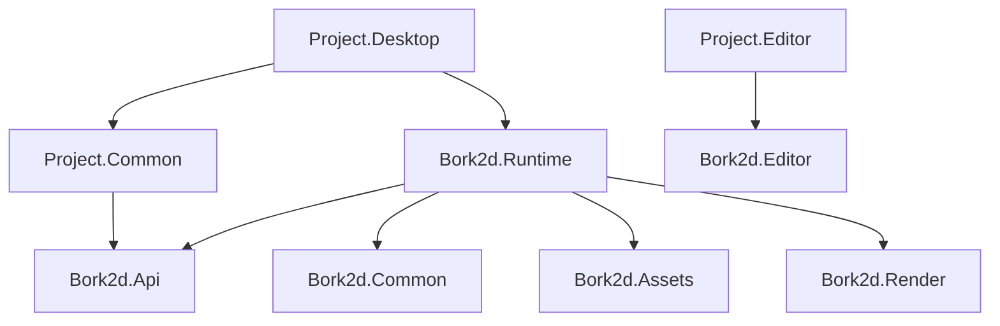

# Architecture Overview

> **Status:** M1, M2, and M3 (pack, VFS, descriptors, runtime integration) are merged into
> `develop` (2026-10-26, PR #4). The builder, validation, windowed SDL host
> (window/input/time/loop), one-tick headless/offscreen host, scene graph, logging, asset pipeline,
> and AOT baseline are `Current`; the editor (M5), Vulkan and frame handoff (M6/M7), and the sprite
> renderer (M8) are `Planned`. TOML bake is M4. Status detail is in [the roadmap](../roadmap.md).

## 1. Purpose

Bork2d is a small, opinionated 2D engine, not a general-purpose scene toolkit. It optimises for
three things:

1. **A small public contract.** Game code writes against `Bork2d.Api` and `Bork2d.Runtime` and
   never sees SDL, Vulkan, Silk.NET, the pack filesystem, or renderer internals.
2. **Predictable frame behavior.** Gameplay is tick-scoped and quiescent before capture;
   rendering consumes immutable snapshots and never touches live game state.
3. **Cheap draws.** Every camera renders its visible sprites with one instanced draw call using
   bindless textures and dynamic rendering.

The design also includes a data-only editor (`Planned`, M5): no scene editing, only texture
slicing and editing of custom serializable classes.

## 2. Goals

- **2D-first, sprite-based rendering** with cameras, layers, z-ordering, tint, and transforms.
- **Vulkan 1.3** renderer with dynamic rendering, descriptor indexing (bindless textures), and
  instancing; no render-pass/framebuffer objects for the swapchain.
- **SDL2** for window creation, input, and Vulkan surface integration.
- **Separate tick and render threads.** While the renderer presents frame N, the game ticks
  frame N+1.
- **Thread-safe scene operations.** The public API has no thread affinity; engine locks
  serialise structural changes and per-object access, and workers join before the tick ends.
- **NativeAOT runtime.** The game/runtime is trim-safe NativeAOT; the editor and build tools
  stay JIT. Serialization uses Nerdbank.MessagePack generated shapes; the game is an instance.
- **Packed, path-addressed assets.** Game code and snapshots carry `Sprite` handles; the runtime
  reads `assets.pck` plus later-wins overlays, loads/decompresses in the background, and skips
  handles whose sprite/texture is not ready. A pack holds raw payloads and MessagePack assets with
  **no per-asset version** (only the pack prefix version) and **no policy size caps** (intrinsic
  `uint32`/`uint64` field widths and streaming bounds). TOML is source/editor format only; entities
  have no IDs. The pack writer is the public tooling exception in `Bork2d.Assets`.
- **Headless and offscreen modes.** Servers run with no window, GPU, or render thread at a
  configured tick rate; tests render windowless to an internal offscreen target.
- **Diagnostics and quality.** Microsoft.Extensions.Logging/ZLogger, `IEngine.LoggerFactory`;
  warnings and style violations are build errors.
- **A short, composable startup API** through a builder in `Bork2d.Runtime`.
- **Windows first**, with portable boundaries that do not block Linux/macOS.
- **A clean game layout:** `Project.Common` (game + assets), `Project.Desktop` (host),
  `Project.Editor` (Avalonia editor host).

## 3. Non-goals for v1

These are out of scope until the roadmap says otherwise:

- 3D rendering, HDR rendering, MSAA, post-processing.
- A full ECS, scene-graph editing, prefabs, or a scene editor.
- Physics, collision, audio, networking, and in-game UI.
- Fixed-timestep simulation with render interpolation; v1 uses a variable timestep.
- Hot reload of assets or shaders (a later optimization).
- Multi-window hosting; one app process with one windowed, offscreen, or headless mode.
- Linux/macOS as supported v1 targets. The abstractions must not block them.
- A visual shader/material system, per-sprite custom materials, or indexed non-Quad sprite
  drawing in v1 (the asset schema carries `indices`; the draw path is later).
- Persisting runtime `Sprite` handles. Assets are referenced by stable keys in data.

## 4. System context

The developer-visible dependency chain is short: `Project.Common` references **only**
`Bork2d.Api` (plus BCL/System.Numerics); `Project.Desktop` references **only** `Bork2d.Runtime`
(plus `Project.Common`); `Project.Editor` references `Bork2d.Editor` plus `Project.Common`.
Game code never references an engine project directly. Exact rules: [Projects](projects.md).

## 5. Runtime topology

The engine invokes game callbacks on its tick thread, which may be any host thread; there is no
process-main-thread affinity. Windowed mode owns one OS/window thread (SDL, window commands, event
pump) and runs the game loop on the caller's tick thread; it creates no render thread and no Vulkan
object. Every mode owns one app-scoped asset loader thread. Headless/offscreen still run `Setup`,
one `Tick`, and `Teardown` on the calling thread. The render thread (M6/M7) is `Planned`; the
threads never touch each other's domain (SDL, Vulkan, or game objects).

| Mode | Tick | OS/window thread | Render thread | SDL | Vulkan | Pacing (M2) |
| --- | :-: | :-: | :-: | :-: | :-: | --- |
| Windowed | yes | yes | no (M6/M7) | yes | no (M6) | uncapped until M7 |
| Offscreen | yes | no | no (M6/M7) | no | no (M6) | one tick (paced loop M7) |
| Headless | yes | no | no | no | no | one tick (timer-paced M7) |

All three modes are selected and validated by the builder. In M2 only windowed mode runs a real
loop; the window is visible from `Run()` start and destroyed before `Run()` returns. Offscreen and
headless keep the one-tick M1 sequence until M7. In the target design the tick publishes an
immutable snapshot into a three-slot ring that the render thread consumes, and the tick may wait
only when the ring is full; headless has no ring and is timer-paced. The state machine is in
[Threading and frame handoff](threading.md).

## 6. Invariants

These rules bind the implementation and every future change. Violating one is an architecture
bug, not a style preference.

1. **Only `Bork2d.Api` and `Bork2d.Runtime` are public surfaces for game code**; internal projects may change or disappear between releases. The one exception is the **tooling-only** pack writer (`PackBuilder`/`PackCompressionMode`) in `Bork2d.Assets` (D-001, D-M3-04).
2. **`Bork2d.Api` contains no GPU, OS, or renderer types**; it uses BCL types, `Microsoft.Extensions.Logging.Abstractions` for `ILoggerFactory`, and `PolyType` 1.4.1 for the `IShapeable<T>` shape constraint only (D-M3-22), with no other third party.
3. **Scene mutation is tick-scoped and quiescent at capture**: mutation happens only during `Setup`/`Tick`/`Teardown`, workers join before `Tick` returns, structural and per-object access use `System.Threading.Lock` (composite updates still need game synchronization), and the tree is unordered.
4. **Snapshots are immutable after publication**: the render thread never reads a live entity, mutates snapshot memory, or blocks the tick on a specific frame.
5. **Snapshots carry handles, not assets**: `Sprite` is an opaque ID resolved against the pack-backed table at draw time; not-ready handles are skipped.
6. **A camera draws its visible sprites with at most one instanced draw call**; empty cameras draw none, and the vertex shader generates four corners from UVs, size, and pivot (the asset stores no vertices).
7. **Layers are single bits, culling masks combinations**: layer `0` or a multi-bit layer is invalid and skipped with a debug diagnostic.
8. **World units are abstract and Y-up; rotation is CCW degrees normalized to `[0, 360)`**: `Camera.Size` is half the visible height, and sprite assets carry UVs, a pivot, a topology, optional indices, and a pixels-per-unit scale.
9. **There is no depth buffer in v1**: draw order is layer then `ZIndex`, ties are unspecified with no entity-ID tie-breaker (D-026), and `ClearKind.Depth` is reserved.
10. **At most one window and one app process in v1**: modes are windowed, offscreen, or headless; headless has no window or GPU and uses its tick rate (default 60, `0` = uncapped).
11. **No steady-state per-frame allocations** in the tick snapshot builder or renderer hot path.
12. **The runtime is NativeAOT- and trim-safe**: no runtime reflection, assembly scanning, runtime TOML, or dynamic code; MessagePack shapes are source-generated.
13. **`assets.pck` is the runtime asset source**: TOML and source images live in `Project.Common`, only baked MessagePack/raw assets ship, overlays are packs (later wins), and a missing base pack throws at `Run()` unless the app calls `WithoutAssets()`. There is no per-asset version and no policy size cap.
14. **Logging is available everywhere through `IEngine.LoggerFactory`**, configured with ZLogger; the default is a plain-text console provider.
15. **Warnings and C# style violations are build errors**, with a format gate in CI.
16. **Pre-1.0 breaking changes are allowed**, but every public change updates the API guide, reference, and decision log in the same change.
17. **Scene objects are root-owned**: `IEngine.Root` strongly owns its tree, `Root.DetachAll()` detaches direct children, `ISceneRoot` is read-only, and there is no entity `Dispose`/`IsAlive` (detach with `Parent = null`, re-attach later). See [Scene ownership](scene-ownership.md).

## 7. Read next

- [Projects and dependencies](projects.md) — reference graph and game solution layout.
- [Runtime lifecycle](runtime-lifecycle.md) — builder, modes, startup, shutdown.
- [Scene ownership](scene-ownership.md) — root-owned lifetime.
- [Threading and frame handoff](threading.md) — bounded run-ahead and the snapshot ring.
- [Assets and tooling](assets-and-tooling.md) — `assets.pck`, overlays, sprites, editor, bake.
- [Rendering](rendering.md) — windowed/offscreen Vulkan and the one-draw contract.
- [Logging](logging.md) — ZLogger and `IEngine.LoggerFactory`.
- [NativeAOT](nativeaot.md) — runtime constraints and source generation.
- [Contributing](../contributing.md) — build, warnings, style.
- [Implementation roadmap](../roadmap.md) — the build order and status.
