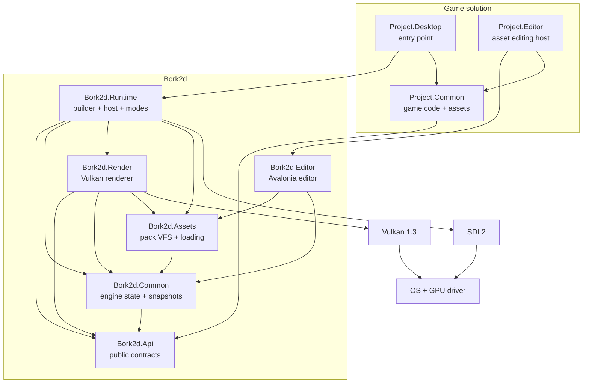
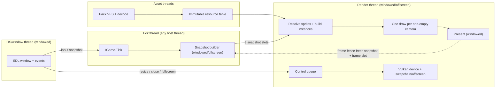

# Architecture Overview

> **Status:** M1 foundation implemented (WP1–WP8); final PR pending. Sections marked `Current`
> describe what exists in the M1 tree; everything else is `Planned` unless called out. The
> window/platform, assets, editor, and renderer are later milestones (M2–M8).

## 1. Purpose

Bork2d is a small, opinionated 2D engine. It is not a general-purpose scene toolkit. The
design optimises for three things:

1. **A small public contract.** A game developer writes against two assemblies and never
   sees SDL, Vulkan, Silk.NET, the pack filesystem, or the renderer internals.
2. **Predictable frame Behavior.** Gameplay is tick-scoped and reaches a quiescent point
   before capture; rendering consumes immutable snapshots and never touches live game state.
3. **Cheap draws.** Every camera renders its visible sprites with one instanced draw call,
   using bindless textures and dynamic rendering.

The engine also ships a data-only editor: no scene editing, only texture slicing and editing
of custom serializable classes.

## 2. Goals

- **2D-first, sprite-based rendering** with cameras, layers, z-ordering, tint, and transforms.
- **Vulkan 1.3** renderer with dynamic rendering, descriptor indexing (bindless textures),
  and instancing. No render-pass/framebuffer objects for the swapchain.
- **SDL2** for window creation, input, and Vulkan surface integration.
- **Separate tick and render threads.** While the renderer presents frame N, the game ticks
  frame N+1.
- **Scene operations are thread-safe.** Game code may run worker threads inside a tick; scene
  structural changes and individual property access are serialized by engine locks, so distinct
  entities can be mutated in parallel; all workers must be joined before the tick ends and
  before the snapshot is taken. Composite concurrent access to the same entity remains the
  game's responsibility.
- **NativeAOT runtime.** The game/runtime is published with NativeAOT and is trim-safe; the
  editor and build tools stay JIT. Runtime serialization uses Nerdbank.MessagePack generated
  shapes, and game code is passed to the builder as an instance.
- **Packed, path-addressed assets.** Game code and snapshots carry `Sprite` handles; the runtime
  reads `assets.pck` (plus overlays), loads/decompresses in the background, and skips handles
  whose sprite/texture is not ready. TOML is source/editor format only. Scene entities have no
  IDs; assets are referenced by canonical paths (not persisted handles).
- **Headless and offscreen modes.** Dedicated servers can run with no window, GPU, or render
  thread and a configured tick rate; tests can render windowless to an internal offscreen target.
- **Diagnostics and code quality.** ZLogger/Microsoft.Extensions.Logging with a pretty default
  and `IEngine.LoggerFactory`; warnings and C# style violations are build errors.
- **A short, composable startup API** through a builder in `Bork2d.Runtime`.
- **Windows first**, with portable boundaries so Linux/macOS do not require an architectural
  rewrite.
- **A game solution layout that keeps game code clean:** `Project.Common` (game + assets),
  `Project.Desktop` (host), `Project.Editor` (extensible Avalonia editor host).

## 3. Non-goals for v1

These are explicitly out of scope until the roadmap says otherwise:

- 3D rendering, HDR rendering, MSAA, post-processing.
- A full ECS, scene-graph editing, prefabs, or a scene editor.
- Physics, collision, audio, networking, and in-game UI.
- Fixed-timestep simulation with render interpolation. v1 uses a variable timestep.
- Hot reload of assets or shaders (a later optimization).
- Multi-window hosting; one app process, with windowed, offscreen, or headless mode.
- Linux/macOS as supported targets at v1. The abstractions must not block them.
- A visual shader/material system, per-sprite custom materials, or indexed non-Quad sprite
  drawing in v1 (the asset schema carries `indices`; the draw path is later).
- Persisting runtime `Sprite` handles. Assets are referenced by stable keys in data.

## 4. System context

The developer-visible dependency chain is intentionally short:

- `Project.Common` references **only** `Bork2d.Api` (plus BCL/System.Numerics).
- `Project.Desktop` references **only** `Bork2d.Runtime` (plus `Project.Common`).
- The engine projects are never referenced directly by game code.

The exact reference rules and the public/internal split are in
[Projects and dependencies](projects.md).

## 5. Runtime topology

The engine invokes game callbacks on its tick thread, which may be any host thread; there is no
process-main-thread affinity. It owns asset loader threads in every mode and additionally a
render thread in windowed and offscreen modes once those milestones land. The game may add
short-lived workers inside a tick. M1 runs a single tick and has no mode threads.

| Mode | Tick | Render thread | SDL | Vulkan | Pacing |
| --- | :-: | :-: | :-: | :-: | --- |
| Windowed | yes | yes | yes | swapchain | bounded run-ahead; presentation/GPU rate |
| Offscreen | yes | yes | no | offscreen target | bounded run-ahead; GPU rate |
| Headless | yes | no | no | no | configured tick rate (default 60; 0 = uncapped) |

| Thread | Owner | Responsibilities | Never does |
| --- | --- | --- | --- |
| **Tick** (any host thread) | `Bork2d.Runtime` | `IGame.Setup/Tick/Teardown`, tick scope, scene/asset requests, time, snapshot publication (windowed/offscreen), shutdown. | Create or submit Vulkan work. |
| **OS/window** (windowed) | `Bork2d.Runtime` | SDL video/events, window operations, input snapshot. | Call Vulkan or mutate game objects directly. |
| **Render** | `Bork2d.Render` | Vulkan instance handoff, device, swapchain (windowed) or offscreen targets, GPU uploads, instance building, draws, present (windowed), fences. | Touch SDL window state or game objects. |
| **Asset loader(s)** | `Bork2d.Assets` | Pack opening, file/decompression I/O, MessagePack/sprite/texture decoding, immutable resource table, upload requests. | Touch Vulkan or the swapchain. |

All scene mutation happens inside the tick window. The engine tick thread owns the loop, time,
and snapshot capture; game workers may create or mutate distinct entities during the tick and
must be joined before it returns. The public API has no thread affinity; calls may originate on
any thread during the tick window and are serialized by structural/per-object locks. The
renderer receives a copy of what to draw, never a reference to a live entity. Assets are read
from pack overlays by loader threads and published through an immutable resource table; GPU
upload happens on the render thread.

## 6. Frame model at a glance

One tick (windowed/offscreen):

1. SDL events are pumped on the OS/window thread (windowed only): input edges, resize, close,
   text. The tick thread consumes the frozen input snapshot.
2. The loop acquires a free snapshot slot. It waits only when the ring is full; there is no
   target tick rate, deadline timer, or `Sleep`.
3. `ITime` advances: `DeltaTime` is wall-clock time since the previous tick start, clamped.
4. `IGame.Tick()` runs on the engine tick thread and opens the tick window. The game may create
   and mutate distinct entities, including from joined workers; all workers must finish before
   `Tick` returns.
5. The engine copies cameras and sprite renderables into the slot, converts generic layer types
   to bits, and publishes it.
6. The render thread takes the newest published snapshot, resolves sprite handles against the
   current asset table, sorts/filters, and copies instances into its GPU frame buffer.
7. The renderer draws one instanced call per non-empty camera and presents (windowed) or renders
   offscreen. The frame fence frees the snapshot slot and the GPU frame slot; the tick may then
   run ahead again.

A render frame may show a snapshot one or more ticks old if the tick is faster; a snapshot may
never be presented if a newer one supersedes it. The tick can run ahead only as far as the
three-slot ring allows, then it blocks on a free slot. Headless mode has no ring or renderer;
it uses a timer for its configured tick rate (default 60, `0` = uncapped). The state machine is
in [Threading and frame handoff](threading.md).

## 7. Invariants

These are the rules the implementation and all future changes must preserve. Violating one
is an architecture bug, not a code-style preference.

1. **Only `Bork2d.Api` and `Bork2d.Runtime` are public surfaces.** Internal projects may
   change or disappear between releases.
2. **`Bork2d.Api` contains no GPU, OS, or renderer types.** No Vulkan handles, no SDL types,
   no Silk.NET namespaces, no `IntPtr` window handles. It uses BCL types plus
   `Microsoft.Extensions.Logging.Abstractions` for `ILoggerFactory`; no other third-party
   dependency.
3. **All scene mutation happens inside the tick window, and the tick is quiescent at
   capture.** Cameras, sprites, transforms, and parenting are mutated only during
   `Setup`, `Tick`, or `Teardown`. During a tick, game workers may create or mutate distinct
   entities; they must be joined before `Tick` returns. The engine serialises structural
   parent/child changes and individual property access with `System.Threading.Lock`; a composite
   multi-property update to one entity still needs game synchronization where atomicity matters.
   The tree is unordered: there are no entity IDs, ordered discovery, or child enumeration.
4. **Snapshots are immutable after publication.** The render thread never reads a live
   entity, never mutates snapshot memory, and never blocks the tick on a specific frame. The
   tick may wait only when the snapshot ring is full or a GPU frame slot is unavailable.
5. **Snapshots carry handles, not assets.** `Sprite` is an opaque ID; the renderer resolves it
   against the pack-backed resource table at draw time and skips anything not ready.
6. **A camera draws its visible sprites with at most one instanced draw call.** Empty cameras
   draw zero calls. The total is one per non-empty camera, not one per sprite or texture. The
   instanced vertex shader generates four corners from the sprite's UVs, world-unit size, and
   pivot; the asset stores no vertices.
7. **Layers are single bits; culling masks are combinations.** A renderable with layer `0` or
   more than one bit set is invalid and is skipped with a debug diagnostic.
8. **World units are abstract, Y-up, with CCW degrees normalized to `[0, 360)`.** `Camera.Size`
   is the half visible height. Sprite assets carry UVs, a normalized pivot, a topology enum,
   optional indices, and a per-sprite pixels-per-unit scale; there is no vertices array and no
   global setting.
9. **There is no depth buffer in v1.** Draw order is layer, then `ZIndex`; ties are unspecified
   and there is no entity ID or creation-order tie-breaker (D-026). `ClearKind.Depth` is
   reserved and does nothing.
10. **At most one window and one app process in v1.** Modes are windowed, offscreen, or
    headless; headless has no window or GPU and uses its configured tick rate (default 60,
    `0` = uncapped).
11. **No steady-state per-frame allocations** in the tick snapshot builder or renderer hot path.
12. **The runtime is NativeAOT- and trim-safe.** No runtime reflection, assembly scanning,
    runtime TOML, or dynamic code; Nerdbank.MessagePack shapes are source-generated. The
    editor/baker are JIT.
13. **`assets.pck` is the runtime asset source.** TOML and source images live in
    `Project.Common`; only baked MessagePack/raw assets ship. The header is a compressed
    `PackHeader`/`PackEntry` object with an XXH3-64 checksum; asset payloads have no checksum.
    Overlays are packs, later wins; a missing base pack throws at startup.
14. **Logging is available everywhere through `IEngine.LoggerFactory`**, configured with
    ZLogger by the builder; the default is a pretty console provider.
15. **Warnings and C# style violations are build errors** in every project, with a format gate
    in CI.
16. **Pre-1.0 means breaking changes are allowed**, but every public change must update the API
    guide, API reference, and decision log in the same change.
17. **Scene objects are root-owned.** `IEngine.Root` strongly owns its transform tree; parented
    cameras/sprites/transforms persist, unparented objects are collectible, and `Root.DetachAll()`
    detaches the tree. `ISceneRoot` is read-only. There is no entity `Dispose`/`IsAlive`: remove
    with `Parent = null`, re-attach the same object later. No weak entity registry. See
    [Scene ownership](scene-ownership.md).

## 8. Project responsibilities

| Project | Responsibility | Status |
| --- | --- | --- |
| `Bork2d.Api` | Public contracts and value types. The only assembly `Project.Common` needs. | `Current` |
| `Bork2d.Common` | Engine implementation: root-owned unordered scene tree, transform math, time, layer validation, Nerdbank shapes. Platform-agnostic. | `Partial` (snapshot capture is M7) |
| `Bork2d.Runtime` | Public builder/host with validation, one-tick `Run`, app-owned logging, and M1 stubs. | `Partial` |
| `Bork2d.Render` | Vulkan device, swapchain (windowed) or offscreen targets, pipelines, bindless textures, instance buffers, draws, present. | `Empty` (references wired) |
| `Bork2d.Assets` | Pack VFS, overlays, decompression, texture descriptors, sprite assets, resource table, Nerdbank shapes, bake support. | `Empty` (references wired) |
| `Bork2d.AotSmoke` | NativeAOT one-tick smoke executable; local publish/run gate. | `Current` |
| `Bork2d.Editor` | Avalonia editor library/app: asset browser, slicing, TOML data editing, bake/pack invocation; **JIT**. | `Planned` |
| Logging | `Runtime` configures ZLogger/Microsoft.Extensions.Logging; `Api` exposes `ILoggerFactory`. | `Current` (WP5) |
| Tests | xUnit suite, dependency matrix, concurrency/GC/AOT coverage. | `Current` (135 tests) |

The current solution contains seven projects (the five engine projects, `Bork2d.Tests`, and
`Bork2d.AotSmoke`). `Bork2d.Editor` is planned (M5). `examples/` is empty; `docs/` contains this
documentation set.

## 9. Current baseline

What actually exists today (M1):

- Seven `net11.0` projects: `Api`, `Common`, `Runtime`, `Assets`, `Render`, `Tests`, and
  `AotSmoke`. References: `Common → Api`; `Assets → Api, Common`; `Render → Api, Common,
  Assets`; `Runtime → Api, Common, Assets, Render`; `AotSmoke → Api, Common, Runtime`; tests may
  reference everything.
- API contracts for engine, game, time, window, input, assets, camera (`ZIndex`), sprite,
  transform (`DetachAll`), scene root, `Sprite`, `Color`, `ClearKind`, `KeyCode`, `MouseButton`,
  and `Bork2dException`.
- `Common`: an internal engine with a dedicated read-only `SceneRoot` (not a `Transform`), a
  transform tree with strong parent/child links, non-virtual transform properties, rotation in
  degrees normalized to `[0, 360)`, one engine-owned structural `System.Threading.Lock` plus
  per-object locks, and no entity IDs or ordered discovery.
- `Runtime`: `Bork2dAppBuilder<TLayer>` validation (mode, layer enum, sizes, paths), an
  app-owned Microsoft.Extensions.Logging/ZLogger factory, and a one-tick
  `Setup` → `Tick` → `Teardown` `Bork2dApp.Run()`.
- `Bork2d.Tests`: 135 deterministic xUnit tests covering ownership/lifetime, remove/re-add,
  root read-only, cycles/re-parenting, rotation, camera `ZIndex`, builder validation, logging,
  concurrency, and the dependency matrix.
- NativeAOT baseline: `IsAotCompatible` plus trim/AOT analyzers on the runtime libraries;
  `Bork2d.AotSmoke` publishes/runs locally with zero AOT/trim warnings. AOT is a local gate;
  CI runs build/test/format only on pushes to `develop`.
- `Assets` and `Render` contain only anchor types and reference wiring. `Bork2d.Editor` is
  absent (M5). There is no window, input, renderer, pack, asset loading, or real mode loop.

What that means for the documents:

- A member is marked `Current` when it exists and is implemented for the M1 host; members that
  need the window, assets, renderer, or snapshot ring are `Planned`.
- Snapshot structs and capture are M7; camera order is applied in M8; window/input is M2;
  pack/assets is M3/M4; Vulkan is M6; the editor is M5.
- The one-tick `Run()` is a smoke path, not the final loop.

## 10. Read next

- [Projects and dependencies](projects.md) — the reference graph and game solution layout.
- [Runtime lifecycle](runtime-lifecycle.md) — builder, modes, startup, shutdown.
- [Scene ownership](scene-ownership.md) — root-owned lifetime and disposal.
- [Threading and frame handoff](threading.md) — bounded run-ahead and the snapshot ring.
- [M1 implementation spec](../specs/m1-foundation.md) — the current implementation plan.
- [Assets and pack files](assets.md) — `assets.pck`, overlays, descriptors, sprites.
- [Logging](logging.md) — ZLogger and `IEngine.LoggerFactory`.
- [Editor](editor.md) — Avalonia builder and source asset authoring.
- [NativeAOT](nativeaot.md) — runtime constraints and source generation.
- [Rendering](rendering.md) — windowed/offscreen Vulkan and the one-draw contract.
- [Contributing](../contributing.md) — build, warnings, style.
- [Implementation roadmap](../roadmap.md) — the order in which this gets built.
