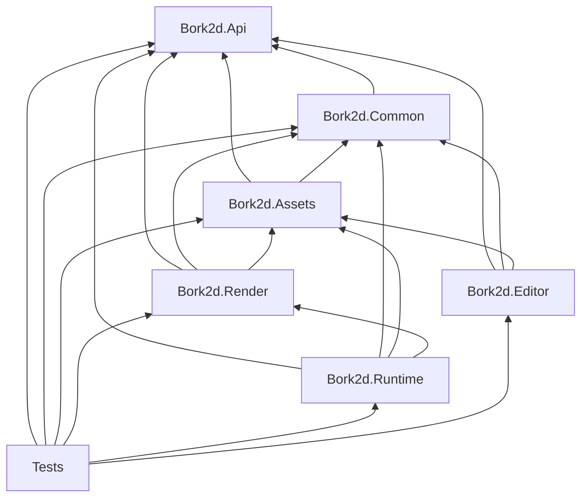

# Projects and Dependencies

> **Status:** the dependency rules below are the target. Today only `Common → Api` exists;
> `Runtime`, `Render`, and `Assets` are empty projects with no references.

## 1. Current projects

| Project | Target framework | References | State | Responsibility |
| --- | --- | --- | --- | --- |
| `Bork2d.Api` | `net11.0` | none | `Partial` | Public contracts and value types. |
| `Bork2d.Common` | `net11.0` | `Bork2d.Api` | `Partial` | Engine implementation, entity state, transforms, snapshots, time. |
| `Bork2d.Runtime` | `net11.0` | none | `Empty` | Public builder/host; later SDL platform and composition. |
| `Bork2d.Render` | `net11.0` | none | `Empty` | Vulkan renderer. |
| `Bork2d.Assets` | `net11.0` | none | `Empty` | Pack VFS, loaders, descriptors, sprite assets, baking support. |
| `Bork2d.Editor` | `net11.0` (planned) | `Bork2d.Api`, `Bork2d.Common`, `Bork2d.Assets` (+ Avalonia) | `Planned` | Avalonia editor library/app; JIT. |

All five existing projects live in `src/Bork2d/` and are listed in
[`Bork2d.slnx`](../../src/Bork2d/Bork2d.slnx).

## 2. Target dependency graph

The graph is acyclic and flows in one direction: contracts → implementation → composition.
`Runtime` is the composition root and the only project allowed to know about all the others.



### Allowed reference matrix

| From \ To | Api | Common | Assets | Render | Runtime | Editor |
| --- | :-: | :-: | :-: | :-: | :-: | :-: |
| **Api** | — | ✗ | ✗ | ✗ | ✗ | ✗ |
| **Common** | ✓ | — | ✗ | ✗ | ✗ | ✗ |
| **Assets** | ✓ | ✓ | — | ✗ | ✗ | ✗ |
| **Render** | ✓ | ✓ | ✓ | — | ✗ | ✗ |
| **Runtime** | ✓ | ✓ | ✓ | ✓ | — | ✗ |
| **Editor** | ✓ | ✓ | ✓ | ✗ | ✗ | — |

Rules behind the matrix:

- `Api` references the BCL (`System.Numerics`, `System.Threading.Tasks`, and similar) plus
  **Microsoft.Extensions.Logging.Abstractions** for `ILoggerFactory`. No Silk.NET, SDL, Vulkan,
  ZLogger, Avalonia, or file I/O.
- `Common` is platform-agnostic. It must not reference SDL, Vulkan, or the asset
  implementation. It consumes `IAssets` through the API interface.
- `Assets` implements `IAssets` and owns pack loading/serialization. It may use `Common` for
  internal diagnostics and threading helpers; it must not reference `Render`.
- `Render` consumes the internal snapshot and resource-table contracts. It must not
  reference `Runtime` and must not call SDL. Window/surface lifetime is handed to it; offscreen
  targets are its own.
- `Runtime` is the composition root: builder, app host, SDL window/input (windowed), Vulkan
  bootstrap, headless/offscreen mode selection, ZLogger configuration, and service wiring.
- `Editor` is independent of the renderer. It edits source data, slices textures, and previews
  them with Avalonia imaging, not with the game renderer. It is JIT and not shipped with the
  game.
- Tests may reference everything and may use internals.

If a new dependency seems necessary, first check whether the type belongs in `Api`
(a public contract), `Common` (shared internal contract), or should be passed as an
interface. Adding an arrow to this matrix requires updating this document and the
decision log.

## 3. Public surface and assembly visibility

### Public assemblies

| Assembly | Public types |
| --- | --- |
| `Bork2d.Api` | All contract interfaces and value types: `IEngine<TLayer>`, `IGame<TLayer>`, `ITime`, `IWindow`, `IInput`, `IAssets`, `ISceneRoot`, `ITransform`, `ICamera<TLayer>`, `ISpriteRender<TLayer>`, `Sprite`, `Color`, `ClearKind`, `KeyCode`, `MouseButton`, `AssetInfo`, `ILoggerFactory`, and future public exceptions/attributes. |
| `Bork2d.Runtime` | `Bork2dAppBuilder<TLayer>`, `Bork2dApp`, and their option types. Nothing else. |
| `Bork2d.Editor` | `Bork2dEditorBuilder`, `Bork2dEditorApp`, and the public editor service types needed by `Project.Editor`. |

### Internal assemblies

`Bork2d.Common`, `Bork2d.Assets`, and `Bork2d.Render` are implementation details. Their types
should be `internal` by default and exposed to the sibling assemblies that genuinely need
them:

```csharp
[assembly: InternalsVisibleTo("Bork2d.Runtime")]
[assembly: InternalsVisibleTo("Bork2d.Render")]
[assembly: InternalsVisibleTo("Bork2d.Assets")]
[assembly: InternalsVisibleTo("Bork2d.Editor")]
[assembly: InternalsVisibleTo("Bork2d.Tests")]
```

The exact `InternalsVisibleTo` list differs per project:

| Project | Internals visible to |
| --- | --- |
| `Bork2d.Common` | `Bork2d.Runtime`, `Bork2d.Render`, `Bork2d.Assets`, `Bork2d.Editor`, `Bork2d.Tests` |
| `Bork2d.Assets` | `Bork2d.Runtime`, `Bork2d.Render`, `Bork2d.Editor`, `Bork2d.Tests` |
| `Bork2d.Render` | `Bork2d.Runtime`, `Bork2d.Tests` |
| `Bork2d.Runtime` | `Bork2d.Tests` |

Consequences:

- There is **no accidental public API** from implementation projects. A public type in
  `Common` is a bug unless it is a contract intentionally re-exported by `Runtime`.
- `Runtime` may reference internals directly; it does not create a parallel public model.
- Strong naming and `InternalsVisibleTo` signing are deferred. Trimming/AOT compatibility is
  **not** deferred: runtime projects enable the AOT/trim analyzers from M1 (see
  [NativeAOT](nativeaot.md)).

## 4. What belongs where

| Concern | Project | Examples |
| --- | --- | --- |
| Public contracts | `Api` | Interfaces, `Sprite`, `Color`, `KeyCode`, serialization attributes, `Bork2dException`. |
| Value semantics and math | `Common` | Transform hierarchy, matrix helpers, layer validation, frame snapshot DTOs, entity IDs. |
| Engine state and loop | `Common` | Root-owned scene tree, snapshot builder, tick timing, `Engine<TLayer, TGame>`. |
| Platform and composition | `Runtime` | Builder, app host, windowed SDL, Vulkan bootstrap, headless/offscreen mode selection, lifecycle. |
| GPU rendering | `Render` | Device, swapchain (windowed) or offscreen targets, dynamic rendering, descriptor sets, bindless textures, instance buffers, pipeline, present. |
| Assets and data | `Assets` | Pack VFS, overlays, decompression, descriptors, sprite assets, resource table, Nerdbank.MessagePack shapes, bake support. |
| Editor UI | `Editor` | Avalonia shell, asset browser, slicing view, property grid, validation, bake/pack invocation. |
| Logging | `Runtime` / `Api` | ZLogger/Microsoft.Extensions.Logging configuration in Runtime; `ILoggerFactory` contract in Api. |
| Gameplay | `Project.Common` | Game classes, custom data types, assets. |

## 5. Game solution layout

A game generated for Bork2d uses three projects. The names below are the template's generic
names; a real game would use its own prefix (`MyGame.Common`, `MyGame.Desktop`, …).

```
MyGame/
  MyGame.sln
  src/
    Project.Common/
      Project.Common.csproj      -> Bork2d.Api
      Game/                      game code: IGame implementation, systems, data types
      Assets/                    textures, TOML data, sprite metadata
    Project.Desktop/
      Project.Desktop.csproj     -> Bork2d.Runtime, Project.Common
      Program.cs                 builder startup
    Project.Editor/
      Project.Editor.csproj      -> Bork2d.Editor, Project.Common
      Program.cs                 editor host (thin)
  bork2d.project.toml            project descriptor for editor/tooling (Planned)
```

### Reference rules for game code

| Project | May reference | Must not reference | Why |
| --- | --- | --- | --- |
| `Project.Common` | `Bork2d.Api` | `Bork2d.Runtime`, `Bork2d.Common`, `Bork2d.Render`, `Bork2d.Assets` | Gameplay stays renderer- and platform-agnostic and fast to compile. |
| `Project.Desktop` | `Bork2d.Runtime`, `Project.Common` | `Bork2d.Render`, `Bork2d.Common`, `Bork2d.Assets` | Only the startup surface is public. |
| `Project.Editor` | `Bork2d.Editor`, `Project.Common` | `Bork2d.Render`, `Bork2d.Common`, `Bork2d.Assets` | The editor edits data; it does not run the game renderer. |

A developer therefore writes against exactly two engine assemblies:

- `Bork2d.Api` in `Project.Common` for gameplay.
- `Bork2d.Runtime` in `Project.Desktop` (and in `Project.Editor` only as part of
  `Bork2d.Editor`'s own package).

`Bork2d.Editor` is distributed by the engine; the game's `Project.Editor` is a thin host that
adds game-specific types/windows through the editor builder. The generated solution references
`Project.Common` directly and registers editable types at compile time; assembly scanning is
not used. The project descriptor format remains `Open`
(see [Editor](editor.md#11-open-questions)).

## 6. Build, packaging, and versioning

Current state:

- Project references only; no NuGet packages, no `Directory.Build.props`, no `global.json`.
- SDK `11.0.100-rc.1` with `net11.0`. This is the only SDK installed that can build the
  current target framework; the roadmap tracks pinning it.
- Build: `dotnet build src/Bork2d/Bork2d.slnx`.

Target state:

- `Directory.Build.props` (M1) for nullable, analyzers, **warnings-as-errors**,
  **`EnforceCodeStyleInBuild`**, deterministic builds, and language version.
- A root `.editorconfig` (M1; Microsoft/.NET standard) with the enforced C# style rules set to
  `error`; CI runs `dotnet format --verify-no-changes`. See [Contributing](../contributing.md).
- A `global.json` pinning the SDK (`rollForward` policy to be chosen). See roadmap M1.
- Tests project (`Bork2d.Tests`) and a dependency test that asserts the reference matrix by
  inspecting assembly references.
- NativeAOT settings on runtime/game projects: `PublishAot`, `IsAotCompatible`, AOT/trim
  analyzers. Warnings-as-errors and style errors apply to all projects; the editor and baker
  stay JIT. See [NativeAOT](nativeaot.md).
- Runtime MessagePack serialization uses Nerdbank.MessagePack generated shapes; no reflection
  resolver, runtime TOML, or assembly scanning in shipped code.
- Distribution as source/project references in the template first; NuGet packaging later.
  The packaging model is `Open`.
- Versioning: pre-1.0 assemblies may break. Public API changes must update the API guide,
  reference, and decision log in the same commit.

## 7. Rules for adding a project or public type

1. **Does it belong in an existing project?** Prefer a new folder over a new assembly unless
   the dependency graph demands separation.
2. **Does the API need it?** If it is a contract, put it in `Api` with no implementation
   dependencies. If it is an implementation detail, keep it `internal`.
3. **Does it cross a thread boundary?** Define an immutable contract (value struct or
   read-only class) and document ownership.
4. **Does it cross an assembly boundary?** Prefer `internal` + `InternalsVisibleTo` over
   making a type public. If several projects need it, move the shared contract into
   `Common` or `Api` deliberately.
5. **Does it add a reference arrow?** Update the matrix in this document and the decision
   log. The dependency test will fail otherwise.

## 8. Migration from the current graph

`Current → Planned` work for the foundation milestone:

| Change | Reason |
| --- | --- |
| Add `Runtime → Api, Common, Assets, Render` references | Builder must compose the engine. |
| Add `Assets → Api, Common` references | Asset service implements `IAssets` and needs internal contracts. |
| Add `Render → Api, Common, Assets` references | Renderer consumes snapshots and the resource table. |
| Make implementation types `internal` and add `InternalsVisibleTo` | Stop leaking `Common`/`Render`/`Assets` as public APIs. |
| Move platform code (SDL) into `Runtime` internals | Keep `Common` platform-independent; `Render` must not call SDL. |
| Add `Bork2d.Editor` and `Bork2d.Tests` projects | Editor and test coverage are planned deliverables. |
| Add AOT/trim analyzers and a publish smoke test | NativeAOT is a baseline requirement, not a late packaging step. |
| Delete placeholder `Class1` files | They are not part of the design. |
| Add `Directory.Build.props`, `global.json`, test project | Baseline quality and reproducibility. |

The migration is the first roadmap milestone; it should not change gameplay behavior because
there is no runnable engine yet.

## 9. Related documents

- [Architecture overview](overview.md) — invariants and context.
- [Runtime lifecycle](runtime-lifecycle.md) — modes, builder ownership, startup.
- [Assets and pack files](assets.md) — pack VFS and runtime asset contracts.
- [Editor](editor.md) — `Bork2d.Editor` and `Project.Editor`.
- [NativeAOT](nativeaot.md) — runtime build constraints.
- [Roadmap](../roadmap.md) — M1 is this migration.
