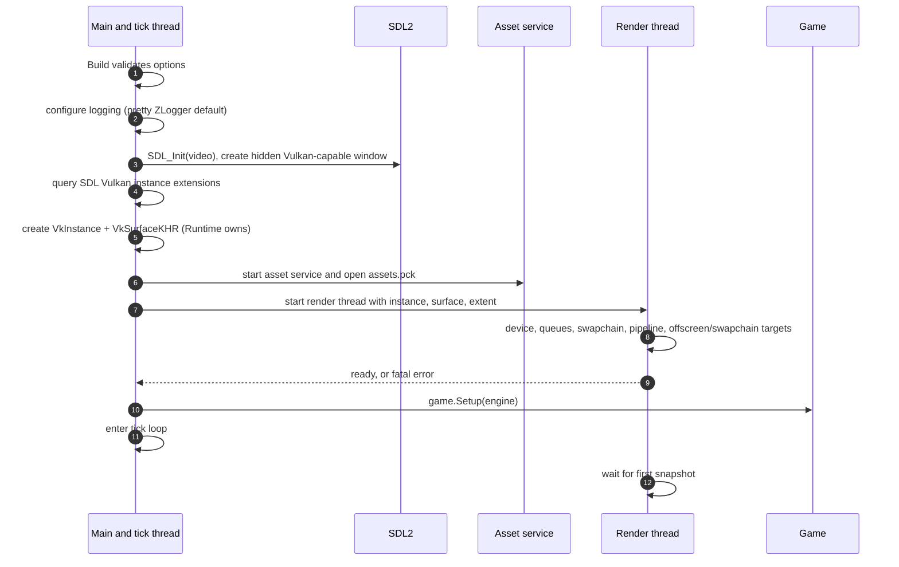
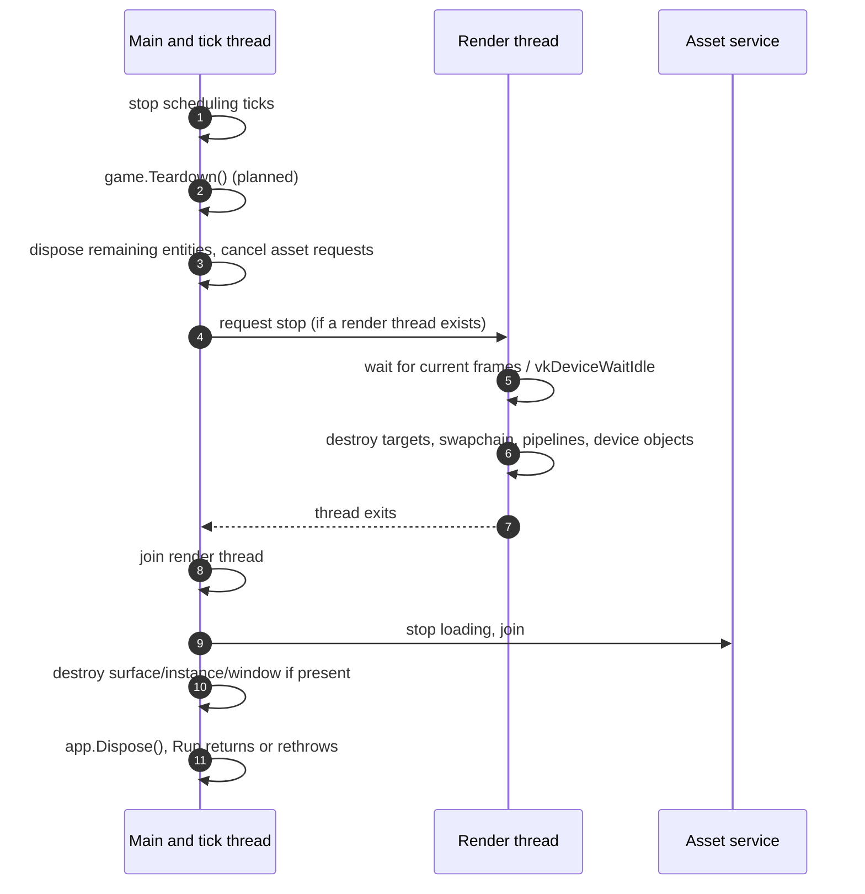

# Runtime Lifecycle

> **Status:** target design. No builder or host exists in the current tree; `Engine.Run()` is
> a placeholder `while (true)` loop. The API shapes below are `Planned` and will be finalised
> in roadmap M1.

## 1. Public startup contract

A game starts through the builder in `Bork2d.Runtime`:

```csharp
var game = new MyGame(logger, network);

using var app = new Bork2dAppBuilder<GameLayer>()
    .WithGame(game)
    .WithTitle("My Game")
    .WithSize(1280, 720)
    .WithAssetsPack("assets.pck")
    .WithVSync(true)
    .Build();

app.Run();
```

- The game is constructed by the developer and passed as an instance. There is no `new()`
  constraint and no reflection-based construction; this supports constructor injection and
  NativeAOT.
- `Bork2dAppBuilder<TLayer>` is created on the **main thread**, configured, and built once.
- `Build()` validates the configuration and returns an `IDisposable` app object. It does not
  create the window, GPU, or threads.
- `Run()` must be called on the main thread. It starts the selected mode, calls `Setup`, and
  enters the tick loop. It blocks until shutdown.
- `Dispose()` is safe whether or not `Run()` was called and is idempotent. The `using`
  declaration guarantees cleanup if `Run()` throws.
- The app owns the platform, renderer, asset service, engine, and snapshot ring. The game
  instance is owned by the caller but its lifetime must cover `Run()`.

The exact method names and signatures are `Open`; the shape is the design intent. See
[the API reference](../api/reference.md#12-runtime-surface).

## 2. Modes

The builder selects exactly one mode:

| Mode | Builder | Window/GPU | Render thread | Input/window | Pacing |
| --- | --- | --- | --- | --- | --- |
| **Windowed** (default) | normal options | SDL window + Vulkan swapchain | yes | yes | bounded run-ahead, presentation/GPU rate |
| **Offscreen** | `WithOffscreen(w, h)` | no window; Vulkan offscreen target | yes | no | bounded run-ahead, GPU frame rate |
| **Headless** | `WithHeadless(ticksPerSecond = 60)` | no window, no GPU | no | no | configured tick rate; `0` = uncapped |

- **Windowed** is the normal game.
- **Offscreen** is for tests, benchmarks, and server-side visual validation. It initializes
  Vulkan but creates no surface/swapchain. Frames are rendered to an internal target and
  discarded in v1; a public readback API is future work.
- **Headless** is for dedicated servers and data-only tools. It does not initialize SDL or
  Vulkan and does not run a render thread. Packs, `LoadData`, `LoadAsset<T>`, `Browse`, and
  `Exists` still work. Sprites can be created but are never rendered. It is paced to the
  configured `ticksPerSecond` (default `60`); `0` means uncapped. This is the one mode where a
  timer/artificial pacing delay is intentional and useful.

`WithHeadless` and `WithOffscreen` are mutually exclusive. Window-only options
(`WithTitle`, `WithSize`, `WithResizable`, `WithFullscreen`, `WithVSync`) are invalid or
ignored in the other modes; validation rejects conflicting combinations.

`IWindow` and `IInput` are unavailable in offscreen/headless modes. Accessing them throws a
`Bork2dException`/`NotSupportedException`; game code that must run in all modes should not
depend on them.

## 3. Builder options and validation

| Option | Default | Status | Meaning |
| --- | --- | --- | --- |
| `WithGame(IGame<TLayer> game)` | required | `Planned` | Caller-owned game instance. Must not be null. |
| `WithAssetsPack(string path)` | `assets.pck` | `Planned` | Base pack path (see [assets](assets.md)). |
| `WithLogging(Action<ILoggingBuilder>)` | pretty ZLogger console | `Planned` | Configure Microsoft.Extensions.Logging/ZLogger. If omitted, the pretty default is installed. |
| `WithTitle(string)` | assembly name | `Planned` | Window title (windowed only). |
| `WithSize(int width, int height)` | `1280 × 720` | `Planned` | Initial framebuffer size (windowed only). |
| `WithResizable(bool)` | `true` | `Planned` | Windowed only. |
| `WithFullscreen(bool)` | `false` | `Planned` | Windowed only; exact mode `Open`. |
| `WithVSync(bool)` | `true` | `Planned` | Windowed present mode preference. Offscreen has no vsync. |
| `WithHeadless(int ticksPerSecond = 60)` | `60` | `Planned` | No window/GPU/render thread; paced to the tick rate. `0` = uncapped. |
| `WithOffscreen(int width, int height)` | — | `Planned` | Windowless Vulkan rendering; frames discarded. |
| `WithMaxDeltaTime(double)` | `0.25` s | `Planned` | Safety clamp for `ITime.DeltaTime`; not a pacing delay. |
| `WithValidation(bool)` | debug only | `Planned` | Vulkan validation layers (windowed/offscreen). |
| `Build()` | — | `Planned` | Validate and create the app object. |
| `Bork2dApp.Run()` | — | `Planned` | Start and run until shutdown. |

Windowed/offscreen have no target tick rate and no `Sleep`/frame limiter; tick pacing comes
from the bounded snapshot ring and the renderer's frame completion. Headless mode uses the
configured tick rate (default 60, `0` = uncapped) and intentionally waits between ticks; this
is the documented exception to "no artificial delays".

Validation performed by `Build()`:

1. `Build` runs on the main thread.
2. `WithGame` was called exactly once with a non-null instance.
3. Exactly one mode is selected (default windowed, or headless, or offscreen).
4. Window-only options are not combined with headless/offscreen.
5. `TLayer` is an `int`-backed flags enum with 1–32 named single-bit values.
6. Sizes are positive; max delta is positive; headless tick rate is `>= 0`; asset pack path is
   non-empty.
7. Logging configuration, if supplied, is non-null; otherwise the pretty ZLogger default is
   used.
7. The pack file exists and parses, or the selected mode explicitly permits an empty filesystem
   (final missing-pack policy is `Open`).

## 4. Startup sequences

### 4.1 Windowed



The window is created hidden and shown after the first successful present (planned).

### 4.2 Offscreen

- No SDL window and no surface.
- Vulkan instance/device, offscreen color targets for the configured width/height, and the
  same pipeline/sprite path as windowed.
- Render thread completes frames; no present. Snapshot slots are released on frame fences.
- Frames are discarded in v1; the target is internal.

### 4.3 Headless

- No SDL initialization, no Vulkan instance/device, no render thread.
- Asset service/pack filesystem and the engine start.
- `game.Setup(engine)` runs, then the tick loop runs at `ticksPerSecond` (default 60;
  `0` = uncapped).
- `IWindow`/`IInput` throw; `ITime`, `IAssets`, scene creation, and `Exit` work.
- Dedicated server code should not create renderables or request textures unnecessarily; the
  engine has no GPU to upload to.

In all modes, the asset service starts before `Setup` so sprites/data can be requested during
`Setup`. In offscreen/windowed, requests are queued; nothing blocks on them. In headless,
data assets work; sprite handles may resolve CPU metadata but never produce a frame.

## 5. Tick loop and pacing

Windowed/offscreen, conceptually:

```csharp
while (!_exitRequested)
{
    if (_mode == Windowed)
        PumpSdlEvents();                 // input, resize, close, text

    var slot = _snapshots.AcquireFreeSlot(); // blocks only when the ring is full
    _time.NewFrame();                    // delta/time for this tick

    _game.Tick();                        // tick window; game joins its workers

    _snapshots.CaptureAndPublish(slot);  // copy to slot, flatten layers, publish
}
```

Headless uses the same loop without the snapshot ring or SDL pump, plus timer-based pacing:

```csharp
var interval = ticksPerSecond > 0
    ? TimeSpan.FromSeconds(1.0 / ticksPerSecond)
    : TimeSpan.Zero;

while (!_exitRequested)
{
    if (interval > TimeSpan.Zero)
        WaitUntilNextHeadlessTick(interval); // timer, not busy-spin

    _time.NewFrame();
    _game.Tick();
}
```

Pacing rules:

- **Windowed/offscreen have no fixed tick rate.** There is no target FPS, deadline wait,
  `Sleep`, or artificial frame limiter; pacing comes from the bounded snapshot ring.
- **Bounded run-ahead.** There are three snapshot slots. A slot is held until the GPU frame
  that consumed it signals its fence. The tick blocks only when all slots are occupied
  (typically at most two frames in flight plus one ready/being written). In steady state the
  tick runs at the renderer's frame rate; it can burst up to the ring depth.
- **Newest wins.** The render thread always takes the newest ready snapshot; older undisplayed
  snapshots are dropped. Lag does not grow an unbounded queue.
- **Headless is timer-paced.** `WithHeadless(ticksPerSecond)` defaults to `60`; `0` means
  uncapped. This is the one intentional pacing delay in the engine, for dedicated servers and
  data tools. It is not a busy-spin.
- **Safety clamp.** `WithMaxDeltaTime` clamps a single `DeltaTime` after a stall; it does not
  delay ticks.
- **No interpolation.** The renderer draws the newest snapshot as-is.
- **Tick workers.** Game workers are started/joined inside `Tick`; the snapshot is captured
  after the tick returns, which is the quiescence point.

If `IEngine.Exit()` was called during the tick, the loop finishes that tick, publishes the
final snapshot, and shuts down. If the renderer reported a fatal error, the loop stops at the
next tick boundary and `Run()` throws.

## 6. Time semantics

| Property | Semantics | Status |
| --- | --- | --- |
| `ITime.DeltaTime` | Seconds since the previous tick start, clamped to `MaxDeltaTime`. First tick is `0`. | `Planned` (declaration `Current`) |
| `ITime.Time` | Monotonic gameplay time in seconds, starting at `0` on the first tick. | `Planned` (declaration `Current`) |
| `MaxDeltaTime` | Safety clamp after a stall/debugger pause; not a pacing delay. | `Planned` |

- The clock is a monotonic `Stopwatch`, never wall-clock time.
- It is not paused when the window is unfocused/minimized; gameplay can pause itself.
- `ITime` is main-thread only; workers receive `dt` as an argument.
- The current `StopwatchTime` starts at construction and has no clamp; wiring it with these
  semantics is part of M2/M7.
- `DeltaTime` includes time spent waiting for a snapshot slot. After a long stall it can be
  large; the clamp limits the gameplay step.

## 7. Window and input (windowed only)

`IWindow` operations are main-thread operations and are forwarded to SDL:

- **Title** — immediate.
- **Size** — client/framebuffer pixels; sends a resize message to the render thread. Reading
  returns the latest known framebuffer size.
- **Fullscreen** — windowed/fullscreen/borderless (exact mode `Open`); recreate swapchain.
- **CursorVisible** — toggles the SDL cursor. No capture/relative mode in v1.
- **Close** — graceful exit after the current tick.

- `IInput` is pumped on the main thread and frozen at tick start; see
  [Threading](threading.md#6-input-across-threads-windowed-only).
- Offscreen/headless have no SDL window; `IWindow`/`IInput` throw.
- DPI: v1 treats the SDL framebuffer size as physical pixels; per-monitor scaling is `Open`
  for M2.
- Renderer resize/fullscreen/minimize messages go through the control queue. The renderer
  waits for the device to be idle before recreating the swapchain in v1.
- While minimized, presentation is skipped; on restore the newest snapshot is drawn.

## 8. Shutdown sequence



- Headless skips all render-thread steps.
- Offscreen skips window/surface/swapchain but destroys the device and offscreen targets.
- `Teardown` runs on the main thread and is the last chance to dispose entities/release game
  resources. Asset requests during Teardown are not guaranteed to complete.
- The render thread never outlives the Vulkan instance/surface (windowed) or the device
  (offscreen).
- `Dispose()` after a failed `Run()` still attempts cleanup and suppresses only secondary
  exceptions, so the original exception is the one the caller sees.

## 9. Error handling

| Failure | Where detected | Behaviour |
| --- | --- | --- |
| Invalid builder options / layer enum / conflicting modes | `Build()` | Throw `ArgumentException` or `Bork2dException`; no window/threads. |
| Game instance missing | `Build()` | Throw. |
| SDL init/window failure | Windowed startup | Throw; clean up. |
| No Vulkan 1.3 device / missing feature | Windowed/offscreen init | Fatal; `Run()` throws. |
| Pack missing/corrupt | Asset service startup / `LoadPack` | Fatal for the default pack (proposed); `LoadPack` throws. |
| Shader/pipeline failure | Render init | Fatal. |
| Game exception in `Setup`/`Tick`/`Teardown` | Main thread | Capture, shut down, rethrow original from `Run()`. |
| Asset load/decode failure | Asset thread | Per-asset diagnostic; handle not renderable; not fatal. |
| Device lost / GPU reset | Render thread | Fatal; signal main, shut down, throw. |
| API misuse (outside tick, main-only API off main, use-after-dispose, invalid layer) | API boundary checks | Debug throw/log; release best effort; same-entity races are the game's responsibility. |

The engine does not swallow exceptions. `Run()` is the single place where background-thread
failures are rethrown on the caller's thread, with cleanup in a `finally`.

## 10. Headless and offscreen modes

### 10.1 `WithHeadless(ticksPerSecond = 60)`

- No SDL, no Vulkan, no render thread, no swapchain.
- `ITime`, `IAssets`, `IEngine` scene creation, `Exit`, and game callbacks work.
- `IWindow`/`IInput` throw.
- Pacing is timer-based at `ticksPerSecond` (default `60`); `0` means uncapped. This is the only
  intentional pacing delay in the engine, intended for dedicated servers.
- Asset data (`LoadData`, `LoadAsset<T>`, `Browse`) works; sprite handles can resolve CPU
  metadata but no texture is uploaded and nothing is drawn.
- NativeAOT headless startup must not touch SDL/Vulkan; this is a CI smoke test.
- Intended for dedicated servers, data tools, and CI simulation.

### 10.2 `WithOffscreen(width, height)`

- No SDL window/surface/swapchain; Vulkan instance/device and offscreen color targets exist.
- The normal render thread, asset uploads, sprites, cameras, and one draw per camera run.
- Frames are discarded in v1; the target is internal. This is for validation, benchmarks, and
  future screenshots.
- Pacing is bounded run-ahead, driven by GPU frame fences; there is no vsync.
- `IWindow`/`IInput` throw.
- A public capture/readback API is future work.
- Intended for CI rendering checks and headless visual tests.

No mode changes the public `IGame` contract: `Setup`, `Tick`, and `Teardown` are still main
thread callbacks.

## 11. Current status and gaps

| Area | Current | Needed |
| --- | --- | --- |
| Builder/host | `Bork2d.Runtime` empty | M1/M2 |
| Game instance injection | No builder; current `Engine` takes a game object but startup is placeholder | M1 |
| Window/SDL | None | M2 |
| Time wiring | `StopwatchTime` unused | M2/M7 |
| Tick loop | `while (true) Game.Tick()` | M7 |
| Exit | None | M1/M7 |
| Snapshot ring | None | M7 |
| Headless/offscreen | None | M6/M7 |
| Dispose/teardown | None | M1 |
| Assets | Empty | M3/M4 |
| Render thread | Empty | M6/M7 |
| Entity ownership | Weak references | M1 |
| NativeAOT | None | M1 baseline, M9 gate |

## 12. Open questions

- Exact builder method names/signatures and `Run()` return shape.
- Default pack missing: fatal vs empty FS vs builder option.
- Window shown before the first frame or only after the first present.
- Fullscreen: exclusive, borderless, or configurable.
- DPI policy and what `IWindow.Size` means under scaling.
- Minimize: pause ticks or only presentation? Proposed: ticks continue; game pauses itself.
- Offscreen readback/capture API and its owner (M8/M10).
- Should `IEngine` expose the selected mode? (Useful for server/game code.)
- Headless tick-rate timer accuracy and whether fractional rates are needed.
- `MaxDeltaTime` default and whether `0` disables the clamp.
- Worker threads at shutdown: the game joins before `Tick` returns; the engine cannot join
  unknown threads.

## 13. Related documents

- [Threading and frame handoff](threading.md) — snapshot ring and bounded run-ahead in detail.
- [Rendering](rendering.md) — windowed/offscreen render modes.
- [Assets and pack files](assets.md) — pack loading and default pack.
- [Logging](logging.md) — default ZLogger configuration and `IEngine.LoggerFactory`.
- [NativeAOT](nativeaot.md) — headless/AOT startup constraints.
- [API reference](../api/reference.md) — proposed `Bork2dAppBuilder` surface.
- [Roadmap](../roadmap.md) — M1, M2, M6, M7.
