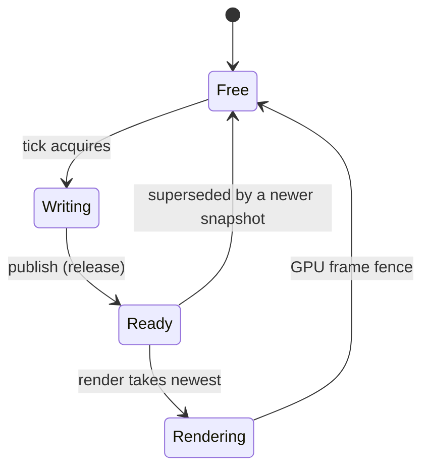
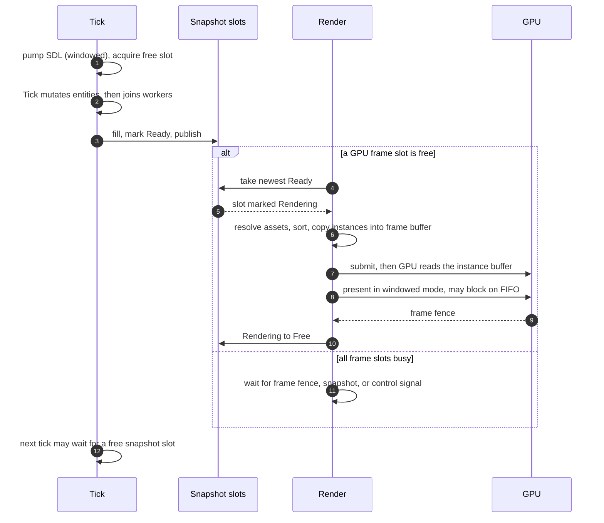

# Threading and Frame Handoff

> **Status:** target design for frame handoff. The M1 scene graph (WP3) is implemented with the
> structural + per-object `System.Threading.Lock` rules in §2; there is still no render thread,
> no snapshot ring, and `Engine.Run()` is a placeholder. This document defines the thread
> contract the implementation must satisfy.

## 1. Threads by mode

| Thread | Windowed | Offscreen | Headless | Responsibilities |
| --- | :-: | :-: | :-: | --- |
| **Tick** | yes | yes | yes | Time, `IGame.Setup/Tick/Teardown`, tick scope, scene/asset requests, snapshot capture (windowed/offscreen), shutdown. May be any host thread. |
| **OS/window** | yes | no | no | SDL video/events and window operations; public `IWindow` calls are marshaled here. |
| **Render** | yes | yes | no | Vulkan device, swapchain (windowed) or offscreen targets, GPU uploads, sprite resolution, sorting, instance building, draws, fences, present (windowed). |
| **Asset loader(s)** | yes | yes | yes | Pack parsing, decompression, MessagePack/descriptor/sprite decoding, immutable resource table, upload requests. |
| **Game workers** | yes | yes | yes | Game-spawned threads; distinct entities; must join before `Tick` returns. |

The engine owns the asset threads and, in windowed/offscreen modes, the OS/window and render
threads. Game workers are owned and joined by the game. Headless mode has no render thread and
does not initialize SDL or Vulkan. **No public API requires the process main thread.**

## 2. Tick-scoped concurrency

The public API is thread-safe; there is no thread affinity. The engine is **not** free of
logical ordering rules:

> All scene mutation happens inside the tick window (`Setup`/`Tick`/`Teardown`), including work
> performed by game worker threads. Calls may originate on any thread. Workers must be joined
> before `Tick` returns. The engine captures the snapshot at that quiescent point, so the
> renderer only ever reads immutable snapshots. Assets cross threads through packs, queues, and
> an immutable table.

"Scene state" includes:

- creating, attaching, detaching, and clearing cameras/sprite renderables;
- changing `Transform` local values or parents;
- changing camera properties (`Size`, `Viewport`, `CullingMask`, `Clear`, `ClearColor`);
- changing sprite properties (`Sprite`, `Layer`, `ZIndex`, `Tint`, planned flip flags);
- changing `IWindow` state (windowed only, any thread, marshaled).

The guarantee is deliberately precise:

- **Structural state is serialized during the tick window.** Entity ID allocation and
  parent/child attach/detach are protected by the scene graph's structural
  `System.Threading.Lock`. Entity creation and parenting from multiple game workers are safe.
- **Distinct entities can be created and mutated concurrently.** Two workers may move
  different sprites, detach different cameras, etc.
- **Individual property access is serialized per object.** Each object uses a `Lock` for
  property get/set, so individual reads/writes do not data-race. Prefer `Interlocked`/
  immutable paths where practical. A logical multi-property update to one entity still needs
  game synchronization if it must be atomic. Parent/child attach/detach is serialized, but
  logical ordering of two workers reparenting the same subtree still needs game synchronization.
- **Any-thread API:** `IWindow`, `IInput`, `ITime`, `Exit`, scene operations, and the builder do
  not require the process main thread. Calls are made during `Setup`/`Tick`/`Teardown` (plus
  `IWindow` while the app is running). `IWindow` operations are marshaled to the OS/window
  thread; `IInput`/`ITime` reads are snapshots. `IGame` callbacks are invoked by the engine on
  its tick thread.
- **Asset requests are always thread-safe and non-blocking.** Asset completion is asynchronous;
  a caller cannot assume a sprite is ready.
- **The tick is the quiescence boundary.** The snapshot is built after `Tick` returns. If a
  worker is still running then, the contract is violated and the snapshot may race.

Workers may create cameras/sprites, request assets, mutate entities they own, read `ITime`/
`IInput` snapshots, and compute data handed back through game-owned queues. They must join before
`Tick` returns and must not assume asset readiness.

Why this model:

- Locking is limited to structural changes and individual object access; game workers can still
  mutate distinct entities in parallel.
- A tick is a natural transaction: the renderer sees either the state before it or after it,
  never a half-updated hierarchy.
- The game retains control over composite shared-state synchronization.
- Headless servers can use the same scene API; only rendering is absent.

The engine adds **debug-only** checks at API boundaries: tick-active for scene mutation,
structural checks, and slot-state assertions. It cannot detect a non-atomic composite update
that spans multiple locked operations; that is the game's responsibility.

## 3. Frame snapshot

A snapshot is the renderer's complete input for one tick. It is immutable after publication
and contains no references to live entities.

```
FrameSnapshot
  Sequence        ulong      monotonically increasing
  TickTime        double     ITime.Time at capture
  DeltaTime       float      ITime.DeltaTime at capture
  Cameras         CameraSnapshot[]
  Sprites         SpriteSnapshot[]

CameraSnapshot
  EntityId        uint
  WorldTransform  Matrix3x2   camera position/rotation/scale in world space
  Size            float       half visible height in world units
  Viewport        Vector4     normalized x,y,w,h; top-left origin
  CullingMask     uint        flattened layer flags
  Clear           ClearKind
  ClearColor      Color       linear RGBA

SpriteSnapshot
  EntityId        uint
  Sprite          Sprite      opaque handle; may be Empty or not ready
  WorldTransform  Matrix3x2   position/rotation/scale, including parent hierarchy
  Tint            Color       linear RGBA
  Layer           uint        exactly one layer bit (0 is invalid)
  ZIndex          int         higher draws later
  Flags           SpriteFlags planned: FlipX, FlipY
```

Rules:

- **Asset-agnostic.** A snapshot never contains textures, vertices, or sprite metadata. The
  renderer resolves the `Sprite` handle against the resource table at draw time.
- **World transforms only.** The tick thread evaluates the parent hierarchy and writes the
  final local-to-world matrix. The renderer never walks parents.
- **Generic layer erased.** `TLayer` is converted to a `uint` mask/bit at capture. The
  renderer is non-generic.
- **Rooted tree.** Capture walks `IEngine.Root` and copies cameras/sprites/transforms that are
  still rooted. There is no weak registry; unparented/unreachable objects are not part of the
  scene.
- **Sorted by the renderer.** Cameras are captured in entity-ID order; sprites in entity-ID
  order. The renderer sorts sprites by layer, `ZIndex`, and entity ID, then filters per camera.
- **Detached entities are absent.** A renderable detached during `Tick` is not copied into the
  snapshot published at the end of that tick. It remains valid and can be re-attached.
- **No readiness filtering at capture.** A sprite whose asset is not ready is still in the
  snapshot; the renderer skips it. This avoids a race where the asset becomes ready between
  capture and draw.
- **Capacity is pooled.** Each slot owns its arrays. Growing capacity is allowed during
  warm-up; steady state must not allocate.
- **Headless has no snapshot ring.** There is no renderer, so capture and publication are
  skipped. The game still ticks and mutates entities.

Snapshots are internal types. They must not appear in `Bork2d.Api`.

## 4. Triple-buffer handoff

There are exactly **three snapshot slots**. A slot is held until the GPU frame that consumed
it signals its fence. This is the bounded run-ahead mechanism: the tick can run ahead while
frames are in flight, but it cannot grow an unbounded queue.



A slot in `Ready` is an unread snapshot. A slot in `Rendering` is associated with a submitted
GPU frame for pacing: the renderer has copied instances from it, and the slot is kept until the
fence signals. A slot in `Writing` belongs to the tick thread. `Ready` slots are not in flight.

### Producer (tick thread)

```
loop:
  slot = AcquireFreeSlot()          // blocks when all three slots are occupied
  time.NewFrame()
  game.Tick()                       // joins game workers before returning
  Fill(slot)                        // cameras, sprites, flatten layers
  slot.Sequence = ++sequence

  slot.State = Ready                // release
  old = Interlocked.Exchange(latest, slot.Index) // release
  if old != -1:
      TryCas(old, Ready -> Free)    // drop an undisplayed snapshot
```

- `AcquireFreeSlot` may block when all slots are `Ready`/`Rendering`. That wait is frame
  backpressure, not an artificial delay; windowed/offscreen use no timer or sleep.
- The publish order is `Ready` before `latest`.
- A superseded `Ready` slot is freed; a `Rendering` slot is never freed by the producer.

### Consumer (render thread)

```
loop:
  ProcessControlMessages()          // windowed: resize/close; offscreen: stop/errors
  WaitForSnapshotOrControl()        // blocked, not spinning
  if not HasReadySnapshot(): continue
  frame = WaitForFreeGpuFrameSlot() // fence-protected GPU frame slot
  slot = TakeLatestReady()          // CAS Ready -> Rendering; clears latest
  if slot is null: continue

  BuildGpuFrame(slot, frame)        // resolve assets, sort, copy instances
  Submit(frame)                     // GPU reads the frame's instance buffer
  OnFence(frame): Release(slot)     // Rendering -> Free; wake a waiting tick
```

`TakeLatestReady` clears `latest` when it still points at the taken slot, so a released slot
does not leave a dangling latest pointer. A newer snapshot published concurrently wins the
compare-exchange and remains latest.

The renderer waits for a free GPU frame slot before taking a snapshot, so it does not hold a
snapshot while blocked on the GPU. If no snapshot is ready, it waits on the event and does not
reserve a frame slot. A newer snapshot published while the renderer is building an older one
becomes the next frame; the older `Ready` is dropped by the producer.

### Frames in flight and bounded run-ahead

Two independent pools:

- **Snapshot slots (3, CPU/GPU lifetime):** the tick acquires a free slot; the renderer marks
  it `Rendering` and holds it until the GPU frame fence. At most two frames are in flight and
  one newest snapshot may be `Ready`.
- **GPU frame slots (2, provisional):** command buffer, instance buffer, semaphores, fence.
  The renderer reuses one only after its fence.

Consequences:

- **Tick faster than render:** the tick fills slots, then waits for a fence. It runs ahead by
  at most the ring depth; it does not spin producing unbounded snapshots. Older `Ready`
  snapshots are dropped; the renderer always shows the newest.
- **Render faster than tick:** the renderer waits for a new snapshot or control message. It
  does not re-present an unchanged snapshot every refresh in v1.
- **GPU slower than the render thread:** the renderer waits on a frame-slot fence; the tick
  continues until the snapshot ring is full, then waits. This bounds latency and memory.
- **No artificial delays in windowed/offscreen:** no `Sleep`, no target tick rate, no deadline
  wait. The only waits are the free-slot wait, the GPU frame-slot fence, and the OS event wait
  when there is no work.
- **Headless is timer-paced:** no snapshot ring and no render thread; the tick loop waits on a
  timer for the configured `ticksPerSecond` (default 60, `0` = uncapped). This is the one
  intentional pacing delay, for dedicated servers.
- **No tearing:** a slot is never overwritten while the renderer is reading it or while a GPU
  frame still references it.

### Slot invariants

1. At most one slot is `Writing`.
2. A slot is never `Writing` and `Rendering` at the same time.
3. A slot in `Rendering` is not reused until its GPU frame fence signals.
4. `latest` is either `-1` (nothing ready) or points to a `Ready`/`Rendering` slot, never
   `Writing`/`Free`. The consumer clears it when it takes that slot.
5. Publishing frees at most the immediately previous `Ready` slot; it never frees `Rendering`.
6. Every slot returns to `Free` after its GPU frame completes.
7. A GPU frame's instance buffer is not overwritten until its fence signals.
8. No thread blocks while holding a CAS-relevant state that another thread needs to progress.

The producer's wait is the intentional backpressure in invariant 6: with three slots and two
frames in flight, a ready snapshot plus two rendering snapshots use all slots.

## 5. Frame sequence



The renderer can submit frame N and prepare frame N+1 while the GPU executes frame N. A
snapshot slot is reused only after the frame that consumed it signals its fence; the GPU never
reads snapshot memory directly, but the slot is held to bound the producer.

Offscreen mode follows the same sequence without `present`. Headless mode has no render thread
and no snapshot ring.

## 6. Input across threads (windowed only)

Input is collected on the OS/window thread and exposed as a snapshot:

- SDL events are pumped on the OS/window thread, including while waiting for work. Handlers
  that touch engine/game state are marshaled to the tick thread.
- At the start of a tick, input is frozen: keys, mouse position/delta/wheel, and text events
  describe events since the previous tick.
- Edge flags (`Pressed`, `Released`) are true for exactly one tick. A key pressed and released
  between ticks yields both flags in the same tick and `IsKeyDown == false`.
- `OnTextTyped` is dispatched on the engine tick thread before `Tick`.
- Mouse coordinates are framebuffer pixels, top-left origin. Camera helpers convert to world.
- Wheel delta is accumulated per tick; positive means up/away from the user.
- On focus loss, held keys/buttons are synthesized as released and wheel/text state is
  cleared.
- `KeyCode` maps physical SDL scancodes; text is separate.
- `IInput` reads are thread-safe snapshots. It is not part of the frame snapshot and is not
  readable from the render thread's public API.

Offscreen/headless modes have no SDL window or input; `IInput` throws.

## 7. Window and renderer control (windowed)

Window mutation may be requested from any thread. Calls are marshaled to the OS/window thread;
the render thread receives a coalescing control channel:

| Direction | Message | Handling |
| --- | --- | --- |
| Caller → OS/window | `Resize(width, height)` | Recreate swapchain; coalesce to latest. |
| Caller → OS/window | `FullscreenChanged` | Recreate swapchain if extent changed. |
| OS/window → render | `Minimized`/`Restored` | Skip present while minimized; recreate on restore. |
| OS/window → render | `Redraw` | Present newest snapshot without a new tick. |
| OS/window → render | `Stop` | Exit after the current frame/device idle. |
| Render → OS/window | `Ready` | Renderer initialized. |
| Render → OS/window | `Fatal(error)` | Store, wake tick, stop after current tick. |

Rules:

- Single-producer/single-consumer; the channel wakes the render thread even if no snapshot
  exists.
- Resize messages are coalesced; the latest framebuffer size wins.
- The OS/window thread never calls Vulkan; the render thread never calls SDL window mutation.
- `IWindow.Size` reflects the latest known framebuffer size; the swapchain may lag one frame.
- Close stops the tick loop first; the renderer is stopped after teardown.
- `VkInstance`/`VkSurfaceKHR` are created on the OS/window thread (SDL owns the window) and
  handed to the render thread; the render thread owns device/swapchain/etc. Surface/instance are
  destroyed only after the render thread joins.

Offscreen mode has no window messages and no surface; only stop/error. Headless has no render
thread.

## 8. Asset and pack coordination

- Packs are opened and their headers parsed by the asset service. The virtual filesystem
  overlay table is immutable except for an atomic swap when `LoadPack` mounts a new pack.
- Loader threads decompress, deserialize, decode, and prepare CPU resources; they never touch
  Vulkan.
- The renderer reads an immutable resource table and creates GPU texture pages/uploads on the
  render thread.
- A sprite is skipped until its sprite asset, texture descriptor, raw payload, and GPU page
  are ready.
- GPU page lifetime is retired by the render thread after frames that reference it complete.
- `LoadPack` is thread-safe; mount packs during `Setup`/before loading. Later packs shadow
  earlier ones; no unload in v1.
- Headless mode can load data assets and sprite CPU metadata, but never creates GPU pages.
- Offscreen mode uses the same upload/render path as windowed, with an internal target.

See [Assets and pack files](assets.md#14-threading).

## 9. Shutdown and error propagation

- **Windowed:** stop ticks → `Teardown` → `Root.DetachAll()` → signal render stop → join render
  → stop assets → join → destroy surface/instance/window → dispose app.
- **Offscreen:** same without window/surface/swapchain; destroy device and offscreen targets.
- **Headless:** stop ticks → `Teardown` → `Root.DetachAll()` → stop assets → dispose app. No
  render thread.
- The render thread never waits on the tick thread. It waits on its own event, signalled by
  snapshot publication, control messages, and stop.
- The asset thread is cancellable and joinable; in-flight loads are abandoned at shutdown.
- Background errors are stored and rethrown on the `Run()` caller after cleanup.
- The tick is a transaction; it is not aborted mid-way for a render error.
- No `Thread.Abort`, no finalizer-based shutdown, no blocking join inside a render callback.

## 10. Memory ordering and API misuse

- Slot state uses `Interlocked`/`Volatile` release/acquire. Publish/take/fence paths are
  lock-free.
- Locks are used for structural attach/detach/creation and per-object property access. Use
  `System.Threading.Lock`, not `lock (object)`; keep critical sections short. Prefer
  `Interlocked`/`Volatile`/immutable snapshots. Snapshot publish/take/fence paths stay lock-free.
- Snapshot arrays are slot-private. The tick writes only the slot it owns; the renderer reads
  only a slot in `Rendering`. No other thread writes snapshot memory.
- The renderer copies snapshot data into per-frame instance buffers; the GPU reads those
  buffers. Snapshot slots are held until the fence for pacing and lifetime, not because the
  GPU dereferences them.
- Buffer uploads use persistently mapped memory; a frame buffer is rewritten only after its
  fence.
- Debug checks: tick-active for scene mutation, layer validation, slot-state assertions,
  "renderer must not see Writing". There are no main-thread checks.
- Release builds keep the per-object locks; composite multi-property updates are the game's
  responsibility and are not atomic.

## 11. Test strategy

1. **Slot state machine tests.** A fake producer/consumer/fence drives
   acquire/write/publish/take/fence/release with random delays. Assertions: bounded run-ahead,
   no lost newest, no slot leak, no read of `Writing`, no free of `Rendering`, sequence
   monotonic.
2. **Pacing tests.** Fake renderer at different frame durations; assert the tick runs no
   faster than the ring allows, waits only when full, never sleeps/delays artificially, and
   drops superseded snapshots.
3. **Concurrency tests.** N workers create/mutate distinct entities, join; all appear exactly
   once; IDs unique; snapshot matches; detach/remove and re-attach from workers are safe.
4. **Shutdown tests.** Stop during publish, take, or simulated GPU work; all threads exit
   within a timeout; all slots end `Free`.
5. **Mode tests.** Headless creates no SDL/render thread and paces to its configured tick rate
   (`0` uncapped); offscreen creates no surface/swapchain and discards frames; windowed handles
   resize/minimize.
6. **Allocation tests.** Fixed entity count, no steady-state allocations in snapshot/render
   paths.
7. **Input tests (windowed).** Fast tap, focus loss, repeated keys, text.
8. **GPU validation.** Validation layers, frame capture, device-loss smoke.

The threading milestone is not done until tests 1–4 pass reliably under stress.

## 12. Current status

| Area | Current | Target |
| --- | --- | --- |
| Main loop | `while (true) { _game.Tick(); }` | Mode-aware loop with bounded snapshot ring. |
| Time | `StopwatchTime` unused | Wired with delta clamp; no target rate. |
| Render thread | None | Windowed/offscreen. |
| Snapshot slots | None | Three slots held until frame fence. |
| Headless | None | No SDL/GPU/render thread; timer-paced (default 60, 0 = uncapped). |
| Offscreen | None | Windowless Vulkan; internal target. |
| Entity storage | Root-owned strong transform tree (`Bork2d.Common`, WP3); structural `System.Threading.Lock`. | — |
| Input | Interface only | Windowed SDL state + edges. |
| Control channel | None | SPSC windowed control queue. |
| Assets | Empty | Pack VFS + loader threads (M3). |

The weak-reference registry is gone: the scene is a root-owned strong transform tree, so
parented objects persist, unparented objects are collectible, `ITransform.DetachAll()` detaches
direct children, and `Root.DetachAll()` is scene teardown. Discovery walks the rooted tree in
entity-ID order. See [Scene ownership](scene-ownership.md).

## 13. Related documents

- [Runtime lifecycle](runtime-lifecycle.md) — modes, startup, shutdown.
- [Scene ownership](scene-ownership.md) — root-owned lifetime model.
- [Rendering](rendering.md) — windowed/offscreen render paths.
- [Assets and pack files](assets.md) — pack mounting and loader ownership.
- [Roadmap](../roadmap.md) — M7 is the frame-handoff milestone.
- [Decision log](../decisions.md#d-003-bounded-run-ahead-snapshot-ring) — pacing decision.
