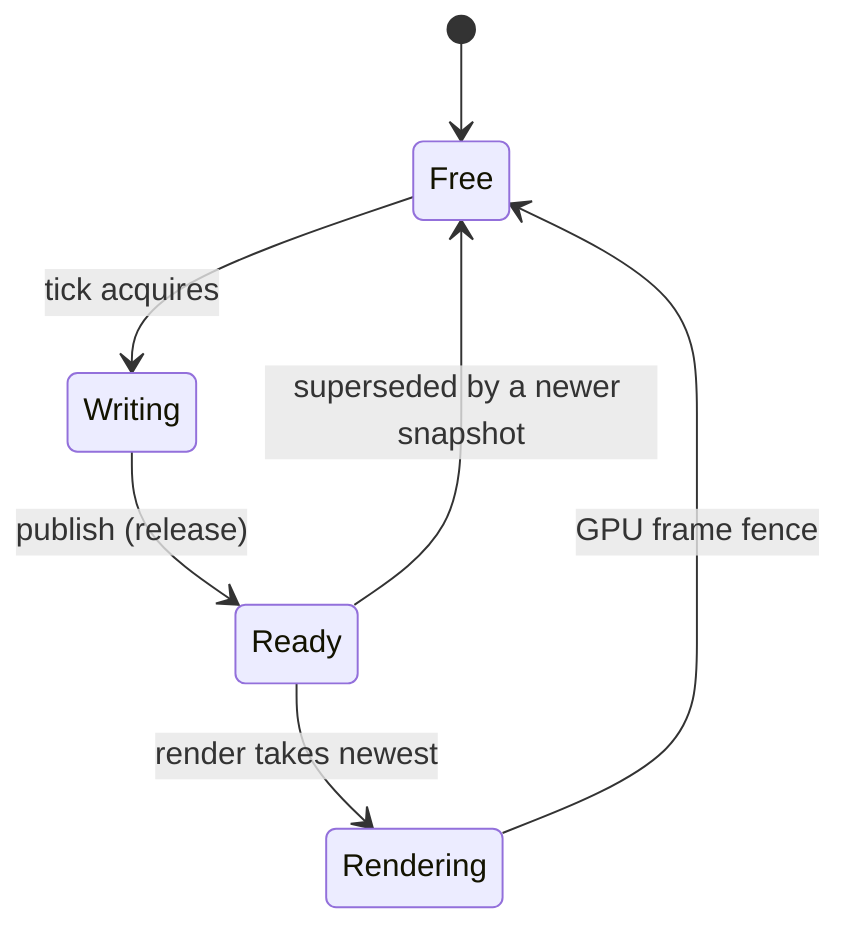

# Threading and Frame Handoff

> **Status:** the M1 scene graph implements the structural and per-object
> `System.Threading.Lock` rules in §2 and the public API has no thread affinity. The M2 windowed
> platform's OS/window thread, command queue, confirmed-state snapshot, and event pump are
> implemented internally (§5.1) but are not wired to the engine yet (M2 WP4). The input freeze and
> text dispatch are `Planned` (M2 WP3), the render thread, snapshot ring, and frame handoff are
> `Planned` (M7), and asset loader threads are `Planned` (M3). The engine has no debug-only
> tick-active, structural, or slot-state checks.

## 1. Threads by mode

| Thread | Windowed | Offscreen | Headless | Responsibilities |
| --- | :-: | :-: | :-: | --- |
| **Tick** | yes | yes | yes | Time, `IGame.Setup/Tick/Teardown`, tick scope, scene/asset requests, snapshot capture, shutdown. May be any host thread. |
| **OS/window** | yes | no | no | SDL video/events and window operations; public `IWindow` calls are marshaled here. |
| **Render** | yes | yes | no | Vulkan device, swapchain or offscreen targets, uploads, sprite resolution, sorting, instance building, draws, fences, present. |
| **Asset loader(s)** | yes | yes | yes | Pack parsing, decompression, MessagePack/descriptor/sprite decoding, immutable resource table, upload requests. |
| **Game workers** | yes | yes | yes | Game-spawned threads on distinct entities; the game joins them before `Tick` returns. |

In the target design the engine owns the asset threads and, in windowed/offscreen modes, the
OS/window and render threads; game workers are owned and joined by the game. Headless does not
initialize SDL or Vulkan. **No public API requires the process main thread.** The OS/window thread
never calls Vulkan; the render thread never calls SDL window mutation.

## 2. Tick-scoped concurrency

> All scene mutation happens inside the tick window (`Setup`/`Tick`/`Teardown`), including work
> by game worker threads. Calls may originate on any thread; workers must be joined before
> `Tick` returns, and the engine captures the snapshot at that quiescent point. Assets cross
> threads through packs, queues, and an immutable table.

"Scene state" means creating, attaching, detaching, and clearing cameras and sprite renderables;
changing transform local values or parents; changing camera/sprite properties (`Size`, `Viewport`,
`CullingMask`, `Clear`, `ClearColor`, `ZIndex`, `Sprite`, `Layer`, `Tint`, planned flip flags);
and changing `IWindow` state (windowed only, marshaled).

The guarantees are deliberately precise:

- **Structural state is serialized; distinct entities run concurrently.** Parent/child
  attach/detach, including attaching a newly created node, is protected by one engine-owned
  structural `System.Threading.Lock` per engine, so creation and parenting from multiple game
  workers are safe while two workers may move different sprites or detach different cameras. The
  tree is unordered and has no entity IDs or ordered discovery.
- **Individual property access is serialized per object.** Each object uses a `Lock` for
  property get/set, so individual reads/writes do not data-race. Logical ordering of two workers
  re-parenting the same subtree still needs game synchronization.
- **The API is any-thread.** `IWindow`, `IInput`, `ITime`, `Exit`, scene operations, and the
  builder do not require the process main thread. `IGame` callbacks run on the engine tick
  thread; `IWindow` operations are marshaled to the OS/window thread (`Planned`, M2);
  `IInput`/`ITime` reads are snapshots.
- **Asset requests are thread-safe and non-blocking** (`Planned`, M3): completion is
  asynchronous, so a caller cannot assume a sprite is ready. Workers may create cameras/sprites,
  request assets, mutate entities they own, read `ITime` snapshots, and hand data back through
  game-owned queues; they must join before `Tick` returns.
- **The tick is the quiescence boundary.** The snapshot is built after `Tick` returns; a worker
  still running then violates the contract (`Planned`, M7). Composite multi-property updates
  that must be atomic are the game's responsibility: the engine cannot detect a non-atomic
  update spanning multiple locked operations and performs no debug-only boundary checks.

## 3. Frame snapshot

`Planned` for M7; camera ordering is M8. A snapshot is the renderer's complete input for one
tick: immutable after publication, free of live entity references, and internal (never
`Bork2d.Api`). It is built by an unordered traversal of the rooted tree with workers joined.
`FrameSnapshot` holds sequence/time/delta plus camera and sprite arrays; `CameraSnapshot` holds
`ZIndex`, world matrix, size, viewport, culling mask, and clear kind/color; `SpriteSnapshot`
holds the handle, world matrix, tint, layer, `ZIndex`, and flip flags.

- **Value-only, no entity IDs.** Structs contain only copied values; no `Transform`/`Camera`/
  `SpriteRender` reference crosses the boundary.
- **Built after `Tick`, asset-agnostic.** Capture runs with all workers joined; workers must not
  write scene state after `Tick` returns. A snapshot never contains textures, vertices, or
  sprite metadata; the renderer resolves the `Sprite` handle at draw time.
- **World transforms only, layer erased.** The tick thread evaluates the parent hierarchy and
  writes the final world matrix; `TLayer` becomes a `uint` mask/bit so the renderer is
  non-generic.
- **Unordered capture, renderer sorting.** Capture walks `IEngine.Root` in no specified order.
  Sprites sort by `(Layer, ZIndex)` ascending and cameras apply in ascending `ZIndex`; ties are
  unspecified. The renderer filters sprites per camera.
- **Detached, not-ready, or headless.** A renderable detached during `Tick` is absent from that
  tick's snapshot; a sprite whose asset is not ready is still captured and skipped at draw time,
  avoiding a race with late readiness. Headless captures nothing because it has no renderer.
- **Pooled capacity.** Each slot owns its arrays and steady state must not allocate.

## 4. Triple-buffer handoff

There are exactly **three snapshot slots**. A slot is held until the GPU frame that consumed it
signals its fence, which bounds run-ahead without growing an unbounded queue.



A `Ready` slot is unread. A `Rendering` slot has a submitted GPU frame whose instances were
copied from it and is held until its fence. A `Writing` slot belongs to the tick thread.

### Producer (tick thread)

```
loop:
  slot = AcquireFreeSlot()          // blocks when all three slots are occupied
  time.NewFrame()
  game.Tick()                       // joins game workers before returning
  Fill(slot)                        // cameras, sprites, flatten layers
  slot.State = Ready                // release
  old = Interlocked.Exchange(latest, slot.Index) // release
  if old != -1: TryCas(old, Ready -> Free) // drop an undisplayed snapshot
```

`AcquireFreeSlot` blocks only when all slots are `Ready`/`Rendering`; that wait is frame
backpressure, not an artificial delay. Publish order is `Ready` before `latest`; a superseded
`Ready` slot is freed, and a `Rendering` slot is never freed by the producer.

### Consumer (render thread)

```
loop:
  ProcessControlMessages()          // windowed: resize/close; offscreen: stop/errors
  WaitForSnapshotOrControl()        // blocked, not spinning
  if not HasReadySnapshot(): continue
  frame = WaitForFreeGpuFrameSlot() // fence-protected GPU frame slot
  slot = TakeLatestReady()          // CAS Ready -> Rendering; clears latest
  if slot is null: continue
  BuildGpuFrame(slot, frame)        // resolve assets, sort, copy instances
  Submit(frame)                     // GPU reads the frame's instance buffer
  OnFence(frame): Release(slot)     // Rendering -> Free; wake a waiting tick
```

`TakeLatestReady` clears `latest` when it still points at the taken slot, so a released slot
does not leave a dangling pointer; a newer snapshot published concurrently wins the
compare-exchange and remains latest. The renderer takes a frame slot before taking a snapshot so
it never holds a snapshot while blocked on the GPU.

Two pools bound the pipeline: **snapshot slots (3)** are held until the consuming GPU frame's
fence, and **GPU frame slots (2, provisional)** bundle command buffer, instance buffer,
semaphores, and fence, reused only after their fence. A slot is never overwritten while the
renderer is reading it or a GPU frame still references it. The tick fills slots, then waits;
older `Ready` snapshots are dropped and the newest is shown.

### Slot invariants

1. At most one slot is `Writing`.
2. A slot is never `Writing` and `Rendering` at the same time.
3. A slot in `Rendering` is not reused until its GPU frame fence signals.
4. `latest` is either `-1` (nothing ready) or points to a `Ready`/`Rendering` slot, never
   `Writing`/`Free`. The consumer clears it when it takes that slot.
5. Publishing frees at most the immediately previous `Ready` slot; it never frees `Rendering`.
6. Every slot returns to `Free` after its GPU frame completes.
7. A GPU frame's instance buffer is not overwritten until its fence signals.
8. No thread blocks while holding a CAS-relevant state that another thread needs to progress.

## 5. Input across threads (windowed only)

`Planned` for M2 WP3; M1 throws `NotSupportedException` from the `IInput` getter.

### 5.1 Window thread, command queue, and confirmed state (M2 WP2, internal)

`Current (internal).` The windowed platform owns one OS/window thread; it is the only thread that
calls SDL. The tick thread never calls SDL and never waits for a window command.

- **Commands.** `IWindow.Title/Size/Fullscreen/CursorVisible` setters validate on the caller
  thread, drop requests redundant with the last requested value, coalesce pending requests per
  property (latest value wins while the order between different properties is preserved), and
  enqueue into one MPSC queue guarded by a `System.Threading.Lock`. Setters then push one
  registered SDL user event to wake the pump. They never block and never call SDL.
- **State.** The OS thread drains the queue before waiting and re-checks it after each wait, so a
  wake-up is not lost. After applying a command or handling a window event it publishes an
  immutable confirmed snapshot (title, window points, framebuffer pixels, scale, fullscreen,
  cursor, minimized, focused, visible, alive) with a volatile write. Getters read that snapshot
  without blocking and may lag one pump (D-M2-04).
- **Events.** One pump handles resize/size-changed, minimize/restore/maximize, focus gained/lost,
  fullscreen changes, close/`SDL_QUIT`, and DPI/scale changes in event order. A close request
  takes the graceful-exit path but does not destroy the window; the OS thread keeps pumping until
  shutdown.
- **Fatal errors.** An unrecoverable SDL error is stored as a `Bork2dException`, requests an
  error exit, and stops the pump. The tick-side host rethrows it after `Teardown` (M2 WP4).
- **Shutdown.** `Shutdown` sets the stop flag, pushes a user event to release the event wait, and
  joins the thread. The OS thread destroys the window before quitting and disposing SDL. There is
  no timeout, sleep, or pacing wait.
- **Locks.** The command-queue lock and the proxy's attach/detach lock are the platform's only
  locks. Neither is held across an SDL call, a game callback, or the event wait, and they are never
  held together. Each lock protects a short critical section only.

### 5.2 Input freeze and handoff (M2 WP3, planned)

- SDL events are pumped on the OS/window thread, including while waiting for work; handlers that
  touch engine/game state are marshaled to the tick thread. At tick start input is frozen: keys,
  mouse position/delta/wheel, and text describe events since the previous tick. Edge flags are
  true for exactly one tick; `OnTextTyped` is dispatched on the engine tick thread before `Tick`.
- Mouse coordinates are framebuffer pixels, top-left origin; wheel delta accumulates per tick.
  On focus loss, held keys/buttons are synthesized as released and wheel/text state is cleared.
  `IInput` reads are thread-safe snapshots, not part of the frame snapshot and not readable from
  the render thread's public API.

## 6. Asset and pack coordination

`Planned` for M3. Asset threads cross to the renderer through an immutable resource table:
loader threads decompress, deserialize, decode, and prepare CPU resources but never touch
Vulkan, and the renderer creates GPU texture pages and uploads on the render thread.

- A sprite is skipped until its sprite asset, texture descriptor, raw payload, and GPU page are
  ready; GPU page lifetime is retired after frames that reference it complete. The virtual
  filesystem overlay table is immutable except for an atomic swap when `LoadPack` mounts a new
  pack; later packs shadow earlier ones and there is no unload in v1.

See [Assets and tooling](assets-and-tooling.md).

## 7. Shutdown and error propagation

Shutdown sequencing and error precedence are in [Runtime lifecycle](runtime-lifecycle.md).
Thread-specific rules:

- The render thread never waits on the tick thread; it waits on its own event, signalled by
  snapshot publication, control messages, and stop. It never outlives the Vulkan
  instance/surface (windowed) or device (offscreen). The asset thread is cancellable and
  joinable; in-flight loads are abandoned at shutdown.
- Background errors are stored and rethrown on the `Run()` caller after cleanup (`Planned`). The
  tick is a transaction and is not aborted mid-way for a render error. No `Thread.Abort`, no
  finalizer-based shutdown, no blocking join inside a render callback.

## 8. Memory ordering

- Slot state uses `Interlocked`/`Volatile` release/acquire; publish, take, and fence paths are
  lock-free. Locks are used only for structural attach/detach/creation and per-object property
  access: `System.Threading.Lock`, not `lock (object)`, short critical sections, no lock across
  an await or blocking wait, structural lock before per-object lock.
- Snapshot arrays are slot-private: the tick writes only the slot it owns; the renderer reads
  only a slot in `Rendering`. The renderer copies snapshot data into per-frame instance buffers;
  the GPU reads those buffers, not snapshot memory, and a buffer is rewritten only after its
  fence. Uploads use persistently mapped memory.
- Release builds keep the per-object locks; composite multi-property updates are neither atomic
  nor detected by the engine.

## 9. Test strategy

1. **Slot state machine.** Fake producer/consumer/fence with random delays: bounded run-ahead,
   no lost newest, no slot leak, no read of `Writing`, no free of `Rendering`, monotonic sequence.
2. **Pacing.** Fake renderer at varying frame durations: tick never faster than the ring, waits
   only when full, never sleeps, drops superseded snapshots.
3. **Concurrency.** N workers create/mutate distinct entities, then join; all appear exactly once
   with distinct references, detach/re-attach is safe, no entity-ID or order assertions.
4. **Shutdown.** Stop during publish, take, or simulated GPU work; all threads exit within a
   timeout and every slot ends `Free`.
5. **Modes and allocation.** Headless has no SDL/render thread and paces to its rate (`0`
   uncapped); offscreen has no surface/swapchain; fixed entity counts allocate nothing.

`Bork2d.Tests` covers §2's scene rules today; 1, 2, 4, and parts of 5 come with M7.

## 10. Related documents

- [Runtime lifecycle](runtime-lifecycle.md) — builder, modes, startup, shutdown.
- [Scene ownership](scene-ownership.md) — root-owned lifetime model.
- [Rendering](rendering.md) — windowed/offscreen render paths.
- [Assets and tooling](assets-and-tooling.md) — pack mounting and loader ownership.
- [Decision D-003](../decisions.md#d-003-bounded-run-ahead-snapshot-ring) — bounded run-ahead.
