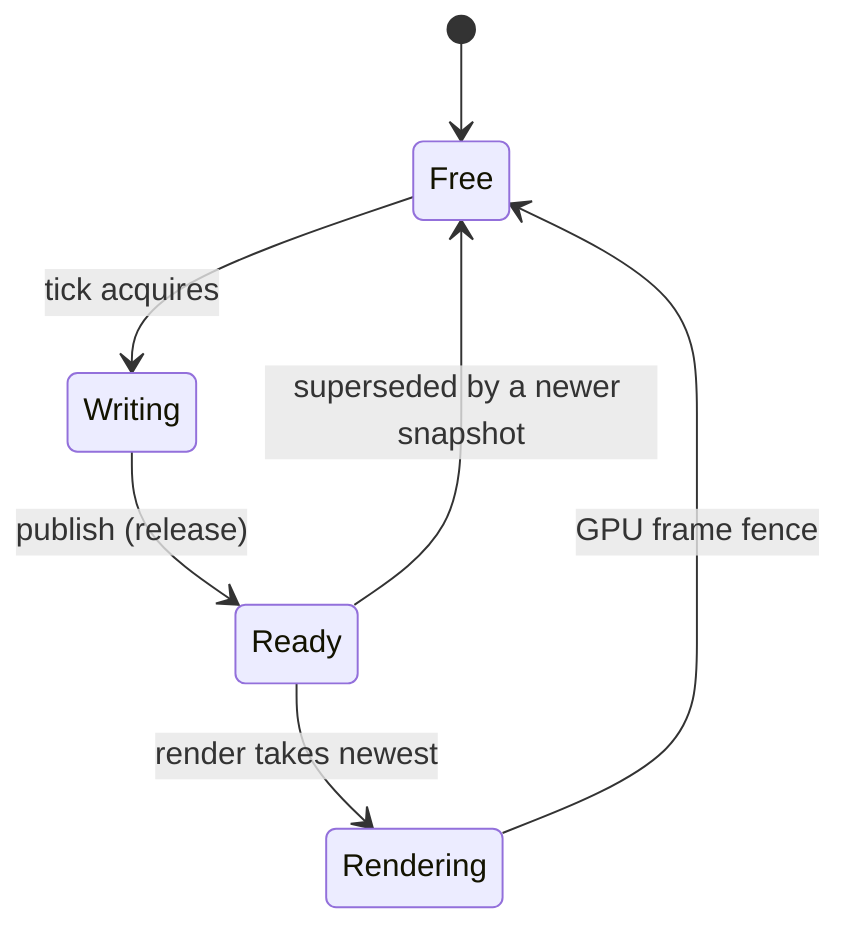

# Threading and Frame Handoff

> **Status:** implemented through M7 (2026-10-31; M7 is merged into `develop` with PR #12, merge
> `5de5ac3`). The M1 scene graph implements
> the structural and per-object
> `System.Threading.Lock` rules in §2 and the public API has no thread affinity. The M2 windowed
> platform's OS/window thread, command queue, confirmed-state snapshot, event pump, input freeze, and
> the runtime tick loops that drive them are `Current` (§5). The M3 asset service's one loader
> thread, FIFO queue, asynchronous completion, cancellation/join, and deserialize-only load path are
> `Current` (§6). The M6 render thread is `Current` for windowed and offscreen: the host starts it
> before `Setup`, waits for readiness only before the first tick, and joins it before the
> surface/instance/window are destroyed. The internal frame snapshot model, the capture pass, and the
> three-slot ring state machine are `Current` (M7 WP-2); renderer consumption, the fence-held slot
> lifetime, the combined snapshot/control wait, and the suspended minimized drain are `Current` (M7
> WP-3); the host acquire/capture/publish wiring, the blocked-producer wake paths, the minimized
> 30 Hz tick cap, and the paced headless loop are `Current` (M7, §5.3/§7). The engine has no
> debug-only tick-active, structural, or slot-state checks. The suite is 1362 tests: 1335
> deterministic plus 27 opt-in/conditional. **M8 (sprite renderer) is implementation-complete
> through WP-5; the milestone PR is open for review and is not merged.** WP-2 added the
> pure camera/planning/instance-layout code (no new thread) and the renderer-owned sprite pipeline;
> WP-3 added the render-thread texture-page subsystem (async `IAssets` calls polled from the render
> thread, per-page upload fences, pooled memory) and the public `RenderStats` bridge; WP-4 added the
> shared plan, per-camera passes/draws, per-frame stats publication, and the thread-safe
> `CaptureFrameAsync` request queue with pooled per-frame staging; WP-5 added no thread or lock
> change (the Release benchmark and the Pong gate are host-side evidence). M8 does **not** change
> the frame snapshot.

## 1. Threads by mode

| Thread | Windowed | Offscreen | Headless | Responsibilities |
| --- | :-: | :-: | :-: | --- |
| **Tick** | yes | yes | yes | Windowed/offscreen loop (slot acquire, time, `IGame.Setup/Tick/Teardown`, input freeze/text dispatch, tick scope, scene/asset requests, snapshot capture, publish, shutdown); headless paced loop with the synthesized clock. May be any host thread. |
| **OS/window** | yes | no | no | SDL video/events and window operations; public `IWindow` calls are marshaled here. |
| **Render** | yes | yes | no | Vulkan device, swapchain (windowed) or offscreen targets, frames/fences, the snapshot ring and consumer, the per-camera sprite passes/draws, present/discard, and the capture copy. Started by the host before `Setup`; no `Tick` runs until it is ready. M8 WP-2 adds the render-thread-owned sprite pipeline/layout/samplers (created after the color format is known); WP-3 adds the page subsystem (prefetch through `IAssets`, upload fences, descriptor writes, capacity growth) and the frame binding-1 bindless sets; WP-4 adds the planner, growable mapped instance filling, per-frame stats publication, and the capture queue/staging. |
| **Asset loader** | yes | yes | yes | One per app: pack reads, decompression, and MessagePack deserialization. It caches no resolved assets and never touches SDL, Vulkan, or game entities. |
| **Game workers** | yes | yes | yes | Game-spawned threads on distinct entities; the game joins them before `Tick` returns. |

The engine owns the asset threads and, in windowed/offscreen modes, the OS/window and render
threads; game workers are owned and joined by the game. Windowed and offscreen create the renderer
through the internal factory; headless does not. Headless does not initialize SDL or Vulkan.
**No public API requires the process main thread.** The OS/window thread never calls Vulkan device
operations; the render thread never calls SDL or window mutation. The windowed instance and surface
are created and destroyed on the OS/window thread; only the single D-M6-16 replacement runs there
after the renderer drops its swapchain.

## 2. Tick-scoped concurrency

> All scene mutation happens inside the tick window (`Setup`/`Tick`/`Teardown`), including work
> by game worker threads. Calls may originate on any thread; workers must be joined before
> `Tick` returns, and the engine captures the snapshot at that quiescent point. Assets cross
> threads through packs, request queues, and deserialized immutable asset values.

"Scene state" means creating, attaching, detaching, and clearing cameras and sprite renderables;
changing transform local values or parents; changing camera/sprite properties (`Size`, `Viewport`,
`CullingMask`, `Clear`, `ClearColor`, `ZIndex`, `SpriteAsset? Sprite`, `Layer`, `Tint`,
`FlipX`/`FlipY`); and changing `IWindow` state (windowed only, marshaled).

The guarantees are deliberately precise:

- **Structural state is serialized; distinct entities run concurrently.** Parent/child
  attach/detach, including attaching a newly created node, is protected by one engine-owned
  structural `System.Threading.Lock` per engine, so creation and parenting from multiple game
  workers are safe while two workers may move different sprites or detach different cameras. The
  tree is unordered and has no entity IDs or ordered discovery.
- **Individual property access is serialized per object.** Each object uses a `Lock` for
  property get/set, so individual reads/writes do not data-race. Logical ordering of two workers
  re-parenting the same subtree still needs game synchronization.
- **The API is any-thread.** `IWindow`, `IInput`, `ITime`, `Exit`, scene operations, and the
  builder do not require the process main thread. `IGame` callbacks run on the engine tick
  thread; `IWindow` operations are marshaled to the OS/window thread (M2, current);
  `IInput`/`ITime` reads are snapshots.
- **Asset requests are thread-safe and non-blocking** (`Current`, M3): completion is
  asynchronous, so a caller cannot assume a sprite is ready. Workers may create cameras/sprites,
  request assets, mutate entities they own, read `ITime` snapshots, and hand data back through
  game-owned queues; they must join before `Tick` returns.
- **The tick is the quiescence boundary.** The snapshot is built after `Tick` returns; a worker
  still running then violates the contract (the internal capture pass is `Current`, M7).
  Composite multi-property updates
  that must be atomic are the game's responsibility: the engine cannot detect a non-atomic
  update spanning multiple locked operations and performs no debug-only boundary checks.

## 3. Frame snapshot

`Current` (internal, M7): the value-only model and the capture pass live in
`Bork2d.Engine.Rendering` and are never part of the public `Bork2d.Engine` contract. Camera
ordering, sprite sorting, and every draw are `Current` (M8 WP-4). **M8 does not
change the snapshot:** it stays value-only and asset-agnostic except the loaded `SpriteAsset?`, and
the renderer resolves textures through `IAssets` instead of receiving new snapshot fields. A
snapshot is the renderer's complete input
for one tick: immutable after publication, free of live entity references except the loaded
`SpriteAsset?`, and built by an unordered traversal of the rooted tree with game workers joined.

| Type | Exact fields (Q5=E1, Q2=B1) | Notes |
| --- | --- | --- |
| `FrameSnapshot` | `Sequence` (`long`), `Time` (`double`), `DeltaTime` (`double`), camera array/count, sprite array/count | One per completed windowed/offscreen tick; the host starts `Sequence` at `1` by convention. |
| `CameraSnapshot` | `ZIndex` (`int`), `WorldMatrix` (`Matrix3x2`), `Size` (`float`), `Viewport` (`Vector4`), `CullingMask` (`uint`), `Clear` (`ClearKind`), `ClearColor` (`Color`) | The world matrix is the camera's world transform; M8 derives view/projection from it. |
| `SpriteSnapshot` | `Sprite` (`SpriteAsset?`), `WorldMatrix` (`Matrix3x2`), `Tint` (`Color`), `Layer` (`uint`), `ZIndex` (`int`), `FlipX`/`FlipY` (`bool`) | `Sprite == null` is captured and skipped at draw time; `Layer` is the flattened single bit. |

- **Capture point.** The host calls the internal `GameEngine<TLayer>.CaptureSnapshot(snapshot,
  sequence)` on the tick thread after `IGame.Tick` returns, with every game worker joined, after
  the first tick, and before `Teardown` starts; the quiescent boundary is the host's contract
  because the engine does not know the loop. A node detached during `Tick` is absent from that
  tick's snapshot; a node created and attached during `Tick` is present.
- **Value-only, no entity IDs.** Structs contain only copied values; no `Transform`/`Camera`/
  `SpriteRender` reference crosses the boundary. The loaded `SpriteAsset` reference is the only
  object reference.
- **World transforms on the tick thread.** Capture holds the engine structural lock for the walk
  and evaluates `Matrix3x2` through the internal `ISceneNode.WorldMatrixCore` contract, which
  already assumes the structural lock is held; it never re-enters the structural lock through
  `Transform.WorldMatrix()`. Per-object properties are read under their per-object locks in the
  existing structural-then-per-object order; no new lock ordering is added and no lock is held
  across a wait (D-024).
- **Layer erased, invalid values preserved.** `TLayer` (Int32-backed flags) is flattened to a
  `uint` mask and bit 31 survives; a renderable should carry exactly one bit, and invalid values
  (`0`, multi-bit) are captured as-is (Q3=C2) and skipped by the M8 renderer with the diagnostic.
- **Built after `Tick`, asset-agnostic.** Capture runs with all workers joined; workers must not
  write scene state after `Tick` returns. A snapshot never contains textures, vertices, or derived
  sprite metadata; the renderer resolves the loaded `SpriteAsset.Texture` reference at draw time.
  Flips are captured values (Q2=B1); WP-4 draws them.
- **Unordered capture, renderer sorting.** Capture walks `IEngine.Root` in no specified order
  through an internal-only visitor; the tree still exposes no child enumeration, traversal helper,
  entity identity, or stable order in the public API. M8 sorts sprites by `(Layer, ZIndex)`
  ascending and applies cameras in ascending `ZIndex`; ties are unspecified, and the renderer
  filters sprites per camera.
- **Detached, not-ready, or headless.** A renderable detached during `Tick` is absent from that
  tick's snapshot; a sprite whose asset is not ready is still captured and skipped at draw time,
  avoiding a race with late readiness. Headless captures nothing because it has no renderer.
- **Pooled capacity.** Each slot owns its arrays: they start empty, grow to the high-water mark,
  and never shrink (Q6=Z1); capture uses no LINQ, boxing, or per-node allocation, and a warm
  fixed-count scene captures without allocating (M7 allocation test).

## 4. Triple-buffer handoff

`Current` (internal, M7) in `Bork2d.Render.Handoff`: the slots, `latest`,
publish/take/release, waits, counters, the renderer-side `SnapshotConsumer`, and the combined
`SnapshotControlWait` exist and are covered by deterministic tests. The renderer
takes the newest `Ready` snapshot only for a free GPU frame, holds it until that frame's fence is
observed, and releases it when the frame index is next reused or in the stop/fatal/idle drain. The
host acquire/capture/publish wiring and the blocked-producer wake paths are `Current` (§5.3
and §7), so a windowed/offscreen run publishes and consumes snapshots. There are exactly
**three snapshot slots**. A slot is held until the GPU frame that consumed it signals its fence,
which bounds run-ahead without growing an unbounded queue.



A `Ready` slot is unread. A `Rendering` slot has a submitted GPU frame whose instances were
copied from it and is held until its fence. A `Writing` slot belongs to the tick thread. The
suspended path is the only `Ready → Free` transition that is not a supersede: while minimized or
at zero extent the consumer frees the newest snapshot immediately, the slot never enters
`Rendering`, and no fence is involved (Q8=H1).

### Producer (tick thread)

```
loop:
  slot = renderer.AcquireSnapshotSlot()   // blocks when all three slots are occupied
  input.Freeze(); time.NewFrame(); input.DispatchText(); game.Tick()
  engine.CaptureSnapshot(slot)            // after Tick, workers joined
  renderer.PublishSnapshot(slot)          // Ready (release); newest wins; previous Ready dropped
  // on a Tick/capture failure: renderer.AbandonSnapshotSlot(slot); nothing is published
```

`AcquireSnapshotSlot` blocks only when all slots are `Ready`/`Rendering`; that wait is frame
backpressure, not an artificial delay, and it returns `null` on stop/exit/fatal. Publish order is
`Ready` before `latest`; a superseded `Ready` slot is freed, and a `Rendering` slot is never freed
by the producer. `WakeSnapshotWait` (installed by the host on `IEngine.Exit()`) wakes a
blocked acquire without stopping consumption, so the Exit tick can still publish (Q4=D1, Q9=I1).
The producer's control flow is in §5.3.

### Consumer (render thread)

```
loop:
  DrainControlMessages()                 // extent/fullscreen/minimize/stop/fatal
  if minimized or zero extent:
      drain the newest Ready without GPU work (Ready -> Free, no Rendering, no fence)
      wait for snapshot/control/stop; continue
  if no Ready: wait for snapshot/control/stop   // no timed polling, no repeat
  wait this GPU frame's fence             // the frame is free
  release the snapshot that frame held     // Rendering -> Free
  slot = TakeLatestReady()                // CAS Ready -> Rendering; clears latest
  if slot is null: wait; continue
  acquire image; record clear; submit      // an out-of-date acquire frees the slot, no frame
  attach slot to the frame; present        // released when this frame index is next reused
```

`TakeLatestReady` clears `latest` when it still points at the taken slot, so a released slot
does not leave a dangling pointer; a newer snapshot published concurrently wins the
compare-exchange and remains latest. The renderer takes a frame slot (waits its fence) before
taking a snapshot so it never holds a snapshot while blocked on the GPU.

Two pools bound the pipeline: **snapshot slots (3)** are held until the consuming GPU frame's
fence, and **GPU frame slots (2)** bundle command buffer, fence/semaphore, instance buffer, and
the empty instance resources, reused only after their fence. A slot is never overwritten while the
renderer is reading it or a GPU frame still references it. The tick fills slots, then waits; older
`Ready` snapshots are dropped and the newest is shown. Resize/fullscreen/surface-loss recovery and
shutdown wait `vkDeviceWaitIdle`, then release every held slot before recreating or destroying
anything; `Join` drains every non-`Writing` slot so all slots end `Free`, even when a fatal let a
producer publish after the renderer's cleanup. Exactly one GPU frame is recorded per consumed
snapshot (Q7=G1); with no `Ready` snapshot the renderer waits and never repeats the previous one.

### Slot invariants

1. At most one slot is `Writing`.
2. A slot is never `Writing` and `Rendering` at the same time.
3. A slot in `Rendering` is not reused until its GPU frame fence signals.
4. `latest` is either `-1` (nothing ready) or points to a `Ready`/`Rendering` slot, never
   `Writing`/`Free`. The consumer clears it when it takes that slot.
5. Publishing frees at most the immediately previous `Ready` slot; it never frees `Rendering`.
6. Every slot returns to `Free` after its GPU frame completes.
7. A GPU frame's instance buffer is not overwritten until its fence signals.
8. No thread blocks while holding a CAS-relevant state that another thread needs to progress.

## 5. Input across threads (windowed only)

`Current (M2).` The windowed host attaches the window/input proxies before `Setup`, runs the loop
below, and detaches them after the platform shuts down. Headless/offscreen create no platform, so
`IEngine.Input` throws `NotSupportedException` from the getter.

### 5.1 Window thread, command queue, and confirmed state (M2, internal)

`Current (internal).` The windowed platform owns one OS/window thread; it is the only thread that
calls SDL. The tick thread never calls SDL and never waits for a window command.

- **Commands.** `IWindow.Title/Size/Fullscreen/CursorVisible` setters validate on the caller
  thread, drop requests redundant with the last requested value, coalesce pending requests per
  property (latest value wins while the order between different properties is preserved), and
  enqueue into one MPSC queue guarded by a `System.Threading.Lock`. Setters then push one
  registered SDL user event to wake the pump. They never block and never call SDL.
- **State.** The OS thread drains the queue before waiting and re-checks it after each wait, so a
  wake-up is not lost. After applying a command or handling a window event it publishes an
  immutable confirmed snapshot (title, window points, framebuffer pixels, scale, fullscreen,
  cursor, minimized, focused, visible, alive) with a volatile write. Getters read that snapshot
  without blocking and may lag one pump (D-M2-04).
- **Events.** One pump handles resize/size-changed, minimize/restore/maximize, focus gained/lost,
  fullscreen changes, close/`SDL_QUIT`, and DPI/scale changes in event order. A close request
  takes the graceful-exit path but does not destroy the window; the OS thread keeps pumping until
  shutdown.
- **Fatal errors.** An unrecoverable SDL error is stored as a `Bork2dException`, requests an
  error exit, and stops the pump. The OS thread then runs its cleanup, so it may destroy the window
  before the tick thread reaches `Teardown`; the window/input proxies stay attached until the host
  shuts the platform down, so `Teardown` can still attempt best-effort access. The tick-side host
  reads the fatal exception after `Teardown` and rethrows it. Normal exit/close paths leave the
  window alive through `Teardown` and destroy it only afterwards (accepted M2 fatal-path behavior).
- **Shutdown.** `Shutdown` sets the stop flag, pushes a user event to release the event wait, and
  joins the thread. The OS thread destroys the window before quitting and disposing SDL. There is
  no timeout, sleep, or pacing wait.
- **Locks.** The platform uses the command-queue lock, the input-accumulator lock, and short-lived
  proxy locks (window attach/detach and input subscription). None is held across an SDL call, a game
  callback, or the event wait, and the command-queue and input locks are never held together. Each
  lock protects a short critical section only.

### 5.2 Input freeze and handoff (M2)

`Status: Current (internal).` The OS/window thread accumulates events into `InputAccumulator`;
the tick thread freezes it once per tick into one of two preallocated `InputSnapshot` instances and
publishes it with a volatile reference write. Reads during `Tick` see only that instance and are
stable; events applied after the freeze belong to the next one.

- **Accumulation.** A non-repeat key down on an up key sets held plus a press edge; an up on a down
  key sets a release edge and clears held; duplicates, repeats, undefined scancodes, the unknown
  scancode zero, and buttons other than the five supported ones are ignored. The five mouse buttons
  map from SDL's one-based index and pressed mask (`Left=1`, `Middle=2`, `Right=3`, `Back`/X1=4,
  `Forward`/X2=5).
  Motion is stored in window points; the wheel accumulates with natural scrolling normalized so
  positive is up/away; text is appended character by character (a surrogate pair is two chars).
- **Focus.** Loss synthesizes a release for every held key/button, clears held state, wheel, and
  pending text, stops SDL text input, and forces the next delta to zero. Regain reads
  `SDL_GetKeyboardState`/`SDL_GetMouseState` outside the input lock, overwrites held state and the
  mouse position without press edges, starts text input, and also forces the next delta to zero.
  Transitions apply in event order, so loss+regain between freezes leaves the loss's release edges
  and the re-seeded held state.
- **Freeze.** The lock copies the down/pressed/released bitsets, mouse masks, position, and wheel,
  transfers and clears text, and clears pending edges/wheel; the unlock is followed by the delta
  computation and the snapshot publication. Delta is zero on the first freeze, a focus transition,
  and while unfocused; otherwise it is the new position minus the previous freeze position. The
  freeze path is allocation-free in steady state; only arrived text can grow a buffer.
- **Handoff.** `InputProxy.Freeze` publishes the snapshot and `InputProxy.DispatchText` raises
  `OnTextTyped` for the frozen characters in order on the tick thread; handler exceptions propagate.
  Edges are true for exactly one tick. Mouse coordinates are framebuffer pixels (window points times
  the confirmed scale), top-left origin.
- **Lifecycle.** Reads before the first freeze are a preallocated empty snapshot; reads during
  `Teardown` are the most recent snapshot; after detach every member throws
  `ObjectDisposedException`. Subscription is thread-safe and no lock is held while a handler runs.
  Input is not part of the frame snapshot and is not exposed to a render thread.

### 5.3 Tick loop and handoff wiring

`Status: Current.` The windowed runtime driver runs entirely on the `Run()` caller thread; the OS
thread never invokes a game callback.

- **Attach and start.** After `SdlWindowPlatform.Start()` succeeds, the runtime creates and starts
  the renderer thread without waiting for readiness, installs the engine's exit wake on the renderer
  (`renderer.WakeSnapshotWait`, before `Setup`), attaches the window/input proxies, and calls
  `platform.AttachRenderer` before `IGame.Setup`, so `IEngine.Window`/`IEngine.Input` are live in
  `Setup` and the OS thread posts confirmed state. Offscreen starts the renderer the same way with no
  platform; headless installs no callback and creates no renderer.
- **Per tick.** Windowed: `renderer.AcquireSnapshotSlot()` first (it blocks only when the ring is
  full, so input/mouse edges that arrive while backpressured belong to the next freeze and
  `DeltaTime` keeps measuring real tick-start intervals), then `input.Freeze()` publishes the
  tick-start snapshot, `time.NewFrame()` advances the clock, `input.DispatchText()` raises
  `OnTextTyped` in order, and `IGame.Tick()` runs. After `Tick` returns (workers joined) the host
  calls the engine's capture into the acquired slot, stamps the monotonic sequence (starting at 1),
  and publishes; the previous `Ready` snapshot is dropped. Offscreen does the same without input.
- **Exit and backpressure.** The engine's exit callback wakes a blocked acquire; no further tick
  starts, and a tick that already owns a slot (the Exit tick) still publishes (Q4=D1, Q9=I1). A
  renderer fatal or stop while blocked is observed after the wake: the host records the renderer
  failure, breaks with zero extra ticks, runs `Teardown` once when `Setup` succeeded, joins the
  renderer, and rethrows.
- **Minimized 30 Hz tick cap.** After a completed/published windowed tick, if the confirmed window
  state is minimized the loop sleeps only the remainder of a one-thirtieth-of-a-second tick-start
  interval with the scheduler's pure `Thread.Sleep`; the grid starts at minimization, is discarded
  on restore, and never accumulates a catch-up burst. It is the only target rate in windowed mode.
- **Readiness gate.** `Setup` never waits for or is interrupted by the renderer (D-M6-06); the wait
  happens after `Setup` and before the first `Tick`. Exit/close during `Setup` skips the wait.
- **Stop boundary.** The loop re-checks the engine exit token, the windowed platform's close/
  `SDL_QUIT` request, and the renderer/platform fatal exception before each acquire. `Exit()` during
  a tick lets that tick complete and publish; `Exit()`/close during `Setup` runs zero ticks.
- **Failure in the tick.** A `Tick`/capture exception abandons the `Writing` slot (nothing is
  published) and follows the M2/M6 error precedence: `Teardown` once when `Setup` succeeded, the
  renderer stopped/joined, the platform/assets shut down, and the original exception rethrown.
- **Teardown.** `Teardown` runs once with the window/input proxies still attached; normal
  exit/close paths have a live window there, but a fatal OS-thread error may already have destroyed
  it, so the game can only attempt best-effort access. The renderer is then stopped/joined
  (**before** the platform destroys the surface/instance/window), the platform is shut down (surface,
  instance, loader, window, SDL, OS thread), and only afterwards are the proxies detached, so
  retained references throw `ObjectDisposedException`.
- **No pacing otherwise.** The normal windowed/offscreen loops have no target rate, deadline,
  `Thread.Sleep`, `SpinWait`, or yield: the acquire is the only wait, and it is event-based. Headless
  has no ring and paces with a strict absolute grid and a pure `Thread.Sleep`, catching up unbounded
  after a stall (Q13=M4/F1/F8); its synthetic `Time`/`DeltaTime` advance one exact step per tick.
  No lock is held across a game callback, an SDL call, or the event wait.
- **Errors.** A game or text-handler failure stops the loop, is captured, and is rethrown after
  teardown, renderer join, and platform shutdown; a fatal OS-thread or renderer error is stored, read
  after teardown, and rethrown (aggregated with a teardown failure). A renderer failure around
  `Setup` still runs `Setup`, zero ticks, and `Teardown` (D-M6-14); the `Setup` exception wins. On
  the platform fatal path the OS thread may have destroyed the window before `Teardown`; the proxies
  remain attached for best-effort access. One tick + teardown failure becomes an
  `AggregateException`.
- **Deterministic coverage.** `Bork2d.Tests` drives the real runtime and platform with
  `FakeSdlApi`/`FakeRenderer`/`FakeVulkanInstance` and a fake scheduler clock, synchronizing through
  an applied window command, the fake renderer's event-based counters, or the fake readiness
  callback instead of sleeps; app runs join with a bounded timeout and every test leaves no platform
  or renderer thread running.

## 6. Asset and pack coordination

`Current (M3/D-035)` for the loader and pack-time reference validation. The renderer/GPU integration
(uploads/pages, render-thread `IAssets` calls, and the per-sprite lookup) is `Current` (M8
WP-3/WP-4).

- The internal asset service owns **one** dedicated loader thread per app and an unbounded FIFO
  request queue. There is no priority, no parallelism, and no cancellation token in the public API.
  The loader reads, decompresses, and deserializes only; it never touches SDL, Vulkan, or game
  entities, and it does not validate asset fields or follow references.
- The runtime starts the service at `Run()` before the platform and `Setup` (opening the base pack
  or the empty `WithoutAssets()` filesystem) and stops it after `Teardown` and platform shutdown on
  every path. `Bork2dApp.Dispose()` disposes an unstarted or stopped service; `Dispose()` during a
  run still throws.
- `LoadData`/`LoadAsset<T>` validate arguments synchronously, capture the current immutable VFS
  snapshot, and resolve the winning entry for the request against that snapshot. A later `LoadPack`
  mount does not change an in-flight request; new lookups see the new stack. `AssetRef<T>`/
  `DataRef` overloads only unwrap a present path; they do not resolve links eagerly.
- Requests complete through `TaskCompletionSource` with `RunContinuationsAsynchronously`, so no
  request completes a continuation on the caller or loader thread. `LoadData` returns a fresh
  `byte[]` and `LoadAsset<T>` a fresh deserialized instance per call; there is no data/asset cache
  and no CPU resource table.
- **Pack-time reference validation** runs in `PackBuilder.Build`/`Write`, not on the loader thread.
  The builder walks each added asset's generated shape, collects every non-null reference, and
  checks that the path exists and targets the matching raw/MessagePack kind. There is no sprite
  field validation in Stage 1 (M5 is removed); the renderer's defensive draw-time rules apply.
- Shutdown stops accepting requests, cancels queued and in-flight load tasks (they complete as
  canceled), joins the loader at a safe point, and only then closes the mounted archives. After
  shutdown every `IAssets` member throws `ObjectDisposedException`.
- The virtual filesystem overlay table is immutable except for an atomic swap when `LoadPack`
  mounts a new pack; later packs shadow earlier ones and there is no unload in v1.
- **Render-thread `IAssets` coordination (`Current`, M8 WP-3).** The render thread calls
  `LoadAsset<TextureDescriptor>`/`LoadData` directly; the calls complete asynchronously on the one
  loader thread, which stays the single loader. A page is `Pending` while its load runs, and its
  sprites are skipped (never blocking); a failed load maps the path to the placeholder and is not
  retried. The renderer polls the returned tasks in its per-frame pump and never waits on a load; no
  lock is held across a Vulkan call, fence wait, loader wait, or game callback. Pending tasks are
  observed and ignored on stop. The host stops the asset service only after the renderer has joined,
  so a render-thread load can never race a disposed service. GPU pages live for the run (no
  eviction), are uploaded through a separate submit/fence, and are destroyed on the render thread
  after `vkDeviceWaitIdle` at shutdown.
- **Stats bridge (`Current`, M8 WP-3/WP-4).** `IEngine.RenderStats` returns a consistent immutable
  snapshot. The runtime installs a source that reads the renderer's thread-safe board right after
  renderer creation; the engine getter takes a short `System.Threading.Lock`, never blocks on the
  GPU, never allocates, and swallows a throwing source. The renderer publishes once per completed
  frame (after submit/present).
  `IEngine.CaptureFrameAsync` enqueues a one-shot request under a short lock; the render thread
  records the copy after the last camera pass and before present/discard, completes the task from
  the frame fence, and never blocks the tick. The request queue is drained/faulted on stop/fatal,
  and per-frame staging memory is pooled.

See [Assets and tooling](assets-and-tooling.md).

## 7. Shutdown and error propagation

Shutdown sequencing and error precedence are in [Runtime lifecycle](runtime-lifecycle.md).
Thread-specific rules:

- The render thread never waits on the tick thread; it waits on its own frame fences and on the
  combined snapshot/control wake (snapshot publication, control posts, stop, fatal). It never
  outlives the Vulkan instance/surface (windowed) or the owned instance/device (offscreen): the
  host stops and joins it before `platform.Shutdown()` destroys the surface/instance/window and
  before the assets stop. The asset loader thread is cancellable and joinable; queued and
  in-flight load tasks are canceled and the loader is joined at shutdown (M3). **M8 shutdown
  ordering (as built in WP-3):** the renderer waits its frame/upload fences and `vkDeviceWaitIdle`,
  destroys the per-frame pools/sets, the page images/views/staging/upload pool, the pipeline, and the
  device, then joins; only afterwards does the host stop the asset service, so the `IAssets` instance
  passed in `RendererStartInfo` outlives the renderer. Pending page-load tasks are observed and
  ignored (including a load that completed with a fault between frames and was never pumped), and
  every submitted upload fence is waited without a timeout before its resources are freed: a wait
  failure (device loss) is logged and the in-flight page resources are deliberately not freed, so
  no live copy can read freed memory. **WP-4 capture shutdown:** pending requests are drained and
  faulted; requests already recorded on a frame complete from its fence before staging is destroyed,
  so no task is left pending and no staging memory outlives the device.
- **Shutdown with frames in flight.** `RequestStop` stops the ring (waking a blocked producer) and
  the control channel (waking a blocked consumer); a renderer fatal does the same before the host
  observes it at the next boundary (Q9=I1). The render thread waits its frame fences and
  `vkDeviceWaitIdle`, then releases every snapshot slot it holds; `Join` then drains every
  non-`Writing` slot, because a producer may publish the fatal/exit tick's snapshot after the
  renderer cleanup. All slots end `Free`; no GPU frame references snapshot memory after the fences.
  A producer blocked in `AcquireSnapshotSlot` wakes on the stop/exit signal and starts no further
  tick; the host then runs `Teardown` once (when `Setup` succeeded), joins the renderer, and shuts
  the platform and assets down.
- **Headless shutdown.** There is no renderer or ring: `Exit` stops the loop before the next tick,
  `Teardown` runs once, and the assets stop. A pacing `Thread.Sleep` is not interrupted, so shutdown
  latency is bounded by one tick period; no thread other than the `Run()` caller is involved.
- The windowed OS thread is stopped and joined before `Run()` returns or throws; the renderer has
  already joined, then the OS thread destroys the surface, instance, and window and unloads the
  Vulkan loader before SDL quits. Background errors are stored and rethrown on the `Run()` caller
  after cleanup (the M2 platform fatal path and the M6/M7 render-thread fatal path are `Current`;
  the host observes the renderer fatal at tick boundaries). The tick is a transaction and is not
  aborted mid-way for a render error. No `Thread.Abort`, no finalizer-based shutdown, no blocking
  join inside a render callback.

## 8. Memory ordering

- Slot state uses `Interlocked`/`Volatile` release/acquire; publish, take, and fence paths are
  lock-free. Locks are used only for structural attach/detach/creation and per-object property
  access: `System.Threading.Lock`, not `lock (object)`, short critical sections, no lock across
  an await or blocking wait, structural lock before per-object lock.
- Snapshot arrays are slot-private: the tick writes only the slot it owns; the renderer reads
  only a slot in `Rendering`. WP-3 allocates each frame's 1024-record 96-byte host-visible coherent
  instance buffer and writes binding 0; WP-4 maps it once, writes the records/camera ranges into it,
  and grows it only at a free fence. Texture uploads use a host-visible staging pool and
  a separate submit/fence. `RenderStats` is published once per completed frame and read as one
  consistent snapshot (a short lock or an equivalent atomic snapshot), and the capture result is
  handed to its task after the frame fence, never from inside a
  render callback that the tick waits on.
- Release builds keep the per-object locks; composite multi-property updates are neither atomic
  nor detected by the engine.

## 9. Test strategy

1. **Slot state machine.** Fake producer/consumer/fence with random delays: bounded run-ahead,
   no lost newest, no slot leak, no read of `Writing`, no free of `Rendering`, monotonic sequence.
   The internal ring state machine and a deterministic 10,000-snapshot stress are `Current`
   (M7).
2. **Render consumption.** `SnapshotConsumer`: one snapshot per GPU frame, the slot held
   `Rendering` until its frame index is reused, release-on-reuse, the suspended drain
   (`Ready → Free`, counted, never `Rendering`), and release-all after idle. The combined
   `SnapshotControlWait` wakes on a snapshot, a control post, a stop, or a fatal without polling.
   Both are `Current` (M7). **Host pacing** is `Current` (M7): the windowed/offscreen tick
   publishes one snapshot per completed tick (including the Exit tick), waits only when the ring is
   full, abandons the slot on a `Tick`/capture failure, and starts no further tick when `Exit` or a
   renderer fatal wakes a blocked acquire. The minimized 30 Hz tick cap is covered with the fake
   scheduler; the normal windowed and offscreen loops assert no sleep.
3. **Concurrency.** N workers create/mutate distinct entities, then join; all appear exactly once
   with distinct references, detach/re-attach is safe, no entity-ID or order assertions.
4. **Shutdown.** Renderer-level stop during submit/fence and the idle drain are `Current` (M7):
   held slots are released, `Join` drains the ring, all threads exit within a timeout, and
   every slot ends `Free`. Host-level stop/exit/fatal during a blocked acquire is `Current` (M7):
   the wait wakes, zero extra ticks run, `Teardown` runs once, and the run joins and rethrows
   the renderer fatal.
5. **Modes and allocation.** Headless has no SDL/render thread/ring and paces on the caller thread
   with the synthesized clock; offscreen has no surface/swapchain; fixed entity counts allocate
   nothing.

`Bork2d.Tests` covers §2's scene rules, the M2 window/input/loop threading (fake SDL seam, bounded
joins, no sleeps), the M3 asset loader (one thread, FIFO order, asynchronous completion,
cancellation/join, enqueue ordering), the M6 SPSC control channel (ordering, latest-value
coalescing, stop wake, one-shot fatal), the renderer host ordering (Setup before readiness, the
first-tick gate, renderer fatal at a tick boundary, tick/teardown aggregation, offscreen `Exit` and
`ITime`, headless no renderer), and the platform's confirmed-state posts/surface replacement. M7
adds the ring state-machine/backpressure/wake tests, the newest-wins supersession and
`latest`-clearing checks, the scripted and concurrent 10,000-snapshot stress with fake
frames/fences, the unordered capture tests (world matrices, detach/attach, invalid layers
including bit 31, null assets, flips), the pooled high-water capacity tests, and the zero-allocation
capture + publish + take + release test. M7 also adds the deterministic consumer tests (one frame
per consumed snapshot, held-to-reuse, suspended drain, release-all, counters), the combined-wait
wake tests, ring `DiscardLatest` tests, the fake-renderer slot API/backpressure tests, and the
rewritten opt-in GPU tests that publish snapshots one at a time and assert frame/consumed
relationships, zero validation messages, and all slots `Free` after `Join`. The M7 host layer adds
the host handoff tests (acquire-before-freeze order, publish after capture, ring backpressure with no
input-edge loss, `Exit`/fatal/stop while a producer is blocked, slot abandonment on a `Tick`
failure, the published Exit/close tick, the handoff counters in the stop log), the minimized 30 Hz
tick-cap tests with a fake scheduler, the headless K1/L2/F5–F8 schedule tests with the fake clock
plus one small real-time tolerant pacer test, and the host-level windowed/offscreen GPU handoff
tests (Q19=S3). The suite is 1158 tests: 1141 deterministic tests in CI plus 17 opt-in/conditional
(9 real-window, 3 reparse-point, 5 real-GPU).

The suite is 1362 tests: 1335 deterministic tests in CI plus 27 opt-in/conditional (9 real-window,
3 reparse-point, 15 real-GPU). WP-3 added the fake-`IAssets` page-state tests (pending/uploading
skip, one load per path, placeholder mapping with the declared-dimension sizing, no-repeat-load,
growth/limit failure, allocation-free steady lookup) and the `RenderStats` bridge tests (any-thread
consistent reads, defaults before the source and in headless, a throwing source, allocation-free
reads); WP-5 adds the 50,000-sprite warmed-plan allocation test and the linked Pong short/long gate
tests, with no new thread or lock.

WP-4 adds the zero-allocation plan/build tests, the instance-growth policy tests, the
public-surface/capture-lifecycle tests, and the opt-in GPU tests that assert one draw per non-empty
camera, per-camera clears/zero-camera behavior, the placeholder, fatal malformed sprites, instance/
page growth, and the `CaptureFrameAsync` contract (length/lifecycle only, **no pixel/golden
assertions**). GPU tests stay local-only; CI is unchanged.

## 10. Related documents

- [Runtime lifecycle](runtime-lifecycle.md) — builder, modes, startup, shutdown.
- [Scene ownership](scene-ownership.md) — root-owned lifetime model.
- [Rendering](rendering.md) — windowed/offscreen render paths.
- [Assets and tooling](assets-and-tooling.md) — pack mounting and loader ownership.
- [Decision D-003](../decisions.md) — bounded run-ahead.
