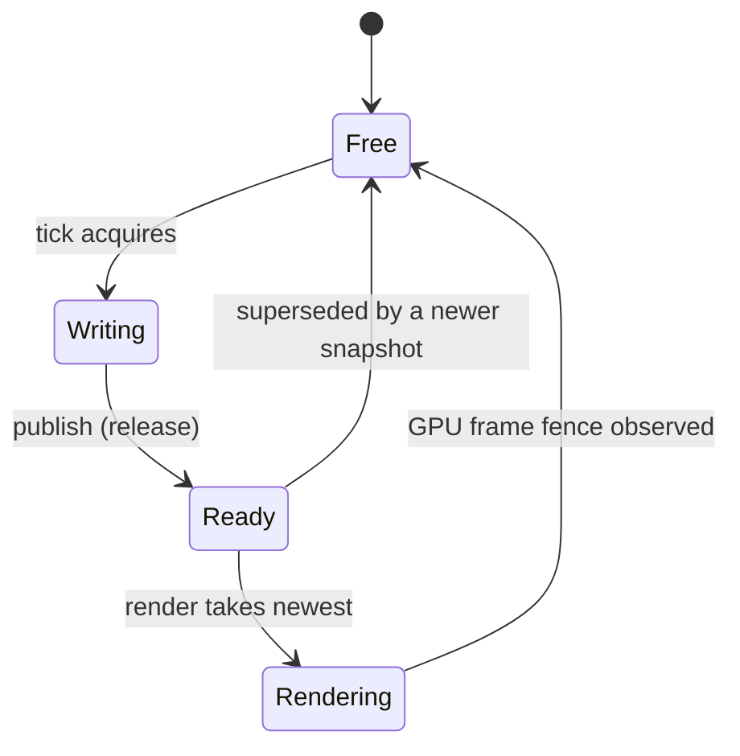

# M7 — Frame Handoff and Pacing (spec)

> **Status:** **Draft — owner decisions recorded (22 answers, 2026-10-31, revised).** This file defines
> the proposed scope, semantics, evidence, work packages, and the decision register for M7 (frame
> handoff and pacing). **Fourteen of the twenty-three questions plus eight follow-ups are answered**
> (§16.0): Q1=A1, Q2=B1, Q3=C2, Q4=D1, Q5=E1, Q7=G1, Q8=H1 + a 30 Hz minimized tick cap, Q9=I1,
> Q10=J1, Q11=K1, Q12=L2 (fully synthesized headless clock), Q13=M4 (strict grid, pure `Sleep`),
> Q14=N1, Q15=O2 (120-tick default); F1–F8 (F5 first tick 0/0, F6 positive headless rate, F7 no
> clamp, F8 unbounded catch-up). **F6 supersedes D-017's `0` uncapped headless rate.** **Open:** Q6
> and Q16–Q23. Nothing in this milestone is implemented. §4 (inherited constraints) and the baseline
> facts in §3 are binding; §16.0 records the owner's answers, which are **not yet in the decision log**
> (WP-1 records them as `D-M7-01…`).
>
> M7 is roadmap [M7 — Frame handoff and pacing](../roadmap.md#5-milestone-detail): a bounded run-ahead
> snapshot ring for windowed/offscreen, plus timer-paced headless. M6 (Vulkan bring-up) is merged
> (`5de725c`, 2026-10-31, PR #11). M8 (sprite renderer) follows and consumes the snapshots this
> milestone introduces.

## 1. Goal

M7 adds the missing middle between the tick thread and the M6 renderer:

- the tick thread **captures one immutable snapshot per tick** (after `Tick`, with game workers
  joined) and publishes it into a **three-slot ring**;
- the render thread **consumes the newest ready snapshot**, renders/holds it, and **releases the slot
  only after the GPU frame that used it is fenced**;
- the tick runs ahead **only up to the ring** and then waits for a free slot (frame backpressure);
  windowed/offscreen add **no target rate, deadline, or `Sleep`** — the builder's `WithMaxDeltaTime`
  gameplay clamp remains the only timing mitigation, with the single owner-approved exception of the
  30 Hz minimized tick cap (Q8/F4);
- **headless** runs a loop with **no ring and no renderer**, paced by a **positive** `ticksPerSecond`
  (default 60; `0`/negative rejected per F6), and no longer the M1 one-tick sequence;
- the M6 renderer stays a **clear-only** renderer; M7 changes *when and how often* it renders, not
  what it renders (sprites, pipelines, and draws are M8);
- capture and handoff are **allocation-free in steady state**, and shutdown with frames in flight is
  clean.

The milestone is done when the exit criteria in §13 are demonstrated, not when the code merges.

## 2. Milestone definition (from the roadmap)

- Three-slot ring (`Free/Writing/Ready/Rendering`); slots held until the GPU fence; tick waits only
  when full; newest `Ready` wins; older snapshots dropped.
- No target tick rate/deadline/`Sleep` in windowed/offscreen; the builder's `WithMaxDeltaTime`
  gameplay clamp only.
- Headless loop with no ring, paced by `ticksPerSecond` (default 60, `0` uncapped — revised by F6 to
  a positive rate).
- Capture after `Tick`: unordered traversal into internal value-only `CameraSnapshot` /
  `SpriteSnapshot`, layer flattening, immutable snapshots.
- Two GPU frames in flight; instance/command resources; resize/close/error handling; shutdown with
  in-flight frames; no per-frame allocations.
- Stress tests: fake fences, slot invariants, pacing, headless timer.

**Owner-approved changes to the roadmap bullets:** the headless clock is fully synthesized
(Q12=L2), the first tick is 0/0 (F5), `ticksPerSecond` must be positive (F6, superseding D-017's
`0` uncapped), `WithMaxDeltaTime` does not clamp headless deltas (F7), catch-up is unbounded (F8),
and the minimized 30 Hz tick cap (Q8/F4) is the only new windowed target rate.

**Exit (roadmap):** tick/render overlap with at most ring-depth run-ahead; no sleeps in
windowed/offscreen (except the minimized tick cap); newest snapshot wins; headless honors its rate;
10k-frame stress has no deadlock/slot leak; AOT headless loads a pack, ticks, exits.

## 3. Current baseline at spec time (2026-10-31)

### 3.1 Code and test facts

M6 is merged into `develop` at `d37c02a` (finalize commit; milestone merge `5de725c`). The tree
contains:

| Area | Current state | M7 consequence |
| --- | --- | --- |
| Engine suite | **1044** tests = 1028 deterministic + 16 opt-in/conditional (9 `[WindowFact]`, 3 reparse-point, 4 `[GpuFact]`). | M7 adds deterministic ring/capture/pacing tests and rewrites GPU handoff tests (§9). |
| `Pong.Tests` | **41** tests. | Headless/offscreen expectations may change with the loop and pacing answers (Q11, Q12, Q15). |
| Scene | Root-owned unordered tree; cameras/sprites are transforms with per-object locks; `Transform.WorldMatrix()` is internal; **no child enumeration and no snapshot types** (D-023, D-026). | Capture requires an internal unordered traversal and the snapshot model (§6.3). |
| `Bork2d.Render` | Internal `IRenderer` seam and factory; SPSC control/fatal channel; windowed and offscreen renderers with **two frames in flight**, 3 swapchain images / 2 offscreen images, dynamic-rendering clear, present/discard; counters; validation. | The renderer gains snapshot consumption/release and a new wait reason (§6.6). |
| Host | Windowed/offscreen: renderer started before `Setup`, first `Tick` after readiness (D-M6-06); offscreen loops until `Exit` and advances `ITime` (D-M6-07); renderer joined before surface/instance/window destruction; error precedence per M6. | The loops gain slot acquisition/publish/backpressure and a new blocked-wait error path (§7). |
| Headless | One `Setup` → one `Tick` → `Teardown`; clock not advanced; `Exit` ignored; no SDL, Vulkan, renderer, or capture. | Replaced by a loop until `Exit` with a fully synthesized clock (`Time = tickIndex / rate`, `DeltaTime = 1 / rate`), a pure-`Sleep` strict grid, and catch-up to system time (Q11=K1, Q12=L2, Q13=M4/F1). |
| Builder | `WithHeadless(int ticksPerSecond = 60)` stores the rate; today `0` uncapped is accepted and the mode runs one tick. | Q11=K1 makes the rate effective; F6 requires `> 0` (rejecting `0`); no new builder option is implied. |
| Renderer start info | Opaque instance/surface handles, extent, vsync, validation, logger factory, replacement-surface callback. | The renderer owns the ring and exposes a slot API (Q1=A1); the host fills slots through Engine capture. |
| Test seams | `FakeRenderer`, `FakeSdlApi`, `FakeVulkanInstance`, `[GpuFact]`/`[WindowFact]`; bounded joins; no sleeps. | `FakeRenderer` models the renderer's slot API, publication/release, and fences deterministically. |
| Pong gate | Published `--headless`, `--windowed --ticks 120`, `--offscreen --ticks 120` exit 0; headless asserts exactly one tick; offscreen ticks are uncapped and its frame count is not asserted. | Headless becomes `--headless`, defaulting to 120 ticks, with `--ticks N` overriding (Q15=O2/F3); windowed/offscreen gates are backpressured (Q22). |

### 3.2 Environment facts

Same local machine as the M6 evidence: Windows 11 Pro 10.0.26300; AMD Ryzen AI MAX+ 395 with Radeon
8060S (Vulkan device API 1.4.359, driver 32.0.32015.7029); Vulkan loader/SDK 1.4.363.0 with
`VK_LAYER_KHRONOS_validation`; .NET SDK `11.0.100-rc.1.26425.128` pinned by `global.json`. These are
environment facts, not portable requirements. GPU tests and the AOT gate remain local-only (D-M6-05).

### 3.3 Stale statements this milestone must reconcile (found while writing this spec)

These are documentation defects, not M7 decisions; Q18 asks how to handle them.

| Location | Statement | Reality |
| --- | --- | --- |
| `IEngine.Time` XML doc (`Bork2d.Engine/IEngine.cs`) | "Headless and offscreen apps run one tick and never advance the clock". | Offscreen advances `ITime` per tick since D-M6-07; M7 makes headless a loop with a synthesized clock (K1/L2). |
| `IEngine.Exit` XML doc | "Headless and offscreen keep the M1 one-tick behavior and ignore the request". | Offscreen honors `Exit` since D-M6-07; headless honors it after K1. |
| [API reference §4](../api/reference.md#4-itime), §12; [guide §2](../api/guide.md#2-start-the-engine), §8 | Headless one tick, zero clock, `Exit` ignored. | Changes with K1/L2 (loop, synthesized clock, `Exit` honored, first tick 0/0). |
| [Runtime lifecycle §2](../architecture/runtime-lifecycle.md#2-modes), [§5](../architecture/runtime-lifecycle.md#5-tick-loop-and-pacing) | Headless one-tick, `Exit` ignored, "pacing is M7". | Changes with K1/L2/F5. |
| [API reference §12](../api/reference.md#12-runtime-surface), [guide §2](../api/guide.md#2-start-the-engine), [runtime-lifecycle §3](../architecture/runtime-lifecycle.md#3-builder-options-and-validation) | `WithHeadless(0)` = uncapped. | F6 rejects `0` in headless; the docs and the `Build()` validation change. |
| [Overview §6](../architecture/overview.md#6-invariants) invariant 18 | Headless "remains one-tick". | Changes with Q11. |
| [Roadmap](../roadmap.md) Runtime row and runnable-engine row | "headless one-tick host". | Changes when M7 lands. |
| [Threading §3](../architecture/threading.md#3-frame-snapshot) | `SpriteSnapshot` holds "flip flags". | Q2=B1 makes this true: M7 adds public `FlipX`/`FlipY` and captures them. |
| [Roadmap M7](../roadmap.md#5-milestone-detail) | "Two GPU frames in flight; instance/command resources". | Q10=J1: M7 adds the unused instance SSBO/descriptor set; M8 adds the pipeline/draw. |
| [Rendering §9](../architecture/rendering.md#9-synchronization-and-presentation) | "Presentation happens every frame, not on a new snapshot; snapshot coupling is M7". | Q7=G1: one frame per consumed snapshot; the coupling clause is replaced in M7. |

## 4. Inherited constraints (facts, not new decisions)

| Constraint | Source |
| --- | --- |
| Exactly **three** snapshot slots with `Free → Writing → Ready → Rendering → Free`; the tick runs ahead while slots are free and waits only when the ring is full; newest `Ready` wins; no target tick rate or `Sleep` in windowed/offscreen. | D-003; [Threading §4](../architecture/threading.md#4-triple-buffer-handoff) |
| Snapshots are **internal, immutable after publication, value-only**, built by an **unordered** traversal after `Tick`, with layers flattened to a bit mask, world transforms evaluated by the tick thread, and the renderer sorting. | D-026; [Threading §3](../architecture/threading.md#3-frame-snapshot) |
| A snapshot is the renderer's complete input: `FrameSnapshot` (sequence/time/delta + cameras + sprites), `CameraSnapshot` (ZIndex, world matrix, size, viewport, culling mask, clear kind/color), `SpriteSnapshot` (loaded `SpriteAsset?` reference, world matrix, tint, layer, ZIndex, and `FlipX`/`FlipY` per Q2=B1). | [Threading §3](../architecture/threading.md#3-frame-snapshot) |
| Two GPU frames in flight; windowed uses 3 swapchain images (`minImageCount + 1`, clamped), offscreen two permanent sRGB images; per-frame command buffer/pool, fence, semaphores. | D-M6-11; [Rendering §9](../architecture/rendering.md#9-synchronization-and-presentation) |
| Windowed/offscreen ticks are variable-timestep: `DeltaTime` is wall-clock between tick starts, clamped by `WithMaxDeltaTime` (default 0.25 s), first tick `0`; no accumulator, no render interpolation. | D-004; [Runtime lifecycle §4](../architecture/runtime-lifecycle.md#4-time) |
| `Setup` runs before renderer readiness and is never skipped because the renderer failed; no `Tick` runs before readiness; a renderer failure around `Setup` runs zero ticks and attempts `Teardown` (D-M6-14); errors keep the M2 precedence. | D-M6-06, D-M6-14; [Runtime lifecycle §6](../architecture/runtime-lifecycle.md#6-shutdown-and-error-propagation) |
| The render thread never calls SDL and never reads live scene state; the OS/window thread owns SDL, the windowed instance/surface; the renderer is stopped/joined before the surface/instance/window are destroyed. | D-M6-09, D-M6-25; [Threading §1](../architecture/threading.md#1-threads-by-mode) |
| Headless never calls SDL or the Vulkan loader and creates no renderer; `WithHeadless` and `WithOffscreen` are mutually exclusive with each other and with window options; the headless rate is `>= 0`, `0` uncapped — **F6 (owner) revises this to `> 0`**, superseding D-017's headless-uncapped clause. | D-017 as revised by F6; [Overview §6](../architecture/overview.md#6-invariants); [Runtime lifecycle §2](../architecture/runtime-lifecycle.md#2-modes) |
| Windowed/offscreen run the real renderer; offscreen loops until `Exit` and advances `ITime`; frames clear/discard; no public readback. | D-M6-02, D-M6-07, D-M6-23; [Runtime lifecycle §2](../architecture/runtime-lifecycle.md#2-modes) |
| Tick-scoped scene mutation: workers join before `Tick` returns; the capture point is quiescent; per-object/structural locks use `System.Threading.Lock`; snapshots carry no entity references. | D-015, D-024; [Threading §2](../architecture/threading.md#2-tick-scoped-concurrency) |
| Scene objects are root-owned with no `Dispose`/`IsAlive`; detach and re-attach the same instance; the tree is unordered with no entity IDs. | D-023, D-026; [Scene ownership §4](../architecture/scene-ownership.md#4-renderer-and-snapshot-relationship) |
| The public contract is `Bork2d.Engine` + `Bork2d.Runtime`; `Bork2d.Render` is internal; no SDL/Vulkan type leaves the implementation; game code references no renderer project. | D-001, D-034; [Projects §3](../architecture/projects.md#3-public-surface-and-assembly-visibility) |
| Runtime projects are NativeAOT/trim-safe with zero AOT/trim warnings; AOT publish/run is a required local gate, not CI; GPU tests are opt-in and local. | D-016, D-M6-05; [NativeAOT](../architecture/nativeaot.md); AGENTS.md §7 |
| Warnings/style/format/docs are gates; same-change docs; no unjustified suppressions; no `Thread.Sleep` in windowed/offscreen except the minimized 30 Hz tick cap (Q8/F4) and headless pacing (the AGENTS §8 exception). | D-022; [Contributing](../contributing.md); AGENTS.md §7–§8 |

**Owner-approved exceptions recorded in §16.0 (2026-10-31):**

- The minimized **tick-loop** cap (Q8/F4: 30 Hz while the window is minimized) is a deliberate,
  minimized-only exception to "no target rate/deadline in windowed/offscreen"; it must not become a
  general frame limiter.
- Headless pacing (Q13: M4 strict grid, F1 pure `Thread.Sleep`) and the synthesized headless clock
  (Q12: L2: `Time = tickIndex / rate`, `DeltaTime = 1 / rate`) are the AGENTS §8 headless timer
  exception; `WithMaxDeltaTime` remains the gameplay clamp but **does not apply in headless (F7)**.
- F6 requires a positive headless rate, so `WithHeadless(0)` becomes a `Build()` error (a public
  validation change that supersedes D-017's uncapped clause); F5 fixes the first tick at 0/0; F8
  makes catch-up unbounded.
- Q2 (B1) adds public `FlipX`/`FlipY` to `ISpriteRender<TLayer>` under D-014; the same change must
  update the API guide/reference and tests.

**Baseline the milestone must not break:** windowed and offscreen still clear/present/discard; the
builder surface and its validation stay unchanged except the Q2 flip members, the F6 positive
headless rate, and any Q16 change the owner approves; headless still never touches SDL/Vulkan (and
now loops per Q11); the M6 error precedence and validation policy still hold; the AOT publish still
contains no tooling assembly and no `vulkan-1.dll`.

## 5. Scope

### 5.1 In scope

- Internal snapshot model (`FrameSnapshot`, `CameraSnapshot`, `SpriteSnapshot`, layer flattening) and
  the capture pass over the rooted tree, after `Tick`, with game workers joined. The snapshot types
  live in `Bork2d.Engine`; the ring/slot state lives in `Bork2d.Render` (Q1=A1).
- Public `ISpriteRender<TLayer>.FlipX`/`FlipY` (Q2=B1), captured by M7 and drawn by M8.
- The three-slot ring: acquire/fill/publish on the tick side; take/hold/release on the render side;
  newest-wins supersession; bounded run-ahead; wake/no-spin waits. One GPU frame per consumed
  snapshot (Q7=G1).
- Tick-side backpressure wired into the windowed and offscreen loops in the order that preserves
  input freeze, text dispatch, time, and `Tick` semantics.
- Renderer consumption of snapshots, slot lifetime to the GPU fence, graceful stop/fatal release,
  resize/fullscreen/minimize/surface-loss interaction with held slots, and shutdown with frames in
  flight. While minimized, the suspended consumer drains the newest snapshot without GPU work and
  the tick loop is throttled to 30 Hz (Q8/F4).
- The per-frame instance SSBO and frame descriptor set, empty/unused until M8 (Q10=J1).
- A headless driver that loops until `IEngine.Exit()`, paced by a **required positive**
  `ticksPerSecond` (default 60; `0` rejected per F6) with a **fully synthesized clock** (first tick
  0/0, F5; `Time = tickIndex / rate`, `DeltaTime = 1 / rate`; no clamp, F7; unbounded catch-up, F8),
  a strict grid, pure `Thread.Sleep`, with no ring, no capture, no renderer, and no SDL/Vulkan
  (Q11=K1, Q12=L2, Q13=M4/F1).
- Internal counters/logs for snapshots published/consumed/dropped, run-ahead, and backpressure
  waits; no per-frame logging.
- Deterministic tests (ring state machine, producer/consumer stress, capture, flips, suspended
  consumption, strict-grid pacing/catch-up with an internal clock seam) and opt-in real-GPU handoff
  tests.
- Pong/AOT gate updates required by the headless and handoff behavior, and the documentation and
  decision-log changes in §11.

### 5.2 Out of scope (deferred)

- Sprite pipeline, shaders, bindless pages, draw-side instancing/instance records, sorting/filtering,
  per-camera draws, camera projection/viewport math, `Clear.Color`/`Clear.None` behavior, drawing
  flips: **M8** (M7 captures the data and creates the empty frame resources per Q10=J1; Q5 decides
  whether any derived camera data is captured early).
- Public offscreen readback/capture/screenshots, recording: M8/M10.
- Depth, MSAA, HDR, post-processing, KTX2, mipmaps, compute, indirect draws, indexed non-Quad draws.
- Device-loss recovery, device override/multi-GPU, transfer queues: M10.
- Fixed-timestep simulation, accumulators, render interpolation, per-tick catch-up in windowed/
  offscreen: not planned (D-004).
- Multi-window, Linux/macOS guarantees, hot reload, editor/preview.
- Pack format, TOML/bake, asset loading, VFS/overlays: unchanged (no new dependency).
- A general-purpose allocator, GPU timestamp queries, or a public frame/diagnostics API (Q16).

## 6. Architecture

> **Reading note.** The responsibilities and the ring protocol below are the target already documented
> in [Threading §3–§4](../architecture/threading.md#4-triple-buffer-handoff); they are restated so the
> milestone is self-contained. **Answered in §16.0 (2026-10-31):** Q1=A1, Q2=B1, Q3=C2, Q4=D1,
> Q5=E1, Q7=G1, Q8=H1 + a 30 Hz minimized tick cap, Q9=I1, Q10=J1, Q11=K1, Q12=L2, Q13=M4/F1,
> Q14=N1, Q15=O2/F3. **Still open:** Q6 (slot array capacity) and Q16–Q23 (public additions,
> decisions/docs, tests, gate assertions, WP plan). F5–F8 are answered (first tick 0/0, positive
> rate, no clamp, unbounded catch-up); F6 supersedes D-017's `0` uncapped headless rate.

### 6.1 Modules, ownership, and boundaries

Regardless of Q1, the responsibilities are fixed by the target design:

| Piece | Responsibility | Boundary |
| --- | --- | --- |
| Snapshot model (`FrameSnapshot`, `CameraSnapshot`, `SpriteSnapshot`, layer mask) | Internal value types holding one tick's renderer input. Immutable after publication. | Never public; no entity references; may hold the loaded `SpriteAsset?` reference. |
| Capture pass | Unordered traversal of `IEngine.Root`, evaluates world matrices, copies properties, flattens layers, fills a slot's pooled arrays. Runs on the tick thread after `Tick`. | Engine-internal scene access; no Vulkan/Render dependency. |
| Slot ring and slot state machine | Ownership of the three slots, `latest`, publish/take/release, wait/wake. | `Bork2d.Render` (Q1=A1); lock-free state transitions; no Vulkan call while holding a lock. |
| Snapshot capture API | Engine-internal entry point the host calls to fill a renderer-owned slot from the rooted scene. | Engine scene access; no Render/Vulkan dependency. |
| Renderer consumption | Takes the newest `Ready` snapshot for a free GPU frame, keeps it until that frame's fence, releases it. | Render-internal; never reads scene entities; uses only snapshot values/assets. |
| Host integration | Acquire before the tick, capture after `Tick`, publish; observe fatal/stop; shut down in order. | `Bork2d.Runtime` composition root. |
| Headless driver | Paced loop with no ring/capture/renderer. | `Bork2d.Runtime`; no SDL/Vulkan call. |

Boundary rules (inherited, enforced by the dependency test and review):

- Q2=B1 adds public `FlipX`/`FlipY`; no other new public type or member unless Q16 approves one.
  `Bork2d.Engine` remains free of Vulkan, Silk, SDL, and renderer types; it gains an internal
  snapshot/capture implementation.
- `Bork2d.Render` still references only `Bork2d.Engine` + `Silk.NET.Vulkan*`; it never references
  `Bork2d.Runtime`, `Bork2d.Bake`, or SDL. Under Q1=A1 it owns the slot ring and exposes an internal
  slot API; the snapshot types are the Engine's internal types.
- `Bork2d.Runtime` sees both sides; no renderer/snapshot type appears in a public signature. The
  internal `IRenderer` seam may grow (take/publish/release/wake) without a public contract change.
- Q1=A1 adds no project or package: the existing `Bork2d.Engine` internals remain visible to
  `Bork2d.Render`, and the renderer owns the ring. No dependency-matrix or publish-graph change is
  expected.
- New source folders follow the folder-per-area namespace rule (IDE0130) and update
  [Projects §4](../architecture/projects.md#4-source-layout-and-namespaces).

### 6.2 Threads and object ownership

| Object | Created on | Owned/destroyed by | Notes |
| --- | --- | --- | --- |
| Snapshot slots and their arrays | First app run (or lazily on first capture) | `Bork2d.Render` (Q1=A1) | Per-slot pooled arrays; never live entity references; released only after fences. |
| `Writing` slot | Tick thread | Tick thread | At most one; freed without publishing when `Tick`/capture throws. |
| `latest` index | Tick thread (single publisher) | Render ring (Q1=A1) | Atomic release/acquire; never points at `Writing`/`Free`. |
| GPU frame slot (command buffer/pool, fence, semaphores, instance SSBO, descriptor set) | Render thread | Render thread | Reused only after its fence; Q10=J1 adds the instance SSBO/descriptor set empty in M7. |
| Renderer slot API | Render (Q1=A1) | Render | The host asks for a free slot, fills it through Engine capture, and publishes; Render releases at fences; no Vulkan types cross. |
| Headless pacer/clock | `Run()` caller thread | Same | No thread; no ring; Q13=M4 strict grid; the wait primitive is F1. |

Rules:

- The tick thread is the **only producer**; the render thread is the **only consumer**; ownership
  transfers by release/acquire publication and CAS state transitions, not by locks.
- The render thread never reads scene entities or `Transform` values; it reads only a snapshot in
  `Rendering` state and the loaded asset values that snapshot references.
- The capture runs after `Tick` returns, with all game workers joined (D-015); it uses the existing
  structural/per-object locks and must not introduce a new lock order or hold a lock across a wait.
- No lock is held across a Vulkan call, a fence wait, a backpressure wait, or a game callback.
- Start/stop are synchronous from the host's point of view: no renderer thread outlives `Run()`;
  `Join()` returns only after the renderer thread has finished.

### 6.3 Snapshot model and capture

**Types (internal, in `Bork2d.Engine` per Q1=A1; fields per Threading §3 plus the open Q6).**

| Type | Fields | Notes |
| --- | --- | --- |
| `FrameSnapshot` | `Sequence` (monotonic, starts at 1), `Time` (double), `DeltaTime` (double), camera array/count, sprite array/count | One per completed tick in windowed/offscreen. `Time`/`DeltaTime` are the tick's `ITime` values at capture. |
| `CameraSnapshot` | `ZIndex` (int), `WorldMatrix` (`Matrix3x2`), `Size` (float), `Viewport` (`Vector4`), `CullingMask` (uint), `Clear` (`ClearKind`), `ClearColor` (`Color`) | The world matrix is the camera's world transform; M8 inverts/composes the view-projection (Q5=E1). |
| `SpriteSnapshot` | `Sprite` (`SpriteAsset?` reference), `WorldMatrix` (`Matrix3x2`), `Tint` (`Color`), `Layer` (uint single bit), `ZIndex` (int), `FlipX`/`FlipY` (public members, Q2=B1) | `Sprite == null` is captured and skipped at draw time (M8). `Layer` is the single-bit mask; invalid values per Q3. |

**Capture rules (fixed by the target design):**

- Runs on the tick thread **after `Tick` returns**; the tick is the quiescence boundary. A node
  detached during `Tick` is absent from that tick's snapshot; a node created and attached during
  `Tick` is present. No capture before the first tick or after `Teardown` starts.
- **Unordered traversal** of the rooted tree: no entity IDs, no stable order, no child enumeration
  exposed publicly. The renderer will sort by `(Layer, ZIndex)` in M8; M7 does not sort.
- **World transforms only**: the tick thread evaluates the parent hierarchy and writes the final
  matrix; no `Transform`/`Camera`/`SpriteRender` reference crosses the boundary.
- **Layer erased**: `TLayer` (int-backed flags) becomes a `uint` mask/bit so the renderer is
  non-generic; a renderable carries exactly one bit. Q3=C2 captures invalid values (`0`/multi-bit)
  as-is; M8 skips them at draw time with the diagnostic.
- **Asset-agnostic**: no textures, vertices, or derived sprite metadata in the snapshot; the renderer
  resolves `SpriteAsset.Texture`/`TextureDescriptor.Payload` at draw time (M8).
- **Immutable after publication**: the tick writes only its `Writing` slot; the renderer reads only
  a `Rendering` slot; a slot is never overwritten while published or referenced by a GPU frame.
- **Pooled capacity**: each slot owns its arrays; after warm-up a capture allocates nothing
  (Q6 covers the initial/growth policy). Capture must not use LINQ, boxing, or per-node allocation.
- **Locking**: the traversal must respect the existing structural-then-per-object lock order and must
  not deadlock or take the structural lock reentrantly without proving that safe; holding the
  structural lock for the whole traversal is allowed only if it cannot block a game callback. The
  capture adds no new lock ordering (D-024).

### 6.4 Ring protocol and invariants

**States.** `Free` (available), `Writing` (tick owns it), `Ready` (published, unread), `Rendering`
(submitted or about to be submitted; held until the GPU frame fence). A `Ready` slot is unread; a
`Rendering` slot is never freed by the producer.



**Producer (tick thread), per tick:**

```text
slot = renderer.AcquireSnapshotSlot()   // blocks while all slots are Ready/Rendering
input.Freeze()                          // windowed only
time.NewFrame()                         // windowed/offscreen only
input.DispatchText()                    // windowed only
game.Tick()                             // joins game workers before returning
engine.CaptureSnapshot(slot, sequence, time, delta)
renderer.PublishSnapshot(slot)          // Ready (release); newest wins; previous Ready dropped
```

`PublishSnapshot` publishes with release, exchanges `latest`, and CAS-frees the previous `Ready`; it
never frees `Rendering` (invariant 5). On a `Tick`/capture exception the `Writing` slot returns to
`Free` and nothing is published; the existing host error precedence applies.

**Consumer (render thread), per frame:**

```text
ProcessControlMessages()            // extent/fullscreen/minimize/recreate, stop, fatal
WaitForSnapshotOrControl()          // blocked, not spinning
frame = WaitForFreeGpuFrameSlot()   // waits the frame fence; releases that frame's snapshot slot
slot = TakeLatestReady()            // CAS Ready -> Rendering; clears latest only if it points here
if slot is null: continue
BuildGpuFrame(slot, frame)          // M7: the clear pass; M8 adds resolution/sort/instances
Submit(frame)                       // GPU reads the frame's resources
OnFence(frame): Release(slot)       // Rendering -> Free; wakes the producer
```

The renderer takes a GPU frame slot **before** taking a snapshot, so it never holds a snapshot while
blocked on the GPU. `TakeLatestReady` clears `latest` when it still points at the taken slot; a newer
snapshot published concurrently wins the compare-exchange and remains latest.

**Slot invariants (Threading §4).**

1. At most one slot is `Writing`.
2. A slot is never `Writing` and `Rendering` at the same time.
3. A slot in `Rendering` is not reused until its GPU frame fence signals.
4. `latest` is either `-1` or a `Ready`/`Rendering` slot, never `Writing`/`Free`; the consumer clears
   it when it takes that slot.
5. Publishing frees at most the immediately previous `Ready` slot; it never frees `Rendering`.
6. Every slot returns to `Free` after its GPU frame completes (including stop/fatal paths).
7. A GPU frame's resources are not overwritten until its fence signals.
8. No thread blocks while holding a CAS-relevant state that another thread needs to progress.

**Bound and run-ahead.** With exactly 3 slots and at most 2 GPU frames in flight:
`Writing ≤ 1`, `Rendering ≤ 2`, `Ready ≤ 1`, and **completed-but-not-retired snapshots
(`Ready + Rendering`) ≤ 3**. The producer blocks exactly when `Free == 0`; because `Ready ≤ 1` and
`Rendering ≤ 2`, that state is 2 `Rendering` + 1 `Ready`. This structurally bounds run-ahead; no
timer participates. Tests must instrument the maximum live-slot count and assert the bound (§9).

**Waiting and memory ordering.** Slot contents are written before the slot is published as `Ready`
(release); the consumer's take is an acquire. Slot release is a release. `Interlocked`/`Volatile`
release/acquire on the slot state and `latest`; no lock is held across a wait. Waits are event-based
(no `Thread.Sleep`, `SpinWait`, deadline, or timed polling in the normal windowed/offscreen path) and
must wake on a released slot, a renderer fatal, a renderer stop, and an exit/shutdown request (Q9=I1:
wake and return failure, zero extra ticks).

### 6.5 Tick-side integration

Order per tick in windowed mode (offscreen is the same without the input steps):

1. **Acquire a free slot from the renderer** (Q1=A1; blocks only when the ring is full). Acquiring
   **before** `input.Freeze()` and `time.NewFrame()` preserves two existing semantics: input/mouse
   edges that arrive while the tick is backpressured accumulate for the next freeze and are not lost,
   and `DeltaTime` measures the real interval between tick starts (the clamp still applies, D-004).
2. `input.Freeze()`; `time.NewFrame()`; `input.DispatchText()`; `IGame.Tick()` (unchanged order).
3. **Capture** into the acquired slot after `Tick` returns (Engine-internal capture).
4. **Publish** the slot through the renderer (newest wins; the previous `Ready` is dropped).
5. Loop boundary: `Exit`/close, renderer fatal, platform fatal (unchanged check points).
6. On an exception from `Tick` or capture: free the slot, no publish, existing teardown/error
   precedence. `Teardown` runs once when `Setup` succeeded; the renderer is stopped/joined
   afterwards and drains any in-flight frames.

The final tick's snapshot on `Exit`/close is **Q4=D1: publish it**; only a `Tick`/capture exception
skips publication. The host must not capture before the first tick (renderer readiness gate) or after
`Teardown` starts. Headless performs no capture and has no ring.

### 6.6 Renderer-side integration

- The renderer waits for a `Ready` snapshot (or control/stop/fatal) instead of rendering
  continuously; it takes a free GPU frame slot first, takes the newest `Ready`, records the M6 clear
  pass (one dynamic-rendering pass, one sRGB attachment, opaque black, `storeOp = STORE`), submits,
  presents (windowed) or discards (offscreen), and releases the snapshot slot when the frame's fence
  has signaled (observed when the frame slot is next reused, or by the stop/fatal drain).
- **Frame drive (Q7=G1):** exactly one GPU frame per consumed snapshot. With no `Ready` snapshot the
  renderer waits; it does not repeat or re-present the previous snapshot. The window updates at the
  tick/capture rate and the tick is backpressured by the GPU; with vsync the present rate bounds the
  tick (which runs at most ring-depth ahead).
- **Suspended consumption (Q8=H1 + 30 FPS tick cap):** while minimized/zero-extent the renderer
  keeps taking the newest `Ready` snapshot and frees it **without GPU work**; a dropped snapshot
  never enters `Rendering` and no fence is involved. The **windowed tick loop** is throttled to
  30 Hz while minimized (F4=tick-loop only), so ticks continue at ≤30 Hz and the suspended drain is
  naturally bounded; the host applies the 30 Hz tick deadline and reuses the F1 pure-`Sleep` wait.
  The 30 Hz cap is minimized-only and must not become a general frame limiter; windowed/offscreen
  otherwise have no target rate. The 30 Hz grid starts when minimization begins and is discarded on
  restore; there is no catch-up burst for the minimized period. The renderer waits on control/stop,
  never a spin.
- **Recreation/surface loss**: `vkDeviceWaitIdle` on recreation completes the in-flight fences; the
  frames are reusable and their snapshot slots are released. The M6 one-attempt surface recovery
  policy is unchanged; a second loss or device loss stays fatal.
- **Stop/fatal**: the renderer wakes the producer, stops consuming, waits/drains in-flight frames,
  releases every `Rendering` slot to `Free`, and joins. A fatal is published once and observed by the
  host at the next boundary; renderer cleanup failures remain logged-only (D-M6-27).
- **Instance/descriptor resources (Q10=J1):** each frame slot gains the instance SSBO and frame
  descriptor set now, created empty/unused. M7 still adds **no draws**, no shaders, no texture pages,
  and no descriptor updates; M8 fills them.
- **No per-frame logging or allocations**; counters are updated with `Interlocked`/`Volatile`.

### 6.7 Headless driver

Headless has no renderer, no ring, no capture, and no SDL/Vulkan call. The roadmap requires a loop
with no ring, paced by a **positive** `ticksPerSecond` (default 60; `0` rejected per F6). Recorded
answers (§16.0):

- **Loop shape (Q11=K1):** `assetService.Start()` → `Setup` → `Tick…` → `Teardown` until
  `IEngine.Exit()` (server semantics; `Setup`-time `Exit` runs zero ticks per D-M2-19), with the
  M2/M6 error precedence. A run that never calls `Exit` continues until the process is stopped.
- **Time (Q12=L2 + F5/F7):** headless `ITime` is **fully synthesized** and does not read the real
  clock. Tick 0 reports `Time = DeltaTime = 0`; tick N >= 1 reports `Time = N / ticksPerSecond` and
  `DeltaTime = 1 / ticksPerSecond`. `WithMaxDeltaTime` does **not** clamp the synthesized step
  (F7). The pacer uses system time only to schedule ticks and to catch up.
- **Pacing (Q13=M4 + F1/F8):** a strict absolute deadline grid from the monotonic scheduler clock;
  tick N is due at `start + N × period`. When behind, the pacer runs every missed tick back-to-back;
  each catch-up tick advances the synthesized `Time`/`DeltaTime` by the step, so the synthesized
  clock catches up with system time. Catch-up is **unbounded** (F8): a long suspension produces a
  large burst. The wait is **pure `Thread.Sleep`** (F1); a sleep is not interrupted, so shutdown
  latency is bounded by one period (about 16.7 ms at 60 Hz).
- **Rate type (Q14=N1 + F6):** the integer `ticksPerSecond` stays and must be `> 0` in headless;
  no fractional public rate and no uncapped `0`.
- **Pong gate (Q15=O2 + F3):** `--headless` defaults to 120 ticks; `--headless --ticks N` overrides.
- **No ring/capture**: headless never builds a snapshot (Threading §3); the renderer is not created
  and the Vulkan loader is not touched.
- `WithHeadless(0)` is rejected by `Build()` (F6); the loop always has a positive period and still
  checks `Exit`/errors at each boundary.

### 6.8 Startup, shutdown, and error matrix (M7 changes only)

| Situation | Where detected | Behavior (pending the noted answers) |
| --- | --- | --- |
| Renderer fatal while the tick is blocked in the ring wait | Ring wait / host | Q9=I1: the wait wakes; no new tick starts; the host runs `Teardown` once (if `Setup` succeeded), stops/joins the renderer, stops the platform/assets, and rethrows the renderer `Bork2dException`. |
| Renderer stop while the tick is blocked | Ring wait / host | Q9=I1: the wait returns failure; the loop starts no further tick and publishes nothing; shutdown proceeds. The normal host path stops the renderer only after the loop has finished, so this is the fatal/race case. |
| `Tick` throws after acquiring a slot | Tick thread | The `Writing` slot returns to `Free`; no publish; the M2/M6 error path (teardown once, renderer joined, original exception) is unchanged. |
| Capture throws | Tick thread | Same as a `Tick` failure; the slot is freed and the exception is reported as the loop failure. |
| `Teardown` throws | Tick thread | Unchanged aggregation with a `Tick` failure; the renderer drains and releases all slots; the run's existing outcome stands. |
| `Exit`/close during a tick | Tick thread | Q4=D1: the tick completes and publishes; the loop stops before the next acquire; `Teardown` runs once; the renderer drains. |
| Minimized/zero extent | Tick thread + render thread | Q8=H1: the renderer consumes/frees the newest snapshot without GPU work; the tick loop is throttled to 30 Hz while minimized (F4); no frames; no busy loop, no deadlock. |
| Swapchain recreation / surface loss | Render thread | `vkDeviceWaitIdle`, frames reused, slots released; the M6 one-attempt surface recovery and its fatal cases are unchanged. |
| Renderer cleanup failure during shutdown | Renderer stop/join | Logged; the run's existing outcome stands (D-M6-27). |
| Headless `Setup`/`Tick`/`Teardown` failures | Tick thread | The windowed error precedence for the K1 loop with L2 synthesized time; no ring involvement. |

### 6.9 Allocation and performance

- **No steady-state allocations** in capture, publication, consumption, or the render frame. Arrays
  are slot-private and grown only when a new high-water mark is reached (Q6); no LINQ, no boxing, no
  per-node allocation, no per-frame delegate allocation.
- Capture cost is proportional to the number of cameras/sprites and the depth of their transforms
  (world-matrix evaluation); the existing per-object locks are the baseline. M7 must not add a
  per-frame traversal allocation or a second full-tree pass.
- The ring wait must not spin: a windowed/offscreen blocked tick consumes no CPU while waiting.
- Q10=J1 adds fixed per-frame instance memory (SSBO + descriptor set), unused until M8; it is
  allocated once per frame slot, never per frame. The minimized 30 Hz tick cap (Q8/F4) is a
  pure-`Sleep` deadline wait, not a spin; it must not burn CPU while minimized.
- Measure before/after for a representative scene (the method is part of the PR evidence); M8 owns
  the 50,000-sprite target.

### 6.10 Diagnostics, logging, and counters

New internal counters (exposed to tests, logged once at stop; no public API unless Q16):

| Counter | Meaning |
| --- | --- |
| Snapshots published | Completed ticks that published a snapshot. |
| Snapshots consumed | Slots taken by the renderer and submitted. |
| Snapshots superseded | Ready slots freed by a newer publish before consumption. |
| Backpressure waits | Times the producer had to wait for a free slot. |
| Max live snapshots | High-water mark of `Ready + Rendering` (must be `<= 3`). |
| Frames presented/discarded | Existing M6 counters; one per consumed snapshot (Q7=G1). |
| Suspended consumptions | Snapshots taken/freed without GPU work while minimized (Q8). |
| Ring waits / wake reasons | Debug counters for stop/fatal/slot wakes (optional internal). |

Events (one-shot, no per-frame/per-sprite lines), existing `Bork2d.Render` and `Bork2d.Runtime`
categories:

| Event | Level | Fields |
| --- | --- | --- |
| Renderer started (M7 fields) | Information | mode, handoff on, ring depth 3, frames in flight 2, one frame per snapshot (Q7=G1), instance resources on (Q10=J1) |
| Renderer stopped | Information | snapshots consumed/superseded, frames presented/discarded, validation counts, stop reason |
| Loop stopped (windowed/offscreen) | Information | ticks, elapsed, backpressure waits, max live snapshots |
| Headless stopped | Information | ticks, elapsed, rate, stop reason |
| Snapshot dropped by a newer publish | Debug (optional, e.g. first or sampled) | sequences; never per frame by default |
| Renderer fatal / stop while a tick waited | Error/Debug | operation, reason; the exception carries the detail |

No per-frame, per-sprite, or per-image logging; no logging inside the acquire/take/release hot path.

## 7. Runtime lifecycle integration

The lifecycle document ([Runtime lifecycle](../architecture/runtime-lifecycle.md)) must be updated in
the same change. The loop shapes become:

**Windowed** (M6 shape plus ring steps):

```text
assetService.Start()
platform.Start()                            // SDL window, Vulkan instance, surface
renderer = factory.Create(startInfo); renderer.Start()   // no readiness wait (D-M6-06)
attach window/input proxies; platform.AttachRenderer(renderer)
if (!Exit && !close) Setup(engine)          // may call Exit
if (!Exit && !close && no renderer failure) renderer.WaitForReady()
while (!Exit && !close && !rendererFatal && !platformFatal):
    slot = renderer.AcquireSnapshotSlot()   // NEW: blocks only when full; fails on fatal/stop (Q9)
    input.Freeze(); time.NewFrame(); input.DispatchText()
    game.Tick()
    engine.CaptureSnapshot(slot)            // NEW: after Tick, workers joined
    renderer.PublishSnapshot(slot)          // NEW: newest Ready wins
if Setup succeeded: Teardown()
renderer.RequestStop(); renderer.Join()     // drains frames; releases slots
platform.Shutdown(); assetService.Stop(); detach proxies
```

**Offscreen** is the same without the window, input, SDL, or platform; it still honors `Exit` and
advances `ITime` (D-M6-07).

**Headless** (Q11=K1, Q12=L2, Q13=M4/F1): `assetService.Start()` → `Setup` → paced `Tick…` until
`Exit` → `Teardown` → `assetService.Stop()`, with no platform, renderer, ring, or capture; `ITime`
is synthesized (`Time = tickIndex / rate`, `DeltaTime = 1 / rate`) and catches up with system time.

**Behavior and error changes to document:**

- Windowed/offscreen ticks are **backpressured by the ring**: a stalled renderer stalls the game at
  most ring-depth ahead. This is the intended replacement for the M6 uncapped loops. In steady state
  with vsync, presentation bounds the tick rate and the tick runs at most ring-depth ahead; "no
  target tick rate" means no timer, not that the tick ignores the renderer. The only owner-approved
  exception is the minimized tick cap (Q8/F4: the windowed tick loop is throttled to 30 Hz while the
  window is minimized; the suspended renderer still drains/drops snapshots without GPU work).
- Windowed/offscreen render **one frame per consumed snapshot** (Q7=G1), not a free-running
  continuous clear; while minimized the renderer consumes/drops snapshots without frames (Q8). The
  offscreen "uncapped, GPU-fence paced" wording of D-M6-12 is superseded.
- Headless **no longer runs one tick** (Q11=K1) and **reports a fully synthesized `ITime`**
  (Q12=L2: tick 0 = 0/0, tick N >= 1 = `N/rate` and `1/rate`; F5), paced by a strict grid with pure
  `Sleep` that catches up unbounded with system time (Q13=M4/F1/F8); the rate must be positive (F6)
  and `WithMaxDeltaTime` does not clamp the step (F7); `Exit` stops the loop; `--headless` defaults
  to 120 ticks and `--headless --ticks N` overrides (Q15=O2/F3).
- `Exit`/close during a tick still publishes that tick's snapshot (Q4=D1); a renderer fatal observed
  during a blocked ring wait wakes the tick, is reported at that boundary with no additional tick,
  and the M2/M6 error precedence is preserved (Q9=I1).
- No new public exception type; failures use `Bork2dException` (renderer/ring) or the game's own
  exception (capture/tick).
- `Setup` still runs before readiness and is never skipped because of the renderer; a readiness
  failure still runs zero ticks and attempts `Teardown` (D-M6-14).

## 8. Invariants added by M7

1. Windowed/offscreen publish **exactly one snapshot per completed tick**; headless publishes none.
   No snapshot exists before the first tick or after `Teardown` starts.
2. A published snapshot is **immutable** and contains no live entity reference (the loaded
   `SpriteAsset?` is the only object reference). Slot arrays are never written while `Ready` or
   `Rendering`.
3. Capture is **quiescent** (workers joined) and unordered; detached nodes are absent; world
   matrices are evaluated by the tick thread; layers are `uint` bits (invalid values preserved per
   Q3=C2 and skipped at draw time in M8).
4. Exactly **three** slots; at most two `Rendering`; `Ready + Rendering <= 3`; the producer waits
   only when `Free == 0`.
5. **Newest `Ready` wins**; a superseded `Ready` is freed; the producer never frees `Rendering`.
6. A **Rendering** slot is released only after its GPU frame's fence; every slot ends `Free`,
   including stop/fatal paths.
7. The producer wait is **event-based**; windowed/offscreen have no target rate, deadline, `Sleep`,
   `SpinWait`, or timed polling; `WithMaxDeltaTime` remains the only clamp. The single exception is
   the minimized tick cap (Q8/F4: the windowed tick loop runs at ≤30 Hz while minimized), which must
   not become a general limiter.
8. The blocked-tick path cannot deadlock: a renderer fatal/stop wakes it, the wait returns failure,
   and the host reports/joins cleanly with zero extra ticks (Q9=I1).
9. Windowed/offscreen render **one frame per consumed snapshot** (Q7=G1); with no `Ready` snapshot
   the renderer waits and does not repeat or re-present. While minimized, the renderer consumes and
   frees the newest snapshot without GPU work and the tick loop is throttled to 30 Hz (Q8/F4).
10. Headless has no ring/capture/renderer and never calls SDL or the Vulkan loader; it runs until
    `Exit` (Q11=K1), requires a **positive** rate (F6), reports a **fully synthesized `ITime`**
    (Q12=L2: tick 0 = 0/0, tick N >= 1 = `N / rate` and `1 / rate`; F5), does **not** clamp the
    synthesized step (F7), and is paced by a strict grid with pure `Thread.Sleep` that catches up
    **unbounded** with system time (Q13=M4/F1/F8).
11. No steady-state allocation in capture, handoff, or the render frame.
12. Shutdown with frames in flight is clean: the renderer drains/joins before the surface/instance/
    window and the assets are torn down; no use-after-free of snapshot or scene memory.
13. Backpressure never loses input edges: acquire happens before `input.Freeze()`, so events that
    arrive during a wait belong to the next tick.
14. `ISpriteRender<TLayer>.FlipX`/`FlipY` are public, captured in M7, and drawn in M8 (Q2=B1); the
    snapshot carries them as values, not entity state.
15. A snapshot dropped by the minimized suspended consumer never enters `Rendering` and involves no
    GPU fence; it returns to `Free` immediately.

## 9. Test strategy

### 9.1 Deterministic tests (no GPU)

- **Ring state machine**: a fake producer/consumer/fence harness with event-gated steps (no sleeps)
  covering all eight slot invariants, supersession/newest-wins, `latest` clearing, producer
  blocking exactly at `Free == 0`, release exactly at fence observation, and every slot ending
  `Free` after stop/fatal. Include the sequence monotonicity and the max-live bound.
- **Producer/consumer stress**: 10,000 snapshots through a fake consumer with deliberate
  interleavings; assert bounded run-ahead (`Ready + Rendering <= 3`), no slot leak, no lost newest,
  no read of `Writing`, no free of `Rendering`, bounded joins, and a clean stop (Q20 selects the
  deterministic/GPU mix).
- **Backpressure and drops**: a slow fake consumer makes the producer wait; a fast producer makes
  supersession drop older `Ready` slots; the newest survives; the producer never spins.
- **Wake/error**: stop while the producer waits; fatal while the producer waits; `Exit` while
  waiting (per Q9); no deadlock; the host reports the right failure with zero extra ticks.
- **Capture**: 0-camera/0-sprite, nested transforms, re-parented nodes, detached nodes, invalid
  layers captured as-is (Q3=C2), null sprite, `FlipX`/`FlipY` (Q2), camera/sprite property copies,
  layer flattening, world matrices, sequence/time/delta, and the per-slot high-water capacity. Reuse
  a scene fixture.
- **Suspended consumption**: a fake minimized state drives the Q8/F4 path: the renderer takes and
  frees the newest snapshot without a GPU frame; the windowed tick loop is throttled to 30 Hz; no
  slot enters `Rendering`; no spin; restoring the window resumes normal one-frame-per-snapshot
  consumption and the unthrottled tick loop.
- **Strict-grid pacing**: a fake clock/wait seam (Q21) drives the M4 pacer: on-time ticks, the
  synthesized `Time`/`DeltaTime` (tick 0 = 0/0, tick N >= 1 = `N/rate` and `1/rate`; F5), an
  overrun followed by catch-up bursts that advance the synthesized clock (F8), the F6 positive-rate
  validation, the F7 no-clamp rule, a positive-rate average within the agreed tolerance, and no
  catch-up in windowed/offscreen. F1's pure `Thread.Sleep` is the production wait; tests replace it
  with the seam.
- **Allocation**: after warm-up, capture + publish + consume in a loop allocates 0 bytes
  (`GC.GetAllocatedBytesForCurrentThread`), with fixed entity counts.
- **Host integration** (windowed fake SDL + fake renderer; offscreen fake renderer): the acquire →
  freeze → time → text → tick → capture → publish order; exit/close; a tick failure frees the slot
  and runs the existing error path; `Setup`-before-readiness; no tick before readiness; renderer
  stop/fatal while waiting; teardown once; bounded joins; no thread left running.
- **Headless**: the K1 loop shape, `Exit` (during a tick, during `Setup`, from another thread), the
  L2 synthesized values (tick 0 = 0/0, tick N >= 1 = `Time = N/rate`, `DeltaTime = 1/rate`; F5),
  the F6 positive-rate rejection, the F7 no-clamp rule, unbounded catch-up (F8) against a fake
  system clock, `--headless` defaulting to 120 ticks (F3), rate limits, M4 catch-up, error
  precedence, no ring/renderer construction, and no SDL/Vulkan call. Deterministic timing uses an
  internal clock/wait seam (Q21).
- **No regression**: the existing deterministic suite stays green; the dependency-matrix and
  public-surface tests confirm no new project/package/public type (unless Q1/Q2/Q16 approves one);
  the docs link check passes.

### 9.2 Opt-in real-GPU tests (`BORK2D_RUN_GPU_TESTS=1`)

`[GpuFact]`, serialized collection, skipped by default, bounded joins, no sleeps, all Vulkan objects
destroyed:

- Windowed handoff: a real SDL+Vulkan window through the host publishes/consumes snapshots, presents
  one frame per snapshot (Q7=G1), resizes, fullscreens, minimizes/restores (Q8), and stops with a
  frame in flight; validation reports zero errors/warnings.
- Offscreen handoff: a fixed target consumes N snapshots, discards frames, stops with in-flight
  frames, and reports zero validation errors/warnings; frame counts are asserted as relationships,
  not equality.
- Suspended consumption: a minimized window (Q8=H1/F4) drains/drops the newest snapshot without GPU
  frames while the tick loop runs at ≤30 Hz, with no deadlock and no validation errors; restoring
  resumes one frame per snapshot and the unthrottled loop.
- Stop/fatal under load: stop while the producer and GPU are active; every slot ends `Free` and the
  renderer joins.
- AOT-published `Pong.Desktop` runs on a GPU machine per §10.

CI stays unchanged: no GPU job; GPU tests remain a local gate (D-M6-05).

### 9.3 Existing-suite impact

- `FakeRenderer` gains the renderer slot API (Q1=A1); host tests synchronize on events/counters,
  never on wall-clock frame counts.
- The M6 GPU tests (`WindowedRendererGpuTests`, `OffscreenRendererGpuTests`, `OffscreenAppGpuTests`)
  that assume continuous rendering are rewritten for handoff (Q19); no test asserts exact frame
  counts or timing.
- The one-tick offscreen tests already migrated in M6; headless tests migrate to the K1 loop and the
  O2 gate (F3 default 120).
- No test uses `Thread.Sleep` except an explicitly bounded wait in the headless pacing test if Q21
  approves one; no flaky retries without a tracking entry.

## 10. Pong example and AOT gate

- `Pong.Desktop --windowed --ticks 120` and `--offscreen --ticks 120` stay the windowed/offscreen
  gates. With the ring and one frame per snapshot (Q7=G1) they are backpressured: the tick count
  stays exactly N; frame counts and elapsed time are not asserted (Q22). The window stays black until
  M8.
- `Pong.Desktop --headless` changes to the headless loop (Q11=K1) with the O2/F3 tick count:
  `--headless` runs **120 ticks** by default and `--headless --ticks N` overrides. The run exits 0,
  asserts the pack/asset chain, and asserts exactly N completed ticks; usage, `PongArguments`, and
  `PongArgumentsTests` change consistently.
- The Pong game code needs no snapshot API; it needs a headless tick limit passed from the CLI
  (O2). Its headless simulation uses a fixed 1/60 step, so a multi-tick headless run changes its
  state (Q15).
- The AOT publish expectations stay: single-file exe, `assets.pck`, `SDL2.dll`, engine/runtime/game
  PDBs, no `vulkan-1.dll`, no tooling assemblies, zero AOT/trim warnings.
- The published headless run must still make **no SDL/Vulkan call** (spy/log evidence); the paced
  loop must not load the Vulkan loader.

## 11. Documentation and decision-log changes

| Document | Change |
| --- | --- |
| [Decisions](../decisions.md) | WP-1 records the §16.0 answers and the later answers as `D-M7-01…`, with `Superseded by`/`Revised by` markers for the affected M2/M6 entries (Q17); F6 supersedes D-017's headless-uncapped clause. |
| [Threading](../architecture/threading.md) | §3 capture is `Current` (fields, Q2=B1 flips); §4 ring/handoff `Current` (Q1=A1, Q7=G1); §7 shutdown with in-flight frames and the Q8 suspended path; §9 tests; remove `Planned` markers. |
| [Rendering](../architecture/rendering.md) | §3.1/§3.2 one frame per snapshot (Q7=G1); §9 snapshot coupling, slot-held-to-fence, Q8 suspended consumption; §10 counters; §11 status. |
| [Runtime lifecycle](../architecture/runtime-lifecycle.md) | §1/§2/§5 loop shapes (windowed/offscreen acquire→publish; headless K1 loop with L2 synthesized time, positive rate, no clamp, unbounded catch-up, M4/F1 pacing); §4 time; §6 error table; §7 minimized/backpressure. |
| [Overview](../architecture/overview.md) | §5 topology (ring in Render, render thread consumption, one frame per snapshot); §6 invariants 4, 10, 11, 18 (Q11); status header. |
| [Projects](../architecture/projects.md) | No new project/package (Q1=A1 uses the existing Engine↔Render IVT); update only if that changes. |
| [NativeAOT](../architecture/nativeaot.md) | No new native dependency; the headless gate command/evidence (Q15=O2). |
| [Logging](../architecture/logging.md) | `Bork2d.Render`/`Bork2d.Runtime` M7 events and counters (§6.10); no per-frame logging. |
| [API reference](../api/reference.md) | `ISpriteRender.FlipX`/`FlipY` (Q2=B1); `WithHeadless` positive-rate validation and the synthesized headless `ITime` (Q12/F5/F6/F7); §2/§4 time and `Exit`; §12 builder/`Run` behavior; any approved Q16 surface. |
| [API guide](../api/guide.md) | §2 Modes (`WithHeadless(0)` is rejected; headless `ITime` is synthesized and ignores `WithMaxDeltaTime`), §6 sprites (flips), §8 Time, §11 lifetimes/threading: backpressure, headless loop/pacing, no draw change. |
| `IEngine`/`ISpriteRender` XML docs | Add the flip members and fix the stale `Time`/`Exit` statements; describe the M7 behavior (Q18). |
| [docs/README.md](../README.md) | Spec entry/status header (this file); update when M7 lands. |
| [Roadmap](../roadmap.md) | Status/progress only when the milestone lands; M7 "Not started" until then. |
| M6 spec | Historical; do not rewrite its as-built evidence. The decision log carries the supersessions. |

Same-change rule: any behavior/contract/status change ships with its owning doc in the same work
package. The docs link check runs after any heading/file change.

## 12. Work packages (proposed; owner approval required)

Sequential is the default; any parallel wave needs the AGENTS.md §3.1 dependency/file-overlap check
recorded in the milestone PR. Proposed split:

| WP | Branch | Scope | Acceptance |
| --- | --- | --- | --- |
| WP-1 | `m-7/wp-1` | Record the §16.0 answers and the later answers as `D-M7-01…`, add supersession markers, update the spec status/answers, mark M7 in progress, link the spec. Docs only. | Docs check; decisions consistent; no code. |
| WP-2 | `m-7/wp-2` | Snapshot model in Engine + capture + public flips (Q2=B1) + the ring in Render (Q1=A1); Q3/Q4/Q5/Q6; deterministic state-machine/stress/capture/allocation tests; dependency/docs. | Ring invariants, capture/flips, 10k stress, no allocations; build/tests/format. |
| WP-3 | `m-7/wp-3` | Renderer consumption: one frame per snapshot (Q7=G1), minimized drain without GPU work plus the 30 Hz tick cap (Q8/F4), empty instance resources (Q10=J1), fences/suspended/recreation/stop/fatal handling, counters/logs, deterministic fake tests + opt-in GPU handoff tests. | Slots held to fences, no leak/deadlock; validation clean; GPU tests pass locally. |
| WP-4 | `m-7/wp-4` | Host integration for windowed/offscreen (acquire/publish, blocked-wait errors, shutdown) and the headless K1 loop with L2 synthesized time and M4/F1 pacing (Q11–Q14/F1/F3/F5–F8, Q21), deterministic host/headless tests, docs. | Backpressure/error matrix; headless loop/rate/time; no SDL/Vulkan in headless; suite green. |
| WP-5 | `m-7/wp-5` | Pong/AOT gate (`--headless --ticks N` per Q15=O2/F3; Q22), publish/run evidence, final docs, full gates, PR. | AOT zero warnings; published runs exit 0; docs/tests/format; PR with evidence. |

Dependencies: WP-1 → WP-2 → WP-3 → WP-4 → WP-5. WP-2 and WP-3 both touch the snapshot/ring contract;
WP-3 and WP-4 both touch the host/renderer seam, so they are sequential unless the owner approves a
file-level split (Q23). No branch starts from an ambiguous base.

## 13. Acceptance criteria

Reviewer-checkable, mapped to the roadmap exit:

1. **Build and static gates.** Debug and Release builds of `src/Bork2d/Bork2d.slnx` are
   zero-warning; tests pass; `dotnet format --verify-no-changes`, `pwsh scripts/check-docs.ps1`, and
   `git diff --check` pass.
2. **Dependency/public surface.** No new package/project reference (Q1=A1 uses the existing
   Engine↔Render IVT); `Bork2d.Render` still references only Engine + Vulkan; the only public
   addition is Q2=B1's `FlipX`/`FlipY` unless Q16 approves more; dependency and public-surface
   tests agree.
3. **Capture.** Every windowed/offscreen completed tick publishes exactly one immutable snapshot
   after `Tick` (including the `Exit` tick, Q4=D1); cameras/sprites are captured with world
   matrices, camera properties, tint, layer bits (invalid ones as-is, Q3=C2), flips, and the agreed
   fields; detached nodes are absent; no live entity reference escapes; a fixed-count scene
   allocates nothing in steady state.
4. **Ring and run-ahead.** All eight slot invariants hold under the deterministic stress; run-ahead
   is structurally bounded (`Ready + Rendering <= 3`, `Rendering <= 2`); newest wins and superseded
   `Ready` snapshots are dropped; every slot ends `Free`.
5. **Backpressure.** The windowed/offscreen tick waits only when no slot is free; no target rate,
   deadline, `Sleep`, `SpinWait`, or timed polling is added in the normal path; `WithMaxDeltaTime`
   remains the only clamp; the minimized tick loop is capped at 30 Hz while the suspended renderer
   drains without GPU work (Q8/F4); input edges are not lost while waiting; a 10,000-snapshot stress
   has no deadlock or slot leak (Q20).
6. **Renderer.** One frame per consumed snapshot (Q7=G1); a `Rendering` slot is held until its GPU
   fence and then freed; the Q8 suspended path takes/frees without a GPU frame; resize/fullscreen/
   minimize/surface-loss complete without deadlock, leak, or use-after-free; stop with frames in
   flight joins cleanly; validation reports zero errors and zero warnings in the validation-enabled
   GPU runs.
7. **Headless.** Headless runs the K1 loop with no ring/capture/renderer, never calls SDL or the
   Vulkan loader, honors `Exit`, requires a **positive** `ticksPerSecond` (F6; `0` is a `Build()`
   error), reports the synthesized L2 `ITime` (tick 0 = 0/0, tick N >= 1 = `N/rate` and `1/rate`;
   F5), does not clamp (F7), catches up **unbounded** with system time under the M4 strict grid
   (Q13/F1/F8/Q21), and publishes no snapshot.
8. **Errors.** A renderer fatal/stop while the tick is blocked wakes it (Q9=I1) and produces the
   documented failure with no extra tick and no deadlock; `Tick`/capture failures free the slot;
   `Teardown` runs once when `Setup` succeeded; the M2/M6 precedence is preserved.
9. **AOT.** `dotnet publish examples/pong/Pong.Desktop/Pong.Desktop.csproj -c Release -r win-x64` is
   zero-warning/zero-trim-diagnostic; published `--headless` (120 ticks by default), `--headless
   --ticks N`, `--windowed --ticks 120`, and `--offscreen --ticks 120` exit 0; the publish contents
   are unchanged.
10. **Docs and decisions.** Every doc in §11 reflects the as-built behavior/status; the decision log
    contains the M7 decisions and the supersession markers; the stale M6 statements (Q18) are fixed
    or tracked; status markers are honest.
11. **Tests.** The deterministic suite is green in CI; the opt-in GPU tests pass locally and are
    recorded in the PR with machine/driver/SDK details and zero validation errors when the layer is
    available; no sleeps/retries hide flakiness.
12. **Process.** Work packages follow the AGENTS.md loop: one branch each, reviewed diff, wave order
    recorded, no direct `develop` commits, no auto-merge.

## 14. Risks

| Risk | Impact | Mitigation |
| --- | --- | --- |
| Full ring plus a suspended/stopped renderer (minimized, recreation, fatal) freezes or deadlocks the tick | Hang; CPU burn; lost game input | Q8=H1 is decided; Q9=I1 wakes the blocked tick and fails cleanly; explicit wake on fatal/stop/exit; deterministic wait/stress tests; GPU minimize/stop tests. |
| A slot is released before its GPU frame is done (or overwritten after) | Validation errors, corruption, use-after-free | Fence-only release; per-frame slot tracking; validation-enabled GPU tests; stop drain. |
| Headless public behavior change (loop/time) surprises games and the gate | Gate hangs; wrong `ITime`; breaking sample behavior | The K1/L2/M4 answers are explicit; the Pong gate defaults to 120 ticks (O2/F3); docs/guide/reference updated in the same change. |
| Headless pacing accuracy with pure `Thread.Sleep` | Weak rate accuracy at 60 Hz (OS timer granularity); flaky timing assertions | F1 chose pure `Sleep`; tests use the fake clock seam (Q21); the real-time check uses a tolerant window; the positive-rate rule (F6) means pacing is always active. |
| M4 catch-up bursts after a stall are unbounded (F8) | A long suspension (debugger, sleep) produces a large back-to-back burst | F8 chose unbounded catch-up; tests use a fake clock with a bounded stall; document the behavior and measure it; a future bound would be a new decision. |
| The 30 Hz minimized tick cap becomes a general frame limiter | Unexpected pacing in windowed mode | Q8/F4 scope it to the minimized tick loop only; tests assert no limiter in the normal path. |
| `WithHeadless(0)` becomes a `Build()` error (F6) | A previously valid builder call breaks; docs/tests may still show `0` uncapped | The owner approved the public validation change; update the API reference/guide, runtime-lifecycle, overview, and tests in the same change. |
| The Q2 flip members are captured but unused until M8 | A public API with no visible effect for one milestone | Docs state it; M8 draws them; Pong is unaffected. |
| Capture cost/allocations in the tick | Frame-time regression; GC pressure | Pooled arrays; no LINQ/boxing; allocation test; measure before/after; M8 owns the large-scene target. |
| The snapshot model locks M8 into a bad shape | Rework in M8 | Q1/Q2 are answered; Q5 stays open; keep the model value-only and asset-agnostic; M8 can add fields without a public break. |
| GPU test rewrites lose coverage | Handoff bugs slip | Q19 keeps renderer-level + host-level coverage; PR records the GPU evidence. |
| Documentation drift across five docs plus XML | Review friction | §11 checklist, docs link check, same-change rule, Q18. |
| The milestone is judged on frame counts that handoff makes nondeterministic | Flaky/flat-out wrong tests | Evidence is relationships/counters, not wall-clock or exact frame equality (Q19/Q22). |

## 15. Deferred / open in later milestones

- Sprite pipeline, shaders, texture pages, draw-side instance records, sorting, filtering,
  per-camera draws, camera projection/viewport math, `Clear.Color`/`None`: **M8**. The instance
  SSBO/descriptor set exist empty from M7 (Q10=J1) and are filled in M8.
- Public readback/capture, device override, device-loss recovery, transfer queue, multi-window,
  Linux/macOS, hot reload: M8/M10.
- Fixed timestep, accumulator, render interpolation, tick catch-up in windowed/offscreen: not
  planned (D-004).
- The editor remains out of Stage 1.

## 16. Decision register

### 16.0 Owner answers received (2026-10-31)

Twenty-two answers were given; the rest are still open. These are owner decisions for M7, recorded here
before WP-1 moves them into the [decision log](../decisions.md) as `D-M7-01…`.

| ID | Answer | Recorded detail |
| --- | --- | --- |
| Q1 | **A1** — ring in `Bork2d.Render` | Snapshot types stay in `Bork2d.Engine` (internal); the ring/slot state lives in `Bork2d.Render`; the host asks the renderer for a free slot, fills it through an Engine capture API, and publishes; Render releases slots at fences. |
| Q2 | **B1** — public flips in M7 | `ISpriteRender<TLayer>` gains public `FlipX`/`FlipY`; M7 captures them, M8 draws them. Public API change, approved for M7 under D-014. |
| Q3 | **C2** — capture, skip at draw | Invalid layers (`0`/multi-bit) are captured as-is; M8 skips them at draw time with the diagnostic. M7 adds no capture-time skip. |
| Q4 | **D1** — publish the final snapshot | A tick that requests `Exit` still publishes; the renderer may render one final frame. No-publish is reserved for a `Tick`/capture exception. |
| Q5 | **E1** — Threading §3 camera fields | `CameraSnapshot` is exactly `ZIndex`, world matrix, `Size`, `Viewport`, `CullingMask`, `Clear`, `ClearColor`; M8 derives the view/projection. |
| Q7 | **G1** — one frame per snapshot | One GPU frame per consumed snapshot; the renderer waits when no `Ready` snapshot exists; no repeat/re-present. The window updates at the tick/capture rate; the tick is backpressured by the GPU. |
| Q8 | **H1 + 30 Hz minimized tick cap** | The renderer keeps consuming/freeing the newest snapshot without GPU work while minimized, and **the windowed tick loop is throttled to 30 Hz while minimized** (F4 = tick-loop only). Ticks continue, at ≤30 Hz. **Recorded interpretation:** the 30 Hz throttle is producer-side and minimized-only; the suspended renderer still drains/frees without a GPU frame, and the wait reuses the F1 primitive (pure `Thread.Sleep`). |
| Q9 | **I1** — wake and fail | A blocked producer wakes on a renderer fatal/stop/exit signal, returns failure, and the host reports the fatal at that boundary with zero extra ticks, runs `Teardown` once, joins, and rethrows. |
| Q10 | **J1** — add unused instance resources | M7 creates the per-frame instance SSBO and frame descriptor set (empty/unused); M8 adds only the pipeline/draw. |
| Q11 | **K1** — loop until `Exit` | Headless replaces the one-tick sequence with `Setup` → `Tick…` → `Teardown` until `IEngine.Exit()`; a run without `Exit` continues until the process is stopped; the Pong gate terminates per Q15. |
| Q12 | **L2** — fully synthesized clock | Headless `ITime` is synthesized, not real: `Time = tickIndex / ticksPerSecond` and `DeltaTime = 1 / ticksPerSecond`. The pacer uses system time only to schedule ticks and catch up, so the synthesized time tracks system time after a stall. **Revision:** supersedes the earlier L1 answer. First tick 0/0 (F5), positive rate (F6), no clamp (F7). |
| Q13 | **M4** — strict grid with catch-up | Absolute deadline grid from the system clock: tick N is due at `start + N × period`; when behind, missed ticks run back-to-back until the synthesized time catches up with the schedule (unbounded, F8). The wait is **pure `Thread.Sleep`** (F1); with L2 every tick's synthetic step advances both `Time` and `DeltaTime`, so F2 is subsumed. |
| Q14 | **N1** — integer rate | `ticksPerSecond` stays an `int`; F6 requires it to be positive in headless (no fractional public rate, no uncapped `0`). |
| Q15 | **O2** — `--headless --ticks N` | `Pong.Desktop` gains a headless tick count with a **default of 120** (F3); `--headless --ticks N` overrides. `PongArguments`, usage, and `PongArgumentsTests` change. |
| F5 | **First tick 0/0** | Tick 0 reports `Time = DeltaTime = 0`; tick N >= 1 reports `Time = N / rate` and `DeltaTime = 1 / rate`. |
| F6 | **Positive headless rate** | `ticksPerSecond` must be `> 0` in headless; `0` (and negative) is rejected by `Build()`. **Supersedes D-017's `0` uncapped headless rate.** |
| F7 | **No clamp** | `WithMaxDeltaTime` does not clamp the synthesized headless `DeltaTime`; the step is exact even below 4 Hz. |
| F8 | **Unbounded catch-up** | After a stall the pacer runs every missed tick back-to-back until the synthesized clock reaches the system schedule; a long suspension can produce a large burst. |

**Recorded interpretations (no further owner choice requested):** the minimized 30 Hz throttle uses
the same 30 Hz grid and the F1 wait primitive (pure `Thread.Sleep`); it is a producer-side,
minimized-only exception to the no-target-rate rule and must not become a general windowed/offscreen
limiter. Headless `ITime` is fully synthesized (L2): the system clock is an implementation detail for
scheduling and catch-up and is not exposed through `ITime`; the first tick is 0/0 (F5), the rate must
be positive (F6), `WithMaxDeltaTime` does not clamp (F7), and catch-up is unbounded (F8). The
`--headless` default is 120 ticks (about two seconds at the default 60 Hz rate).

### Register at a glance

| ID | Concern | Answer | Blocks |
| --- | --- | --- | --- |
| Q1 | Snapshot/ring ownership and the internal handoff contract | **A1** | WP-2/3/4, §6.1 |
| Q2 | Public flip flags in M7 or M8 | **B1** | WP-2, §6.3 |
| Q3 | Invalid layer at capture or at draw | **C2** | WP-2, §6.3 |
| Q4 | Final snapshot on `Exit` | **D1** | WP-2/4, §6.5 |
| Q5 | Camera snapshot field set | **E1** | WP-2, §6.3/M8 |
| Q6 | Slot array capacity policy | open | WP-2, §6.3/§6.9 |
| Q7 | One frame per snapshot vs repeat the newest | **G1** | WP-3, §6.6 |
| Q8 | Suspended consumption while minimized/recreating | **H1 + 30 Hz tick cap** | WP-3, §6.6 |
| Q9 | Waking a blocked tick on renderer fatal/stop/exit | **I1** | WP-3/4, §6.8 |
| Q10 | Instance/descriptor resources in M7 or M8 | **J1** | WP-3, §6.6 |
| Q11 | Headless loop shape and no-`Exit` behavior | **K1** | WP-4, §6.7/§7 |
| Q12 | Headless `ITime` semantics | **L2** (F5/F6/F7) | WP-4, §6.7/§7 |
| Q13 | Pacing mechanism, accuracy, sleep, interruptibility | **M4 + F1** (F2 subsumed; F8) | WP-4, §6.7 |
| Q14 | Integer vs fractional `ticksPerSecond` | **N1** | WP-4, §6.7 |
| Q15 | Pong headless AOT-gate termination | **O2 + F3** | WP-5, §10 |
| Q16 | Public API additions in M7 | open (Q2=B1 is in) | WP-1/5, §7 |
| Q17 | Decision-log supersessions and new M7 entries | open | WP-1, §11 |
| Q18 | Stale M6 statements (XML/reference/guide/overview) | open | WP-1/5, §3.3/§11 |
| Q19 | GPU test strategy under handoff | open | WP-3/5, §9 |
| Q20 | 10k-frame stress: deterministic, GPU, or both | open | WP-2/3, §9 |
| Q21 | Headless pacing test strategy/tolerance | open | WP-4, §9 |
| Q22 | Windowed/offscreen AOT-gate assertions/duration | open | WP-5, §10 |
| Q23 | Work-package split/parallelism approval | open | WP plan, §12 |

**Follow-ups F5–F8 are answered** (first tick 0/0, positive rate, no clamp, unbounded catch-up);
F6 supersedes D-017's `0` uncapped headless rate.


### A. Snapshot ownership and capture

**Q1 — Where do the snapshot types and the three-slot ring live, and what is the internal contract?**
**Answered 2026-10-31: A1 — see §16.0.**
The snapshot must be built from the scene (Engine side) and consumed by the renderer (Render side),
while Runtime composes; none of it may become public. `Bork2d.Render` references `Bork2d.Engine`;
Engine internals are visible to Render and Runtime; Runtime references both. Options:

- **A1.** Snapshot types in `Bork2d.Engine` (internal); the ring/slot state in `Bork2d.Render`; the host
  asks the renderer for a free slot, captures/fills it through an Engine/internal capture API, and
  publishes; Render releases slots at fences.
- **A2.** Snapshot types and the ring in `Bork2d.Engine` (internal); Runtime passes the ring/source to
  `RendererStartInfo`; Render takes/releases through the Engine type.
- **A3.** Snapshot types and the ring in a new internal shared assembly referenced by Engine, Render,
  and Runtime (new project; dependency matrix, tests, and publish graph change).
- **A4.** Snapshot types in Engine; the ring in Runtime; Render receives an opaque take/release
  interface defined in Engine.

Constraint: no public types; no Vulkan/Runtime type in Engine; no Engine→Render reference; the
dependency test and [Projects §2](../architecture/projects.md#2-target-dependency-graph) must agree.

**Q2 — Flip flags.** **Answered 2026-10-31: B1 — see §16.0.**
`Threading §3` gives `SpriteSnapshot` flip flags, but `ISpriteRender<TLayer>` has
no flip members and M7 adds no draws. Options: **B1** add public `bool FlipX`/`FlipY` to
`ISpriteRender<TLayer>` now, capture them, draw them in M8; **B2** defer flips to M8 and remove the
claim from Threading §3; **B3** add a public but M7-inert flag now. A public change needs explicit
approval (AGENTS.md; D-014 does not grant standing permission).

**Q3 — Invalid layer at capture.** **Answered 2026-10-31: C2 — see §16.0.**
Layers are single bits; `0` and multi-bit values are invalid
(D-006, [Rendering §8](../architecture/rendering.md#8-sorting-layers-and-clears)). Options: **C1** skip
invalid sprites at capture and record a one-time/count diagnostic; **C2** capture them and let M8 skip
at draw time with the diagnostic; **C3** capture and skip silently in M7.

**Q4 — Final snapshot on `Exit`.** **Answered 2026-10-31: D1 — see §16.0.**
If `Exit()` is called during a tick, does the host publish that
tick's snapshot? Options: **D1** publish (the renderer may render one final frame); **D2** discard (the
last frame is the previous tick); **D3** publish only if the tick completed normally (already implied
by the no-publish-on-exception rule).

**Q5 — Camera snapshot field set.** **Answered 2026-10-31: E1 — see §16.0.**
Options: **E1** exactly the Threading §3 list (`ZIndex`, world
matrix, `Size`, `Viewport`, `CullingMask`, `Clear`, `ClearColor`) and M8 derives the view/projection;
**E2** also capture the derived view and projection in M7; **E3** also capture the resolved viewport
pixel rect for the current framebuffer. (M7 does not draw; the choice shapes the M8 handoff and the
capture cost.)

**Q6 — Slot array capacity.** Options: **Z1** start empty, grow to the high-water mark, never shrink;
**Z2** preallocate a fixed default (e.g. 64 cameras / 1024 sprites) and grow if exceeded; **Z3** a
configurable capacity with a hard overflow error (internal option). Requirement: no steady-state
allocation; the first growth may allocate.

### B. Handoff and rendering

**Q7 — Frame drive.** **Answered 2026-10-31: G1 — see §16.0.**
M6 renders continuously and decoupled (D-M6-01); [Rendering §9](../architecture/rendering.md#9-synchronization-and-presentation)
says presentation happens every frame, not on a new snapshot, and snapshot coupling is M7.
Options: **G1** one GPU frame per consumed snapshot (the renderer blocks when no `Ready` snapshot
exists; the window updates at the tick/capture rate; the tick is backpressured by the GPU); **G2**
re-render the newest snapshot every display/GPU frame while it is newest (display-paced; a slot is
held until the last repeat; instance data re-copied); **G3** windowed re-presents the last presented
image without re-rendering when no new snapshot exists, offscreen waits; **G4** a hybrid (render on
new snapshots, keep/re-render the last snapshot to avoid starving the display).

**Q8 — Suspended consumption.** **Answered 2026-10-31: H1 + 30 Hz minimized tick cap — see §16.0.**
While minimized/zero-extent or during swapchain invalidation the
renderer cannot present; if it stops consuming, the ring fills and the tick blocks (freezing the
simulation, contradicting D-M2-11 and runtime-lifecycle §7: ticks continue while minimized).
Options: **H1** the renderer keeps consuming snapshots while suspended and frees them without GPU
work (ticks continue; newest wins; no frames); **H2** the producer treats a suspended renderer as
"ready slots always free" (drop instead of block, via a renderer-suspended signal); **H3** ticks pause
while minimized (changes D-M2-11 and game behavior); **H4** widen/grow the ring while suspended
(unbounded; conflicts with D-003 unless approved).

**Q9 — Waking a blocked tick.** **Answered 2026-10-31: I1 — see §16.0.**
When the producer waits for a free slot and the renderer faults,
stops, or `Exit` is requested from another thread, what happens? Options: **I1** the wait wakes on a
fatal/stop/exit signal, returns failure, and the host reports the fatal at that boundary with zero
additional ticks, runs `Teardown` once, joins, and rethrows; **I2** the wait wakes only on a released
slot and the renderer guarantees it releases all slots on fatal/stop; **I3** the wait returns no slot
and the host continues ticking without rendering (silent degradation; conflicts with D-M6-02).

**Q10 — Instance/descriptor resources in M7.** **Answered 2026-10-31: J1 — see §16.0.**
The roadmap lists "instance/command resources"; M8
owns the sprite pipeline, instance SSBO, descriptor set, and draws. Options: **J1** M7 adds the
per-frame instance SSBO + frame descriptor set (empty/unused) so M8 adds only the pipeline/draw;
**J2** M7 leaves the M6 clear frame and M8 adds them; **J3** M7 adds only per-frame host bookkeeping
(snapshot reference, sequence, counters) and no new GPU objects.

### C. Headless

**Q11 — Headless loop shape.** **Answered 2026-10-31: K1 — see §16.0.**
Today headless runs one `Tick`, ignores `Exit`, and never advances
`ITime`; D-017 stores the rate; the roadmap requires a paced loop. Options: **K1** replace the
one-tick sequence with `Setup` → `Tick…` → `Teardown` until `IEngine.Exit()` (server semantics; a run
without `Exit` continues until the process is stopped; the Pong gate terminates per Q15); **K2** keep
the one-tick default and add an opt-in builder switch for the paced loop (public API; compatibility
preserved); **K3** the loop plus a new builder tick-limit option (public API) so a run can end after
N ticks without game code; **K4** keep one tick and pace nothing (contradicts the roadmap).

**Q12 — Headless `ITime`.** **Answered 2026-10-31, revised: L2 — see §16.0.**
Options: **L1** advance the clock per tick like windowed (first tick
`Time = DeltaTime = 0`, then raw elapsed and clamped delta; pacing jitter visible); **L2** synthesize
`DeltaTime = 1 / ticksPerSecond` for a positive rate (`0` uncapped uses a real or zero delta) and
`Time = tickIndex / ticksPerSecond` (deterministic); **L3** keep both `0` (M6 behavior); **L4**
wall-clock `Time` with a fixed synthesized `DeltaTime`. **The owner revised this answer from L1 to
L2:** headless uses only synthesized values; system time is used only for scheduling/catch-up.
F5–F7 are answered in §16.0 (first tick 0/0, positive rate, no clamp).

**Q13 — Pacing mechanism and accuracy.** **Answered 2026-10-31: M4 + F1 (F2 subsumed by L2; F8
unbounded) — see §16.0.** Options: **M1** absolute deadline grid from a monotonic
`Stopwatch`, wait only the remainder with a coarse `Thread.Sleep` plus a short yield/spin for the last
sub-millisecond, rebase after an overrun, `Exit`-interruptible; **M2** relative `Sleep(period)` after
each tick (drifts by the tick cost); **M3** an OS waitable/periodic timer; **M4** strict grid with
catch-up bursts. F1 chose pure `Thread.Sleep` (no spin); L2 makes every tick's `Time`/`DeltaTime`
synthesized, subsuming F2. F8 is answered (unbounded catch-up); Q21 (test tolerance) is open.

**Q14 — Rate type.** **Answered 2026-10-31: N1 — see §16.0.**
**N1** keep `int ticksPerSecond` (`0` uncapped; roadmap §9 default); **N2** add a
fractional `double` rate (public API addition/break); **N3** keep the integer public rate and allow an
internal fractional/test override. F6 supersedes the `0` uncapped case: headless requires a positive
rate.

**Q15 — Pong headless AOT gate.** **Answered 2026-10-31: O2 + F3 (default 120) — see §16.0.**
`--headless` currently asserts exactly one tick and `PongGame`'s
headless mode has no tick limit, so a loop would run forever. Options: **O1** construct the game with
`tickLimit: 1` in headless mode (loop exits after one tick; assertions `1/1/1` unchanged; no CLI
change); **O2** add `--headless --ticks N` with a **default of 120** (F3) and assert N ticks (usage,
`PongArguments`, `PongArgumentsTests` change; the gate exercises pacing); **O3** keep one tick in the
runtime for headless (conflicts with Q11).

### D. Public surface, decisions, docs

**Q16 — Public API additions in M7.** The flips are already approved (Q2=B1), so this question is
about anything beyond them. Options: **P1** no other public addition (behavior only; internal
counters/logs); **P2** also add public diagnostic counters or render/frame info; **P3** also add a
public frame/snapshot info API (otherwise deferred).

**Q17 — Decision-log changes and supersessions.** Answers become `D-M7-01…`. M7 at least revises
D-M2-01's headless clause (its offscreen clause was already superseded by D-M6-07), D-M6-01
(continuous decoupled frames), D-M6-12 (offscreen uncapped/GPU-fence), D-028's headless clause,
D-017's `0` uncapped headless rate (F6), and overview invariant 18. Options: **X1** add new
`D-M7-xx` entries and mark the affected entries `Superseded by`/`Revised by` (per the log's own
rule); **X2** amend the older entries in place; **X3** add only the new entries and leave the old
wording with a spec note.

**Q18 — Stale M6 statements.** Fix the `IEngine.Time`/`Exit` XML docs and the outdated
reference/guide/runtime-lifecycle/overview/README/roadmap wording (§3.3) during M7's docs work, or as
a separate docs-only change now? Options: **R1** fix in M7's documentation WP (same-change rule);
**R2** land a separate docs fix before M7; **R3** only the API XML/reference/guide now, defer the rest
to the milestone landing.

### E. Tests and evidence

**Q19 — GPU test strategy under handoff.** Options: **S1** rewrite the GPU tests at the host level
(real `Bork2dApp` + a test game that ticks/exits) and assert relationships (frames > 0, frames ≤
ticks, no validation errors, clean shutdown), plus a direct renderer test fed by snapshots; **S2**
keep renderer-level tests with a test-only snapshot source and add one host-level handoff test;
**S3** both. No wall-clock or exact frame-count equality; bounded counter waits only.

**Q20 — 10k-frame stress.** **T1** deterministic CI test with a fake consumer/fences (slot
invariants, max live ≤ 3, no leak, joins); **T2** T1 plus an opt-in GPU 10k stress; **T3** GPU-only
(not CI; likely flaky/slow).

**Q21 — Headless pacing tests.** **U1** an internal clock/wait seam for deterministic schedule tests
plus one small real-time tolerant test; **U2** the deterministic seam only (the real pacer is proven
by the AOT gate exiting 0); **U3** real-time only with loose tolerances. Include the tolerance and
whether the test may use real waits.

**Q22 — Windowed/offscreen AOT gate under backpressure.** **V1** keep the commands and assert exit 0,
one `Setup`/`Teardown`, exactly N ticks, no validation errors; no frame-count or duration
assertions; document the longer runtime; **V2** reduce the tick counts to keep the gate fast; **V3**
add frame-count assertions (fragile; not recommended unless deliberately chosen).

**Q23 — Work-package split/parallelism.** **W1** the proposed 5 WPs, sequential (docs → snapshot/ring
→ renderer → host+headless → gate/docs/PR); **W2** split headless pacing into its own WP after the
ring and run it in parallel with the renderer WP (needs the file-overlap check; the host loop is
shared, so likely still sequential); **W3** a different split (owner specifies).

## 17. Related documents

- [Roadmap](../roadmap.md#5-milestone-detail) — M7 definition, sequence, open decisions, status.
- [Threading](../architecture/threading.md#4-triple-buffer-handoff) — snapshot ring, slots, fences,
  bounded run-ahead.
- [Rendering](../architecture/rendering.md#9-synchronization-and-presentation) — frame structure,
  presentation, synchronization.
- [Runtime lifecycle](../architecture/runtime-lifecycle.md#5-tick-loop-and-pacing) — loop shapes,
  time, startup/shutdown, error precedence.
- [Overview](../architecture/overview.md#5-runtime-topology) — topology and invariants.
- [Scene ownership](../architecture/scene-ownership.md#4-renderer-and-snapshot-relationship) —
  root-owned lifetime and the renderer relationship.
- [Projects](../architecture/projects.md#2-target-dependency-graph) — dependency matrix and public
  surface.
- [NativeAOT](../architecture/nativeaot.md) — AOT constraints and the publish gate.
- [Logging](../architecture/logging.md#5-categories) — categories and M7 events.
- [API reference](../api/reference.md#12-runtime-surface) — builder/app contract; headless/time.
- [API guide](../api/guide.md#modes) — modes and game-loop guidance.
- [Decision log](../decisions.md) — accepted decisions; M7 entries are added by WP-1.
- [M6 spec](m6-vulkan-bringup.md#18-as-built-evidence-2026-10-30) — the renderer baseline and its
  as-built evidence.
- [Pong example spec](pong-example.md#12-as-built-evidence) — the AOT gate and its evidence format.
- [Contributing](../contributing.md) — gates, tests, docs checklist.
